# IAM Foundational Concepts

> Simple explanations with diagrams for the core building blocks of Identity and Access Management.

---

## 1. What is IAM?

**Identity and Access Management (IAM)** answers two fundamental questions:

- **Who are you?** — Identity & Authentication
- **What can you do?** — Authorization

Think of it like a hotel:
- Your **ID card** proves who you are (Identity)
- The receptionist **checks your booking** (Authentication)
- Your **room key** only opens your room, not others (Authorization)
- The hotel **logs every door entry** (Accountability)

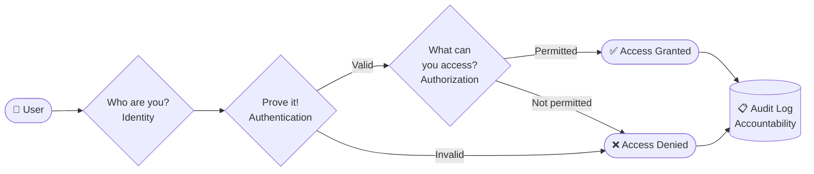

### The 4 A's of IAM

| Concept | Simple Meaning | Example |
|---|---|---|
| **Identity** | Who you are | Username, employee ID |
| **Authentication** | Prove who you are | Password + OTP |
| **Authorization** | What you're allowed to do | Read-only on finance folder |
| **Accountability** | Track what you did | Login logs, audit trails |

---

## 2. Principle of Least Privilege (PoLP)

**Simple rule:** Give people only the access they need to do their job — nothing more.

> "Need to know, need to do."

A finance employee should be able to view invoices but **not** delete them.
An intern should read reports but **not** modify production databases.

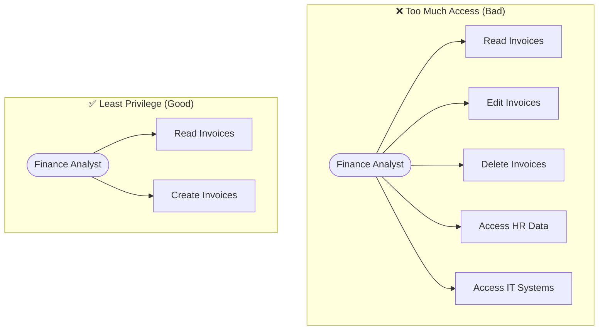

### Why it matters
- Limits **blast radius** if an account is compromised
- Reduces **insider threat** risk
- Makes **audits** cleaner and simpler

---

## 3. Separation of Duties (SoD)

**Simple rule:** No single person should control an entire sensitive process end-to-end.

> "The person who requests money shouldn't also approve it."

This prevents fraud and errors by requiring **two or more people** to complete critical tasks.

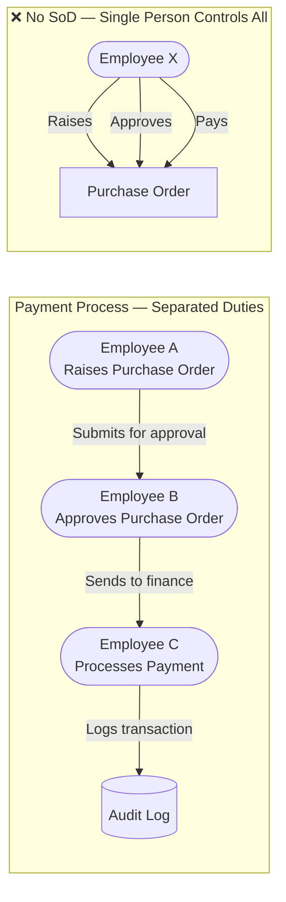

### Common SoD examples

| Process | Duty 1 | Duty 2 |
|---|---|---|
| Payments | Request payment | Approve payment |
| User accounts | Create account | Approve account |
| Code deployment | Write code | Deploy to production |
| Access requests | Request access | Grant access |

---

## 4. Defense in Depth

**Simple idea:** Use multiple layers of security so that if one layer fails, others still protect you.

> Like an onion — many layers, not just one wall.

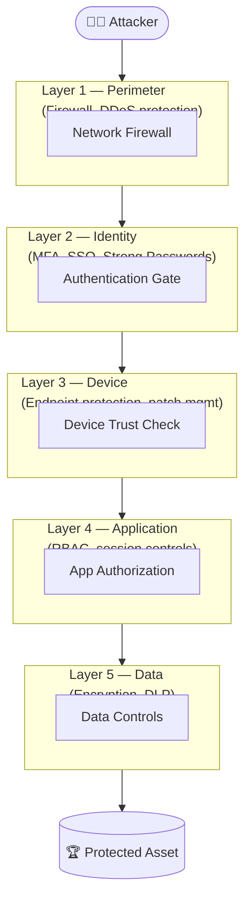

Each layer **slows down or stops** an attacker. Even if one layer is bypassed, the next one takes over.

---

## 5. Zero Trust Architecture (ZTA)

**Old thinking:** "If you're inside the network, you're trusted."
**Zero Trust thinking:** "Never trust anyone — always verify, every time."

> "Trust nothing. Verify everything. Every time."

This matters because:
- Employees work from home (no clear perimeter)
- Cloud apps are outside the corporate network
- Stolen credentials can bypass perimeter defenses

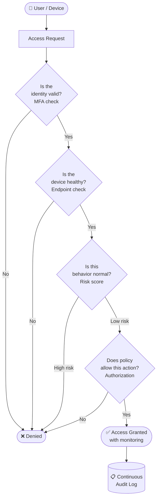

### ZTA Core Tenets (NIST SP 800-207)

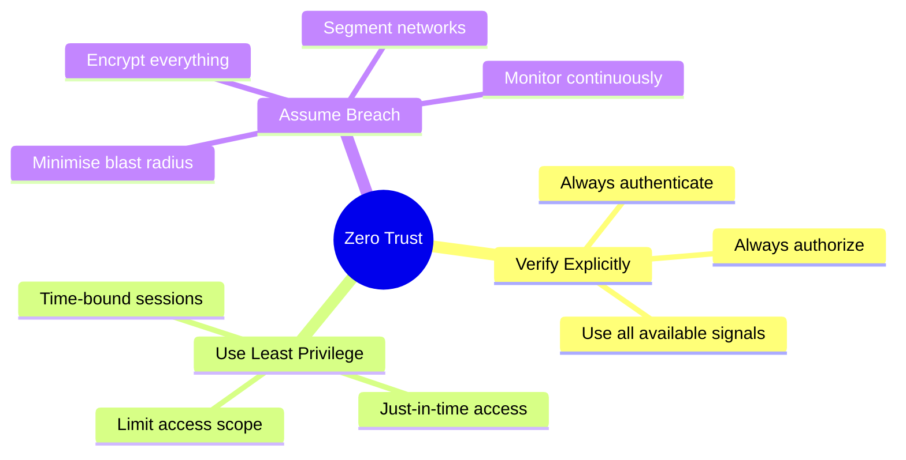

---

## 6. Identity Lifecycle

**Simple idea:** An identity is created, changes over time, and must be removed when no longer needed.

The three events that drive identity changes:

| Event | Meaning | Example |
|---|---|---|
| **Joiner** | Someone new arrives | New employee joins the company |
| **Mover** | Someone changes role | Employee gets promoted or transfers team |
| **Leaver** | Someone departs | Employee resigns or is terminated |

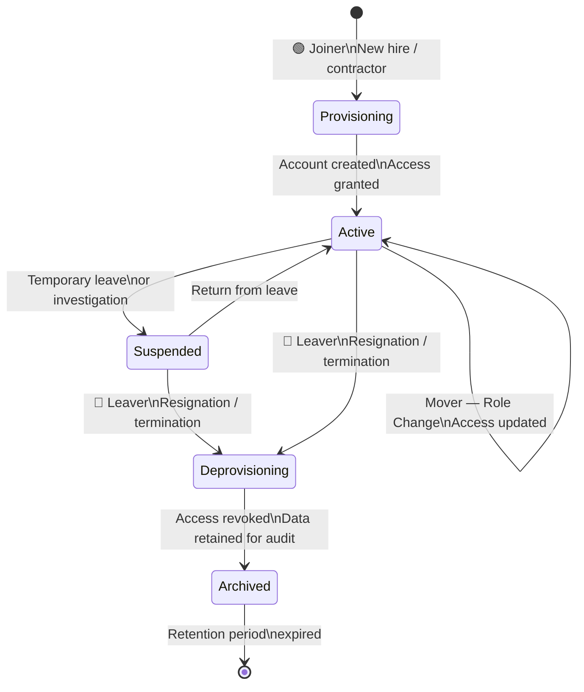

### Why lifecycle management matters

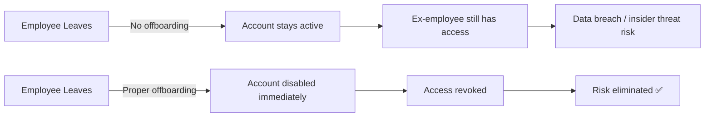

---

## 7. Trust Models

**Simple idea:** Trust defines which systems or organisations accept each other's identities.

### Explicit Trust
You explicitly configure which parties you trust.

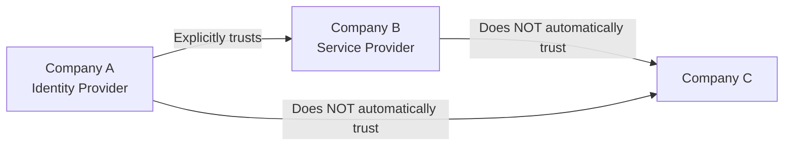

### Transitive Trust
If A trusts B and B trusts C, then A also trusts C (automatically).

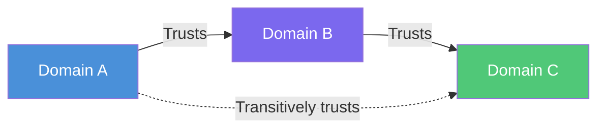

> **Risk:** Transitive trust can create unintended access paths. Always audit trust chains.

### Implicit Trust
Trust is assumed without explicit configuration — usually inside a network perimeter.

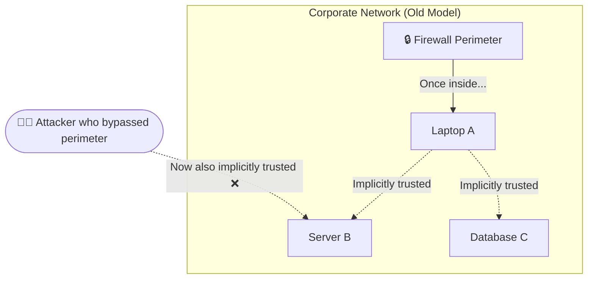

> **Zero Trust specifically eliminates implicit trust** — every request is verified regardless of network location.

### Trust Models Compared

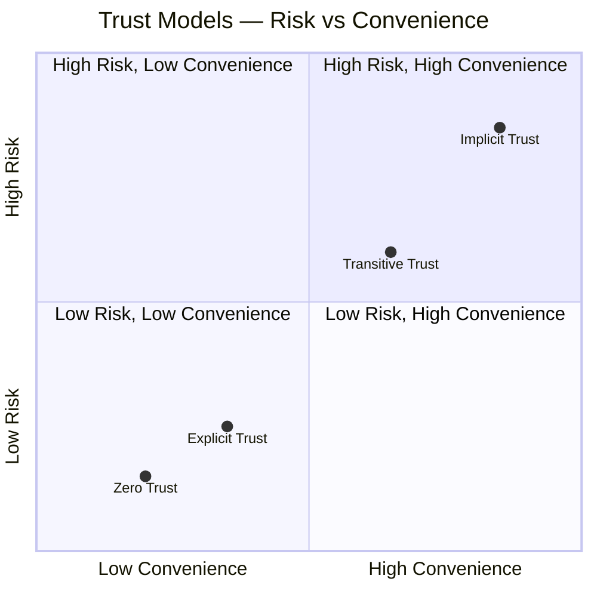

---

## Putting It All Together

Here is how all foundational concepts connect in a real-world IAM system:

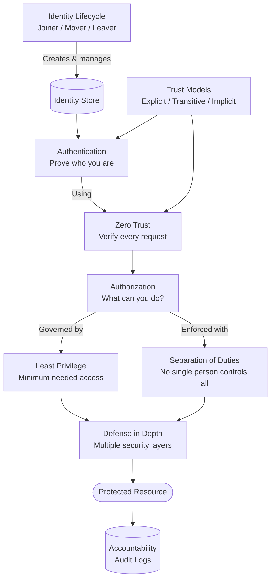

---

## Quick Reference Cheat Sheet

| Concept | One-liner | Key Rule |
|---|---|---|
| **IAM** | Who are you and what can you do? | Identity + Authentication + Authorization + Accountability |
| **Least Privilege** | Give only what's needed | No excess permissions, ever |
| **Separation of Duties** | Split critical tasks | No single person controls end-to-end |
| **Defense in Depth** | Many layers of security | One failure doesn't mean total compromise |
| **Zero Trust** | Never trust, always verify | Verify every request, every time |
| **Identity Lifecycle** | Manage from birth to death | Provision on join, update on move, revoke on leave |
| **Trust Models** | How systems trust each other | Explicit is safest; implicit is riskiest |
