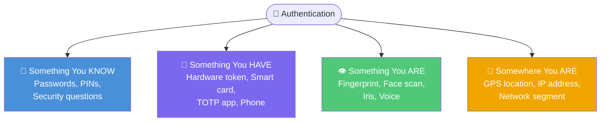
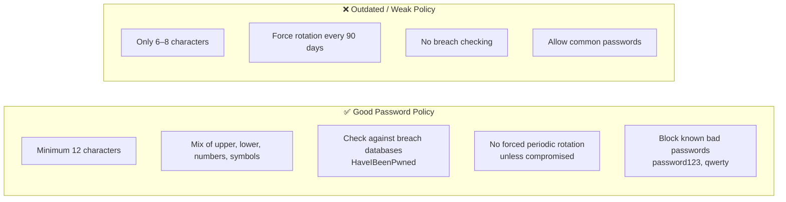
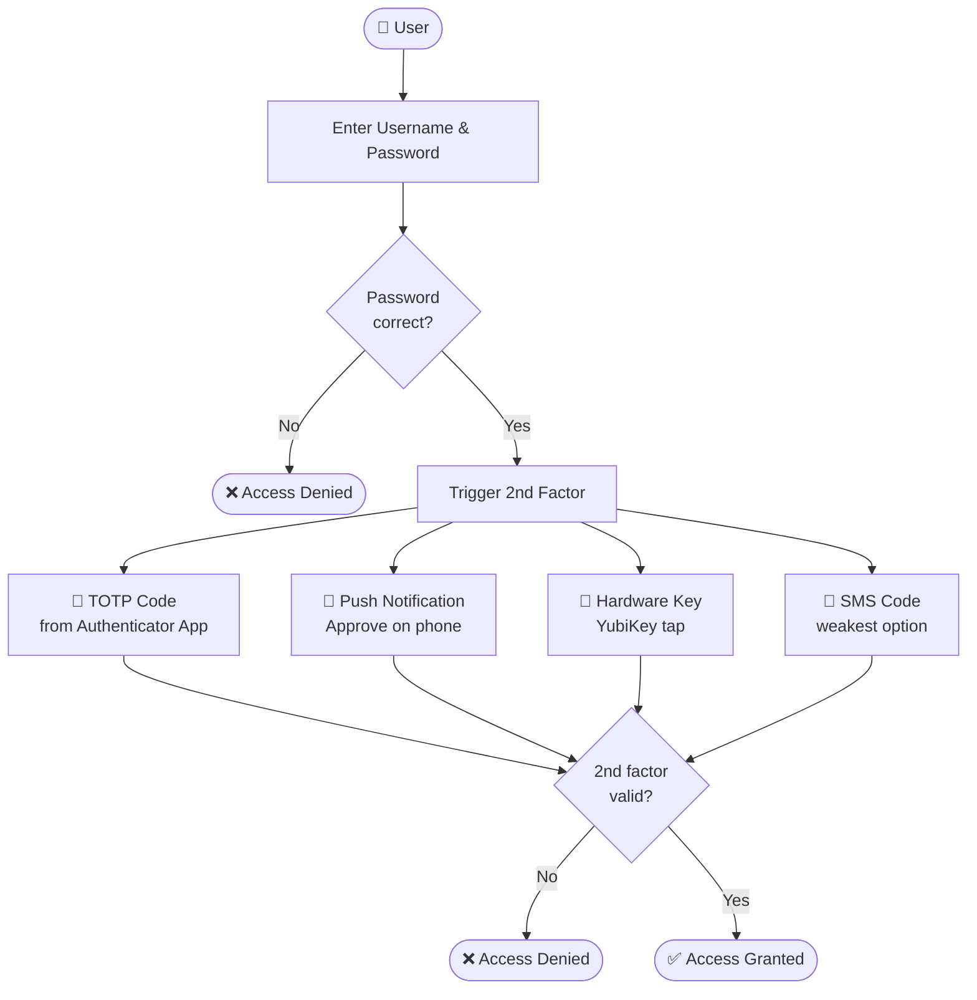
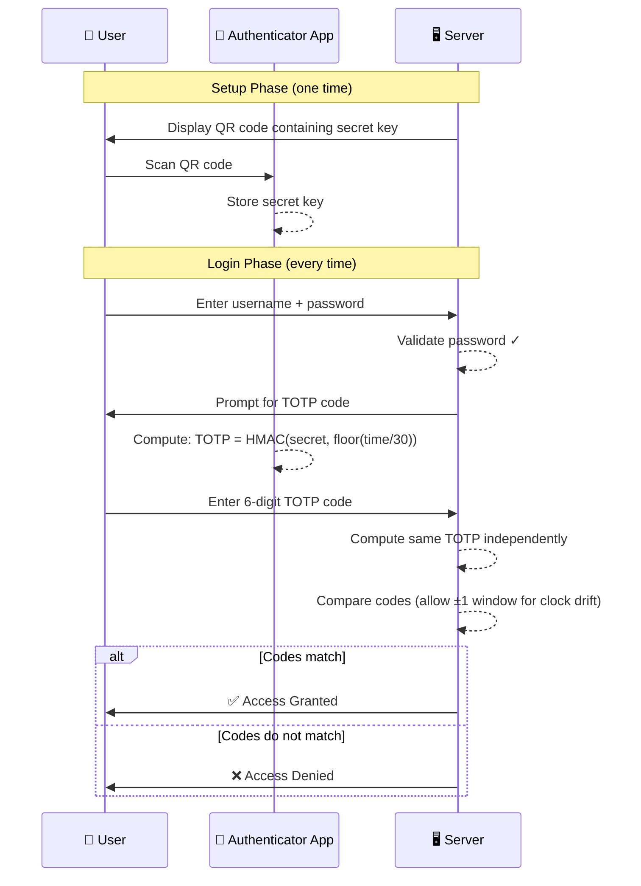
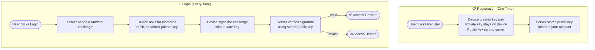
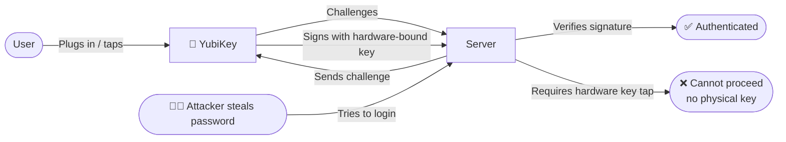
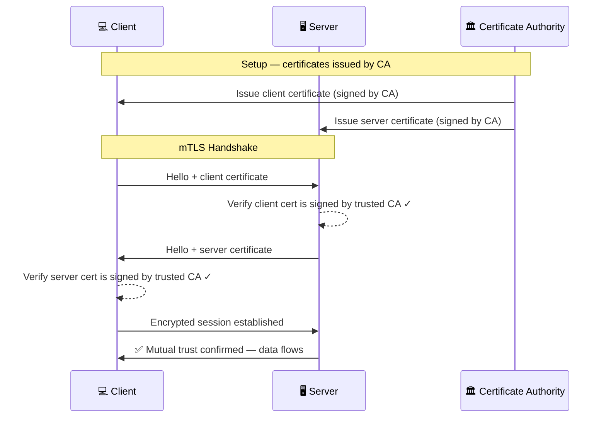
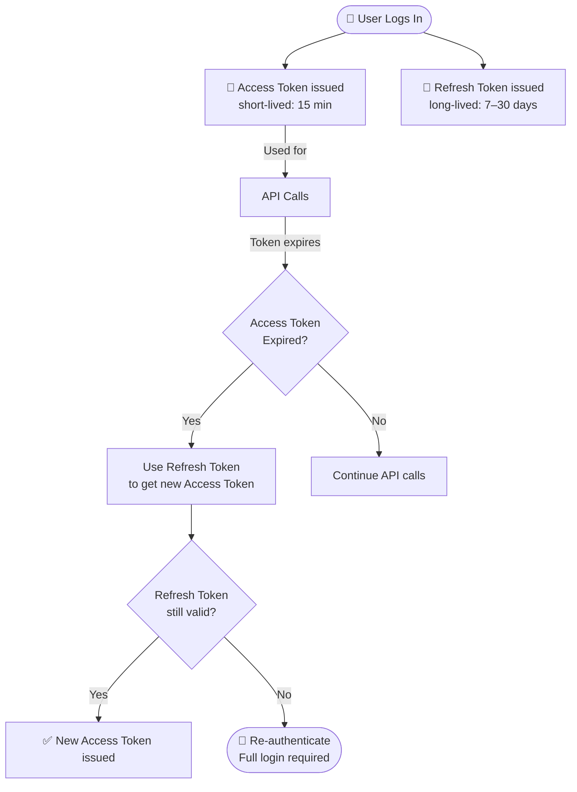
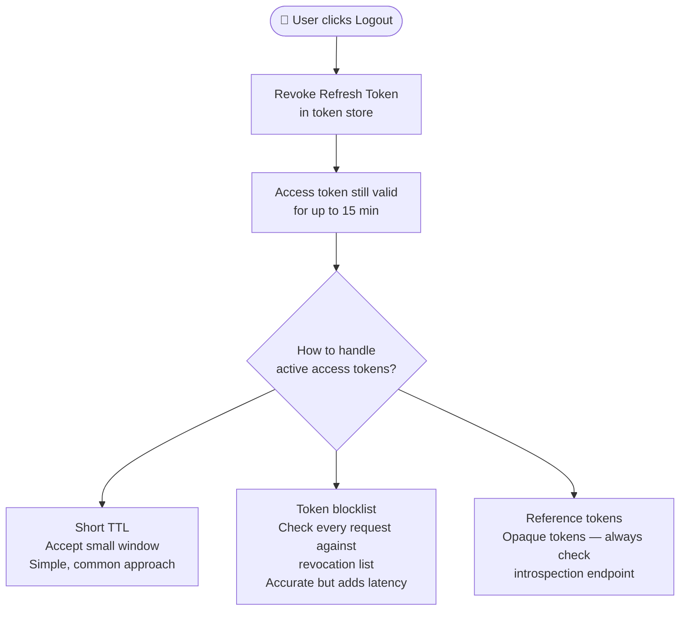

# Authentication

> Authentication answers the question: **"Can you prove you are who you claim to be?"**

Think of it like boarding a flight:
- Your **passport** is your identity
- The **security agent checking it** is authentication
- Once through, you're **authorized** to board your gate

---

## 2.1 Authentication Factors

There are four categories of proof you can use to authenticate. Using more than one makes it much harder for attackers.

| Factor | Examples | Weakness |
|---|---|---|
| Something you know | Password, PIN | Can be guessed, stolen, phished |
| Something you have | Phone, YubiKey | Can be lost or stolen |
| Something you are | Fingerprint, face | Cannot be changed if compromised |
| Somewhere you are | IP address, GPS | Can be spoofed with VPN/proxies |

> **Multi-Factor Authentication (MFA)** = combining 2 or more different factor types. Two passwords is NOT MFA — they're the same factor type.

---

## 2.2 Authentication Mechanisms

### Password Policies

A strong password policy reduces the risk of guessing attacks.

---

### Multi-Factor Authentication (MFA)

**Simple idea:** Even if someone steals your password, they still need your second factor.

**Why SMS is weak:**
- Phone numbers can be hijacked via **SIM swapping** (attacker convinces carrier to transfer your number)
- SMS codes can be **intercepted** on SS7 network vulnerabilities
- Use TOTP apps (Google Authenticator, Authy) or hardware keys instead

---

### TOTP — Time-Based One-Time Password

TOTP generates a 6-digit code that changes every 30 seconds based on a shared secret and the current time.

---

### Passwordless Authentication — FIDO2 / WebAuthn / Passkeys

**Simple idea:** Instead of a password, your device holds a private key. The server holds the public key. You prove identity by signing a challenge — the private key never leaves your device.

> Like a wax seal: anyone can verify it's yours (public key), but only you have the stamp (private key).

**Passkeys** = FIDO2 credentials that can sync across your devices via iCloud Keychain, Google Password Manager, etc.

---

### Hardware Security Keys (YubiKey, FIDO U2F)

A physical USB/NFC device you tap to authenticate. The private key is stored inside the hardware chip and **cannot be extracted**.

---

### Certificate-Based Authentication (mTLS)

Both the client and server present certificates to prove their identity — commonly used for machine-to-machine authentication.

---

## 2.3 Session Management

Once authenticated, the server needs to remember you are logged in. This is done with **session tokens**.

### Session Tokens vs Cookies

| Term | What it is |
|---|---|
| **Session token** | A random string the server uses to identify your logged-in session |
| **Cookie** | The browser's way of storing and sending the session token back to the server |

---

### Fixed vs Sliding Session Expiry

```mermaid
flowchart TD
    subgraph Fixed["⏱️ Fixed Expiry"]
        F1[Login at 9:00 AM] --> F2[Session expires at 10:00 AM]
        F2 --> F3[Must re-login\neven if actively using app]
        F3 --> F4[Good for high-security apps\nbanking, healthcare]
    end

    subgraph Sliding["🔄 Sliding Expiry"]
        S1[Login at 9:00 AM\n30-min timeout] --> S2[Active at 9:25 AM → resets to 9:55 AM]
        S2 --> S3[Active at 9:50 AM → resets to 10:20 AM]
        S3 --> S4[Idle for 30 min → session expires]
        S4 --> S5[Good for productivity apps\nemail, dashboards]
    end
```

---

### Access Tokens vs Refresh Tokens

> **Why two tokens?** Access tokens are short-lived so stolen ones expire quickly. Refresh tokens are long-lived but only used rarely (at token expiry), reducing exposure.

---

### Token Revocation and Logout Propagation

**Problem:** Tokens are self-contained — the server can't "un-issue" them without extra work.

---

## Quick Reference Cheat Sheet

| Concept | One-liner | Key Rule |
|---|---|---|
| **MFA** | Two or more different factor types | Password + TOTP = MFA; two passwords ≠ MFA |
| **TOTP** | Time-based 6-digit code from shared secret | Changes every 30 seconds; never reusable |
| **Passkeys / FIDO2** | Private key on device, public key on server | Private key never transmitted |
| **mTLS** | Both sides present certificates | Used for machine-to-machine trust |
| **Session token** | Server-side proof you're logged in | Store securely; use HttpOnly + Secure flags |
| **Access token** | Short-lived credential for API calls | Keep TTL short (5–15 min) |
| **Refresh token** | Long-lived token to get new access tokens | Store securely; revoke on logout |
| **SMS MFA** | One-time code via text message | Weak — vulnerable to SIM swapping |
| **Sliding expiry** | Session resets on activity | Good UX; use for low-risk apps |
| **Fixed expiry** | Session ends at set time regardless | Stronger security; use for sensitive apps |
