# Managing Digital Identities

[← Back to Index](README.md)

> What a digital identity actually is, the different types, how they are structured, stored, and kept trustworthy across an organisation.

---

## 1. What is a Digital Identity?

A **digital identity** is a collection of attributes that uniquely represents a person, system, or thing in a digital environment.

Think of it like a passport — it contains attributes (name, date of birth, nationality) that distinguish you from every other person, and it is issued and trusted by an authority.

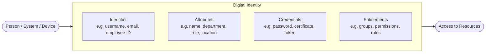

---

## 2. Types of Digital Identities

Not all identities belong to humans. Modern organisations manage many types:

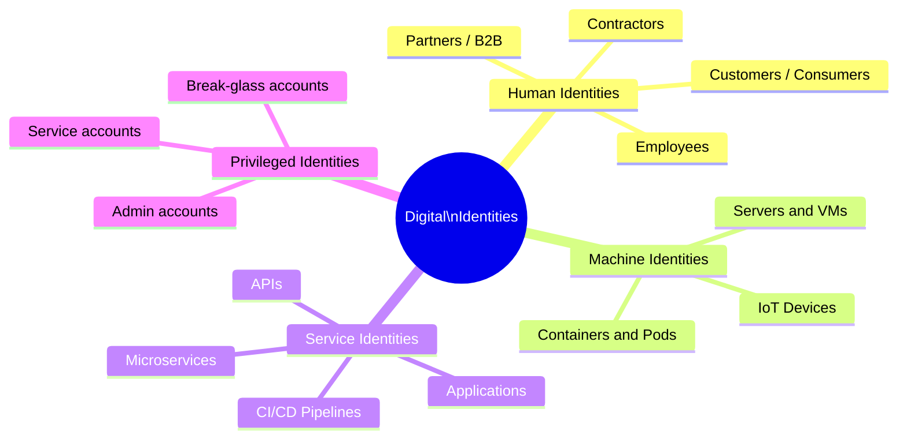

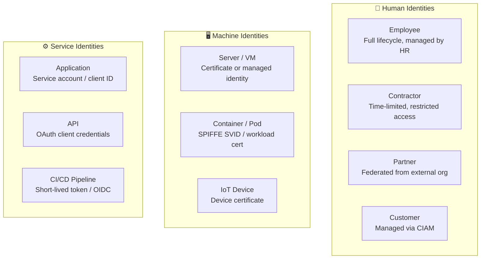

---

## 3. Identity Attributes

Attributes are the data points that describe an identity. They are used by policy engines to make access decisions.

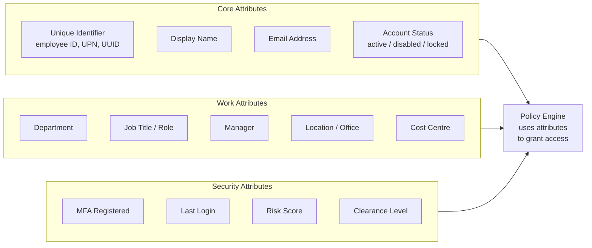

---

## 4. Identity Assurance Levels (NIST 800-63)

Not all identities are equally trustworthy. NIST defines three **Identity Assurance Levels (IALs)** based on how rigorously the identity was verified.

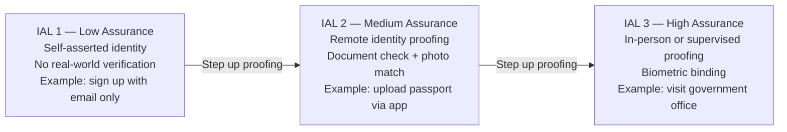

| IAL | Verification | Typical Use Case |
|---|---|---|
| IAL 1 | Self-asserted | Consumer app signup |
| IAL 2 | Remote document check | Online banking, healthcare portal |
| IAL 3 | In-person biometric | Government services, high-security access |

---

## 5. Identity Stores and Repositories

Identities must be stored somewhere. The choice of identity store affects scale, performance, and integration.

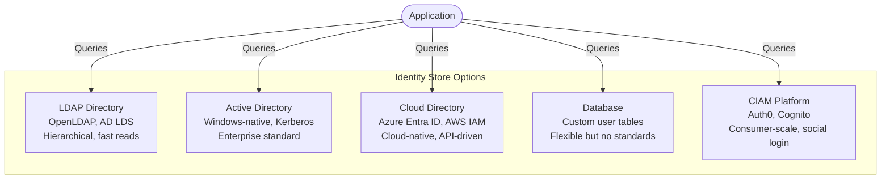

---

## 6. Authoritative Source of Identity

An **authoritative source** is the single system of record that owns the definitive version of an identity. All other systems derive their data from it.

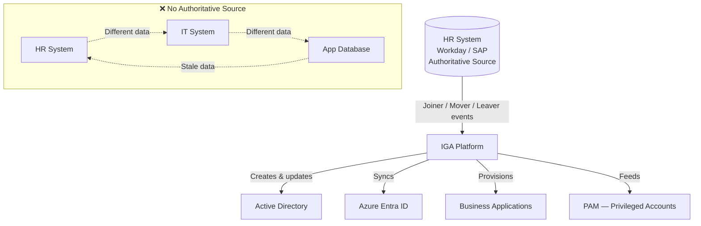

> **Rule:** Every identity attribute should have exactly one authoritative source. When systems disagree, the authoritative source wins.

---

## 7. Identity Federation

**Federation** allows one organisation to trust and use identities managed by another — without duplicating them.

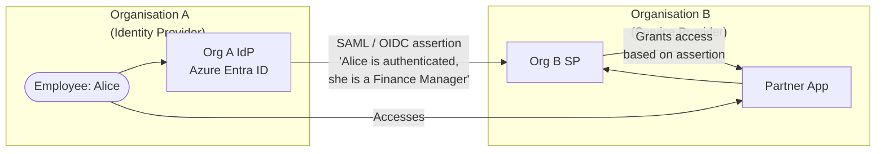

**Without federation:** Organisation B creates a duplicate account for Alice, manages her password separately, and must deactivate it when she leaves Organisation A — which often never happens.

**With federation:** Alice's identity lives only in Organisation A. When she leaves, one deprovisioning action cuts all access everywhere.

---

## 8. Non-Person Entities (NPEs)

A growing portion of identities are **not human**. These are called Non-Person Entities (NPEs) and require their own lifecycle management.

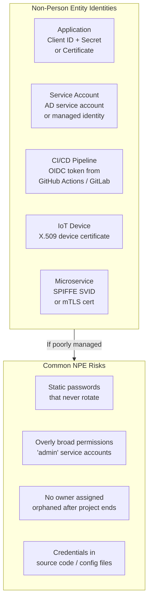

**NPE best practices:**

| Risk | Mitigation |
|---|---|
| Static credentials | Use managed identities or short-lived tokens |
| Broad permissions | Apply least privilege to every service account |
| No owner | Assign a human owner to every NPE at creation |
| Hardcoded secrets | Use a secrets manager (Vault, AWS Secrets Manager) |

---

## 9. Identity Lifecycle Management

Every identity — human or machine — goes through a lifecycle that must be managed.

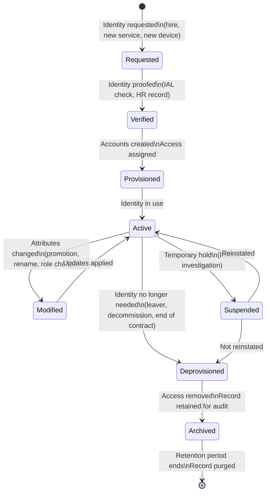

---

## 10. Identity Governance — Keeping Identities Clean

Over time, identities accumulate stale attributes, excess permissions, and drift from their intended state. Governance keeps them accurate.

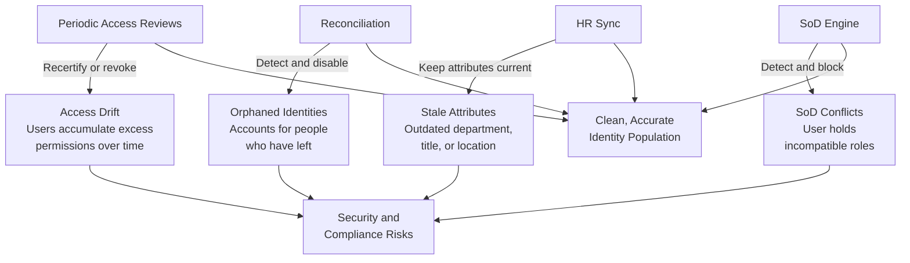

---

## Quick Reference

| Concept | Simple Meaning |
|---|---|
| **Digital Identity** | Attributes that uniquely represent a person, system, or device |
| **Identity Attributes** | Data points (name, role, dept) used to describe and govern an identity |
| **IAL** | How rigorously an identity was verified (1 = low, 3 = high) |
| **Identity Store** | Where identities are persisted (AD, LDAP, cloud directory, database) |
| **Authoritative Source** | The single system of record that owns the definitive identity data |
| **Federation** | Trusting identities from another organisation without duplicating them |
| **NPE** | Non-Person Entity — application, service, device, or pipeline identity |
| **Identity Lifecycle** | The managed journey from creation through to deletion |
| **Access Drift** | Accumulation of excess permissions that were never removed |
| **Orphaned Identity** | An active account whose owner has left — a security risk |
