# Multi Factor Authentication (MFA)

[← Back to Index](README.md)

> A deep dive into every MFA method, how each works under the hood, where each breaks, and how to choose the right one.

---

## 1. What is MFA and Why It Matters

A password alone is no longer enough. Billions of credentials are leaked every year from data breaches. Attackers buy these lists and try them automatically against every major service — a technique called **credential stuffing**.

> **Analogy:** An ATM requires your physical card AND your PIN. Even if someone knows your PIN, they cannot withdraw money without the card. MFA applies the same principle to digital logins.

**Microsoft research:** MFA blocks over **99.9% of automated account compromise attacks**, even when passwords are known.

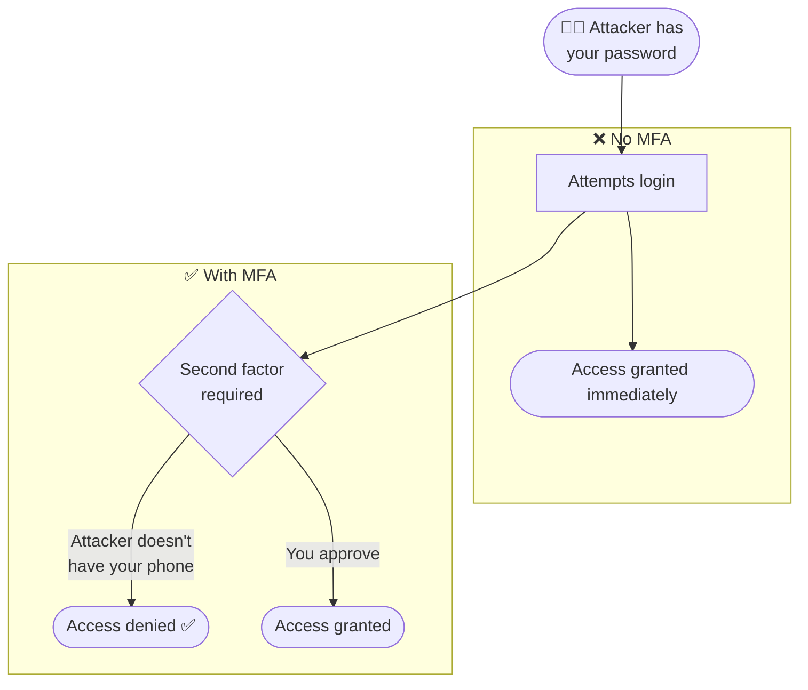

### Why passwords fail on their own

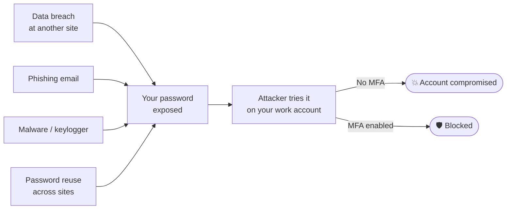

---

## 2. MFA Factors and Strength Hierarchy

MFA factors fall into four categories. **Using factors from two different categories** is what makes authentication strong.

| Factor | Category | Examples |
|---|---|---|
| Something you **know** | Knowledge | Password, PIN, security question |
| Something you **have** | Possession | Phone, hardware key, smart card |
| Something you **are** | Inherence | Fingerprint, face, iris |
| Somewhere you **are** | Location | Geolocation, IP range, network |

### Strength spectrum — weakest to strongest

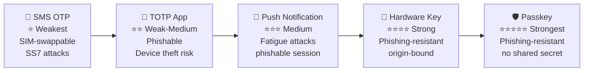

> **Key insight:** SMS and TOTP can be intercepted in real time by a skilled attacker. Hardware keys and passkeys cannot — they are cryptographically bound to the legitimate site.

---

## 3. OTP Methods in Detail

### 3.1 TOTP — Time-Based One-Time Password

TOTP generates a 6-digit code that changes every 30 seconds, using a **shared secret** seeded during setup and the **current time** as inputs.

> **Analogy:** Both you and the server are watching the same clock and doing the same calculation. As long as your clocks are in sync, you get the same number.

**How it works (simplified):**

```
Code = HOTP(secret, floor(current_unix_time / 30))
     = HMAC-SHA1(secret, time_counter) → truncate to 6 digits
```

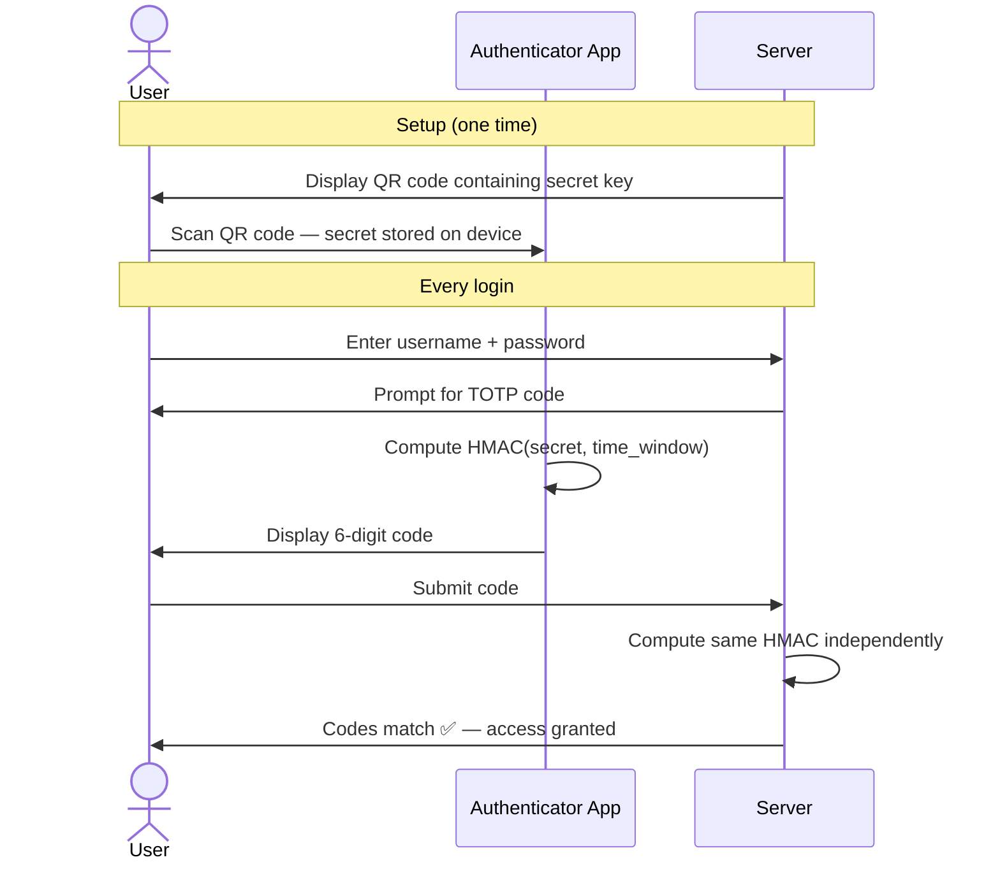

**Apps:** Google Authenticator, Microsoft Authenticator, Authy, 1Password

**Weakness:** The code can be phished in real time — an attacker's fake login page can relay the code to the real site within the 30-second window.

---

### 3.2 HOTP — Counter-Based OTP

HOTP works the same as TOTP but uses a **counter** instead of time. The counter increments each time a code is generated.

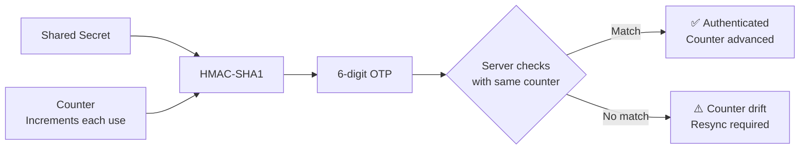

**Risk:** If the user generates codes without submitting them, the client counter advances ahead of the server — causing sync failures. TOTP is more common today because time-sync is automatic.

---

### 3.3 SMS OTP

A one-time code is sent via text message to the user's registered phone number.

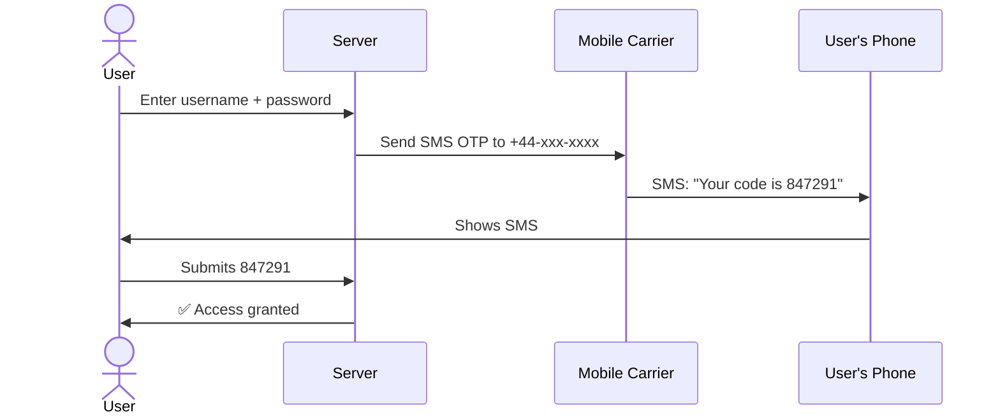

**Why SMS is weak:**

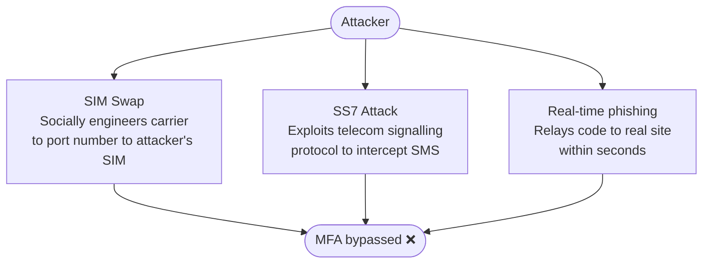

| Scenario | Use SMS OTP? |
|---|---|
| Consumer app, low risk | Acceptable (better than nothing) |
| Corporate/enterprise login | Avoid — use TOTP or hardware key |
| Privileged / admin access | Never — use hardware key |
| Regulated industries (banking, healthcare) | Avoid — regulators increasingly reject SMS |

---

## 4. Push Notifications

Push MFA sends a notification to the user's registered smartphone app. The user taps **Approve** or **Deny**.

> **Analogy:** Someone rings your doorbell — you look through the peephole, recognise the person, and decide whether to let them in.

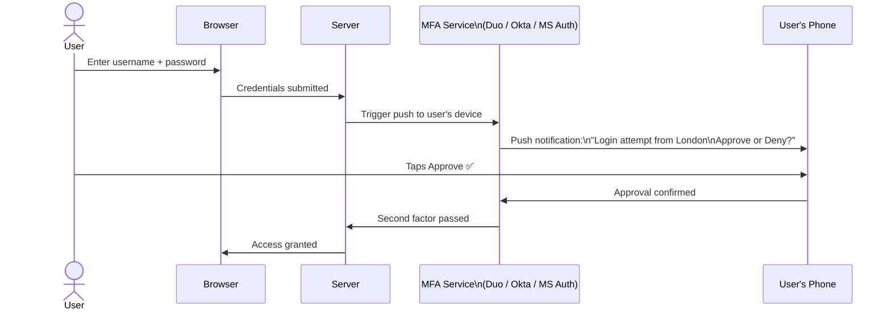

### MFA Fatigue Attack

An attacker who has the user's password repeatedly sends push notifications hoping the user taps **Approve** by mistake or out of frustration.

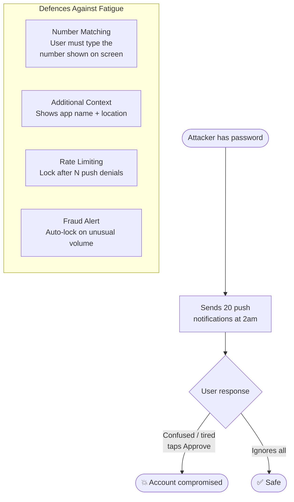

**Number matching** is the most effective defence: the login screen shows a number (e.g. "47") and the push notification asks "Type the number shown" — an attacker cannot know it.

---

## 5. Hardware Security Keys (FIDO U2F / FIDO2)

A hardware security key is a physical USB/NFC device that uses **public-key cryptography** to authenticate. It is **phishing-resistant** because the key is cryptographically bound to the exact website domain.

> **Analogy:** A wax seal that only fits one specific envelope — it cannot be copied or used elsewhere.

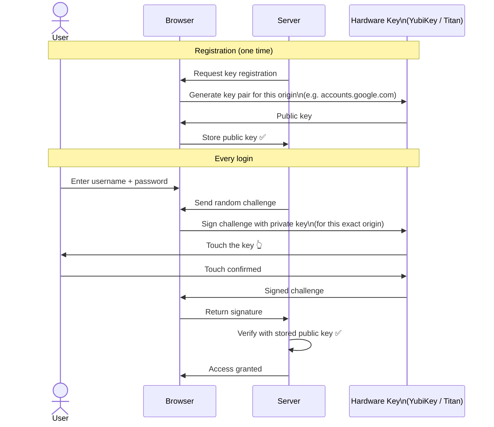

**Why hardware keys cannot be phished:**

The private key is bound to the **exact origin** (domain). A fake site like `accounts-g00gle.com` gets a different key pair — the signature it receives is useless on the real site.

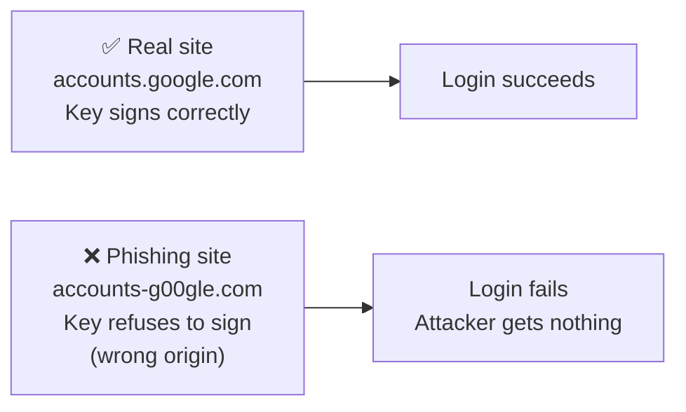

**Examples:** YubiKey (Yubico), Google Titan Key, Apple Touch ID key (FIDO2 built into MacBook)

---

## 6. Passkeys (Passwordless MFA)

A **passkey** is a FIDO2 credential stored on your device (or synced via cloud) that replaces both the password and the second factor in a single step.

> **Analogy:** Your fingerprint on your phone IS the key — you don't need to remember anything or carry a separate device.

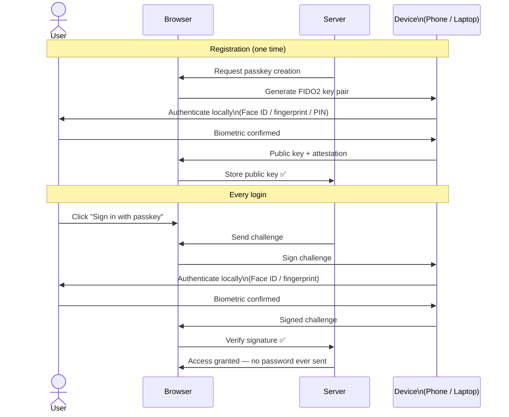

**Key properties:**

| Property | Detail |
|---|---|
| **No shared secret** | Private key never leaves the device |
| **Phishing-resistant** | Bound to exact origin domain |
| **Biometric is local** | Face/fingerprint verified on device — never sent to server |
| **Synced passkeys** | Stored in iCloud Keychain / Google Password Manager — available across devices |
| **Device-bound passkeys** | Stay on one device only — higher security, less convenience |

---

## 7. Adaptive / Risk-Based MFA

Not every login carries the same risk. Requiring a hardware key to check a news feed is unnecessary friction. Requiring only a password to approve a wire transfer is negligent.

**Risk-based MFA** dynamically adjusts the required authentication strength based on context signals.

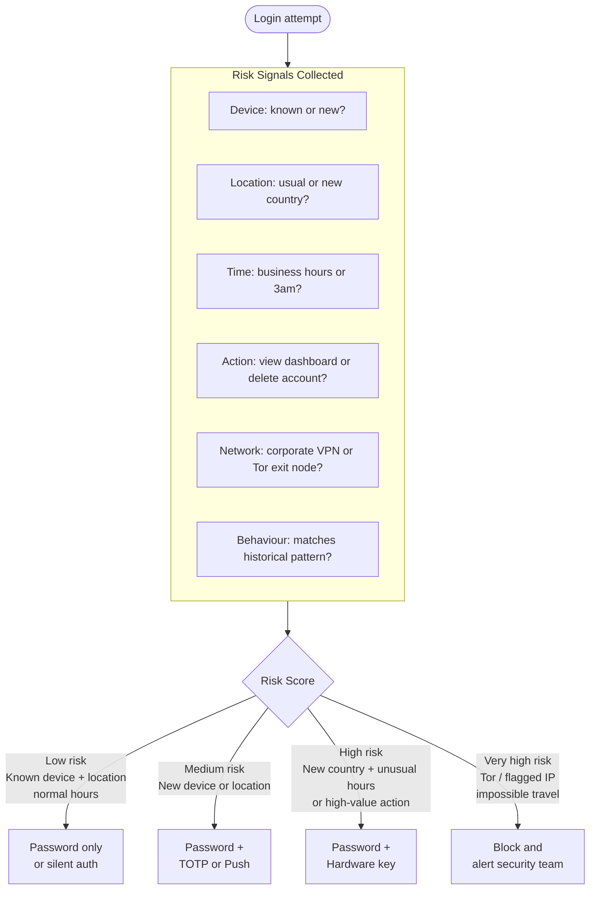

### Step-Up Authentication

A user is already logged in but attempts a sensitive action — the system challenges them again.

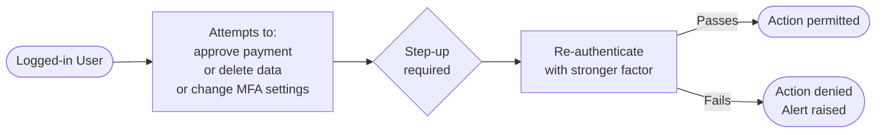

---

## 8. MFA in Enterprise Scenarios

### Conditional Access (Azure Entra ID)

Conditional Access policies evaluate signals at login time and enforce the right level of authentication.

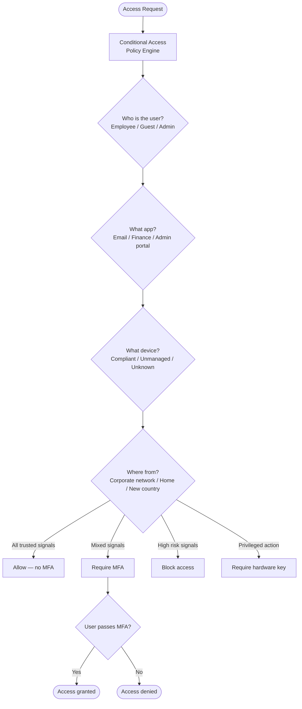

### MFA for Privileged Accounts

Admin and privileged accounts face stricter MFA requirements — they are the highest-value targets.

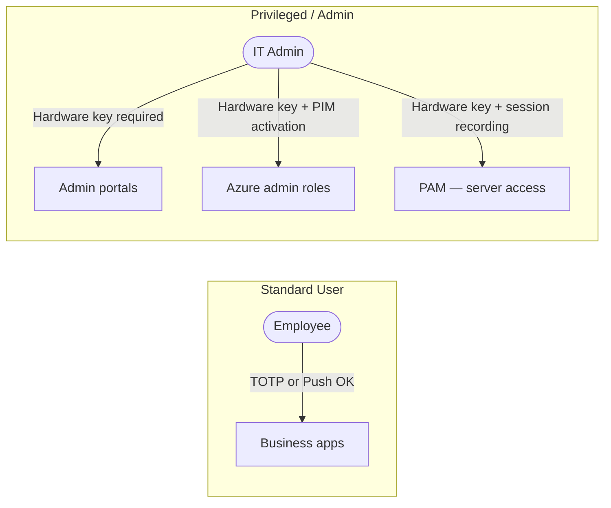

---

## 9. MFA Bypass and Attacks

### AiTM — Adversary-in-the-Middle Phishing

The most dangerous attack against TOTP and push MFA. The attacker acts as a real-time proxy.

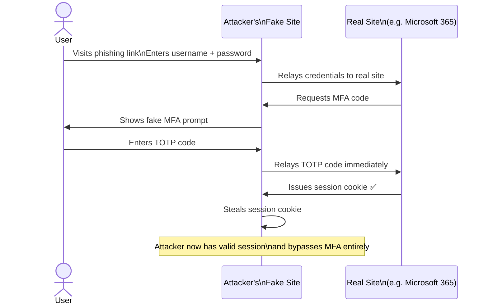

**Defence — phishing-resistant MFA only:**

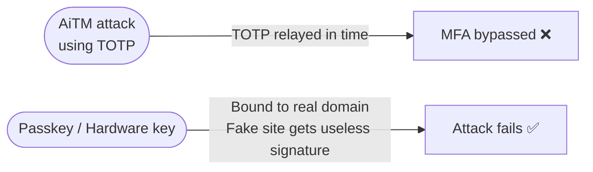

### Attack Summary and Defences

| Attack | Affected Methods | Defence |
|---|---|---|
| Credential stuffing | Password only | MFA of any kind |
| SIM swapping | SMS OTP | Switch to TOTP or hardware key |
| SS7 interception | SMS OTP | Switch to app-based MFA |
| AiTM phishing | SMS, TOTP, Push | Passkeys or hardware keys only |
| MFA fatigue | Push notifications | Number matching, rate limiting |
| Device theft | TOTP app, passkeys | Device PIN / biometric lock |

---

## 10. MFA Recovery and Fallback

A strong MFA method is undermined if the **account recovery path is weak**.

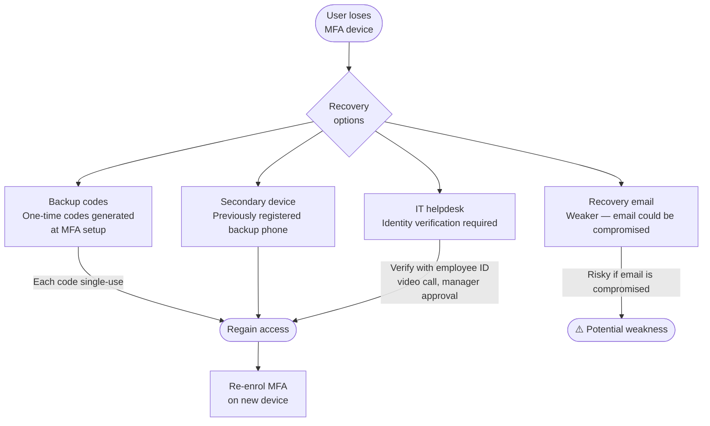

**Backup code risks:**

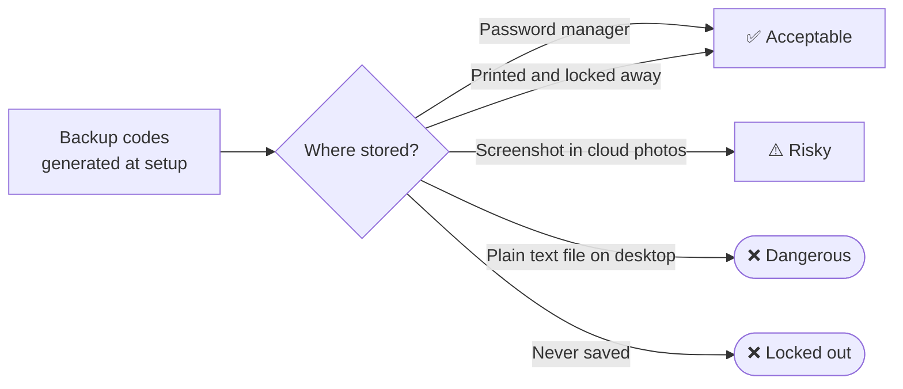

> **Rule:** Backup codes are as sensitive as passwords. Store them in a password manager or physical safe — never in an email or unencrypted file.

---

## 11. Quick Reference

| Method | Phishing Resistant | SIM-Swap Resistant | UX Friction | Cost | Best For |
|---|---|---|---|---|---|
| **SMS OTP** | ❌ No | ❌ No | Low | Low | Low-risk consumer apps only |
| **TOTP App** | ❌ No | ✅ Yes | Medium | Free | General enterprise use |
| **Push (no number match)** | ❌ No | ✅ Yes | Low | Medium | General use — enable number matching |
| **Push (number matching)** | ⚠️ Partial | ✅ Yes | Low-Med | Medium | Good enterprise default |
| **Hardware Key (FIDO2)** | ✅ Yes | ✅ Yes | Low | £25–50/key | Privileged accounts, high-value targets |
| **Passkey** | ✅ Yes | ✅ Yes | Very Low | Free | Modern apps, consumer + enterprise |

### Choosing the right MFA method

```mermaid
flowchart TD
    START([Choose MFA method]) --> Q1{Is phishing\nresistance required?}

    Q1 -->|Yes — privileged\nor high-value account| Q2{Budget for\nhardware keys?}
    Q2 -->|Yes| HW[Hardware Key\nFIDO2 / YubiKey]
    Q2 -->|No / BYOD| PK[Passkey\non personal device]

    Q1 -->|No — standard\nbusiness account| Q3{Push MFA\navailable?}
    Q3 -->|Yes| PUSH2[Push with\nnumber matching]
    Q3 -->|No| TOTP2[TOTP app\nGoogle / MS Authenticator]

    Q1 -->|Consumer app\nlow risk| SMS2[SMS OTP\nor Social login]
```
