# Authorization

[← Back to Index](README.md)

> Authorization answers: **"What are you allowed to do?"** — after you've already proven who you are.

Think of it like a hotel keycard:
- The front desk **authenticated** you (checked your ID)
- Your keycard **authorizes** you — it opens your room (301) but not the penthouse, the pool after hours, or the staff areas

---

## 3.1 Access Control Models

Different models answer the question "who decides what access is allowed?" in different ways.

---

### DAC — Discretionary Access Control

The **owner** of a resource decides who can access it. Like sharing a Google Doc — you choose who can view or edit.

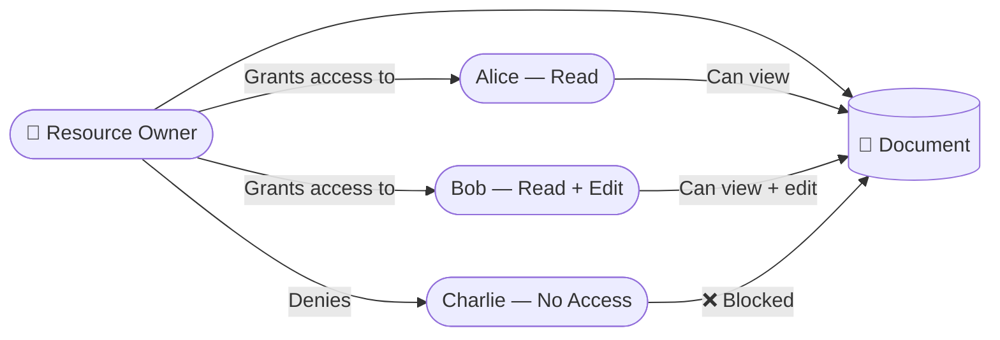

> **Risk:** Owners can accidentally over-share. No central control.

---

### MAC — Mandatory Access Control

The **system (not the owner)** enforces access based on security labels. Used in military/government contexts.

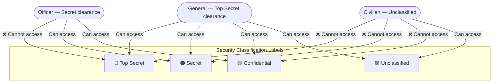

> **Rule:** You can only read at or below your clearance level. The system enforces this — not the document owner.

---

### RBAC — Role-Based Access Control

Users are assigned **roles**, roles have **permissions**. This is the most widely used model in enterprise software.

> Like job titles — a "Manager" can approve timesheets; a "Staff" member cannot.

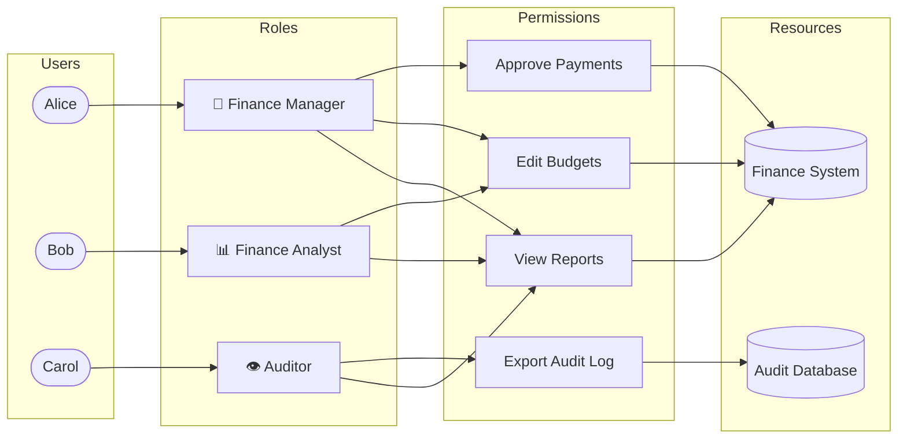

---

### ABAC — Attribute-Based Access Control

Access is decided by evaluating **policy rules** against attributes of the user, resource, and environment. Much more flexible than RBAC.

> "A doctor can read a patient's record — but only during their shift, and only if the patient is assigned to their department."

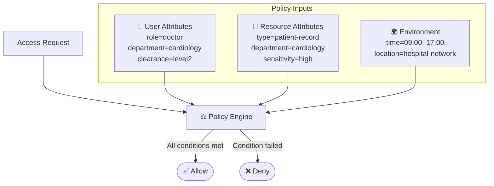

---

### ReBAC — Relationship-Based Access Control

Access is based on the **relationship** between the user and the resource in a graph. Used by Google (Zanzibar), GitHub (org/repo/team structure).

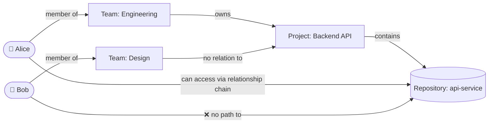

---

### Access Control Models Compared

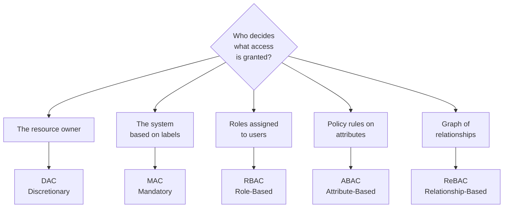

---

## 3.2 Access Control Concepts

### Subjects, Objects, Permissions

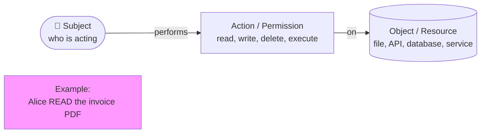

---

### Role Hierarchies

Roles can inherit permissions from lower-level roles — like job levels where a senior role includes everything the junior role can do.

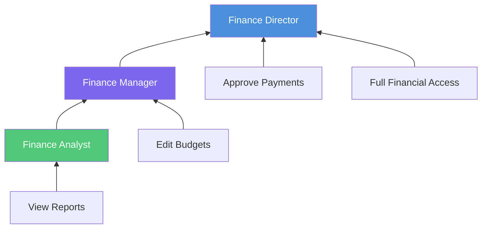

---

### Role Explosion Problem

As an organisation grows, RBAC can generate thousands of roles — each a unique combination of permissions. This becomes unmanageable.

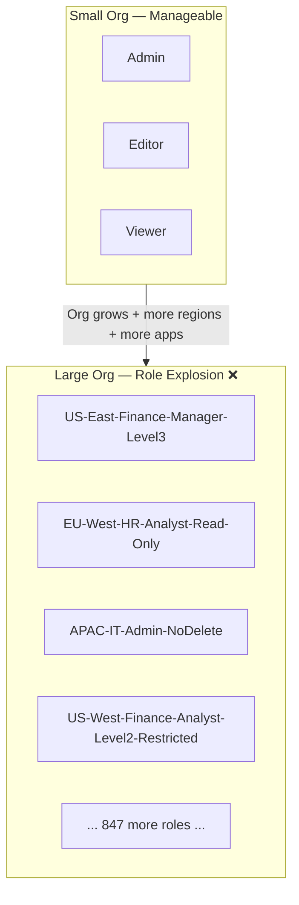

> **Solution:** Move to ABAC or ReBAC for complex environments, or use role mining tools to consolidate.

---

### Just-in-Time (JIT) and Just-Enough-Access (JEA)

**JIT:** Access is granted only when needed, for a limited time — then automatically removed.
**JEA:** Access is scoped to only what's needed for that specific task.

> Like a visitor badge at a secure facility — valid today only, for the meeting room only.

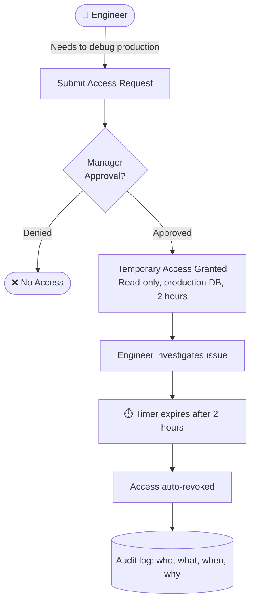

---

### Implicit Deny

**Golden rule of authorization:** Everything is denied by default. Access is only granted when there is an **explicit allow**.

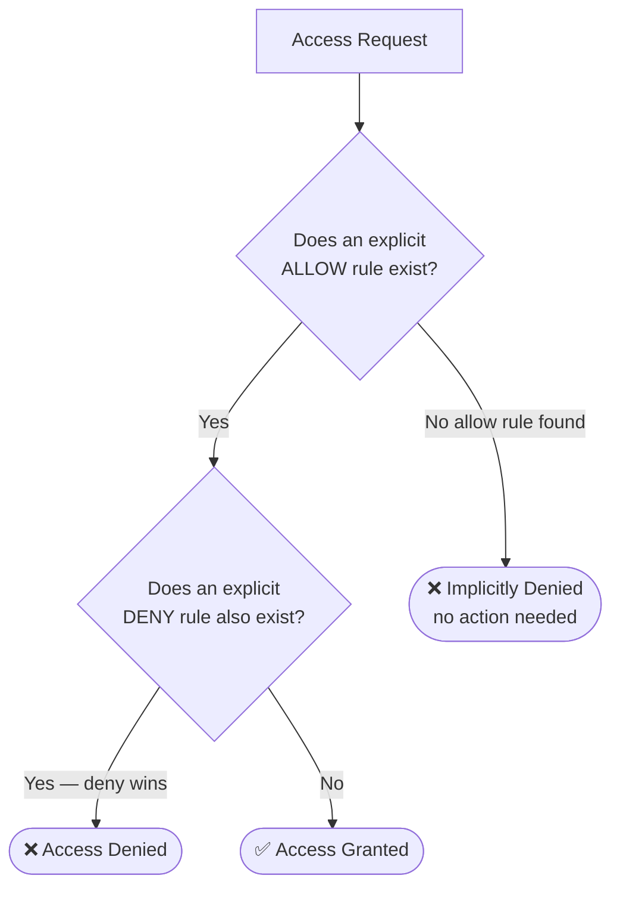

---

### Policy Evaluation Order and Conflict Resolution

When multiple rules apply, the system must decide which wins. Most systems follow: **explicit deny overrides explicit allow**.

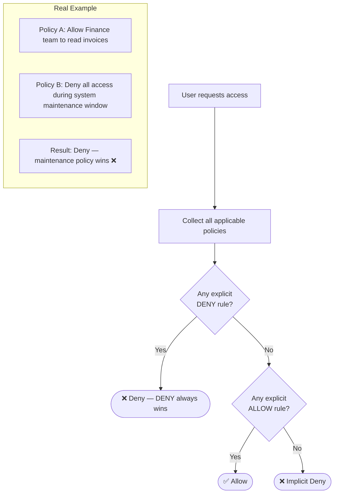

---

## Quick Reference Cheat Sheet

| Concept | One-liner | Key Rule |
|---|---|---|
| **DAC** | Owner controls access | Flexible but risky — owner can over-share |
| **MAC** | System enforces labels/clearances | Used in military/government; very rigid |
| **RBAC** | Roles bundle permissions for users | Most common in enterprise; watch for role explosion |
| **ABAC** | Policy rules on attributes | Most flexible; good for complex, dynamic environments |
| **ReBAC** | Access via relationship graph | Used in GitHub, Google Drive |
| **JIT Access** | Grant access only when needed | Auto-revoke after time window |
| **JEA** | Scope access to minimum task | No "just in case" permissions |
| **Implicit Deny** | Default is always deny | Access requires an explicit allow |
| **Deny overrides** | Explicit deny beats explicit allow | Used in AWS IAM, Azure RBAC |
| **Role explosion** | Too many fine-grained roles | Sign that RBAC needs ABAC or consolidation |
