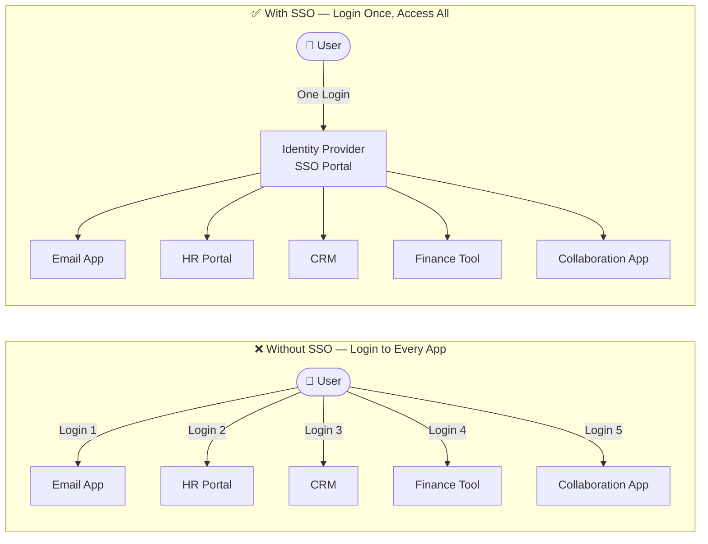
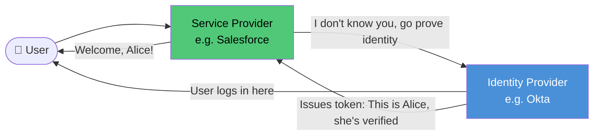
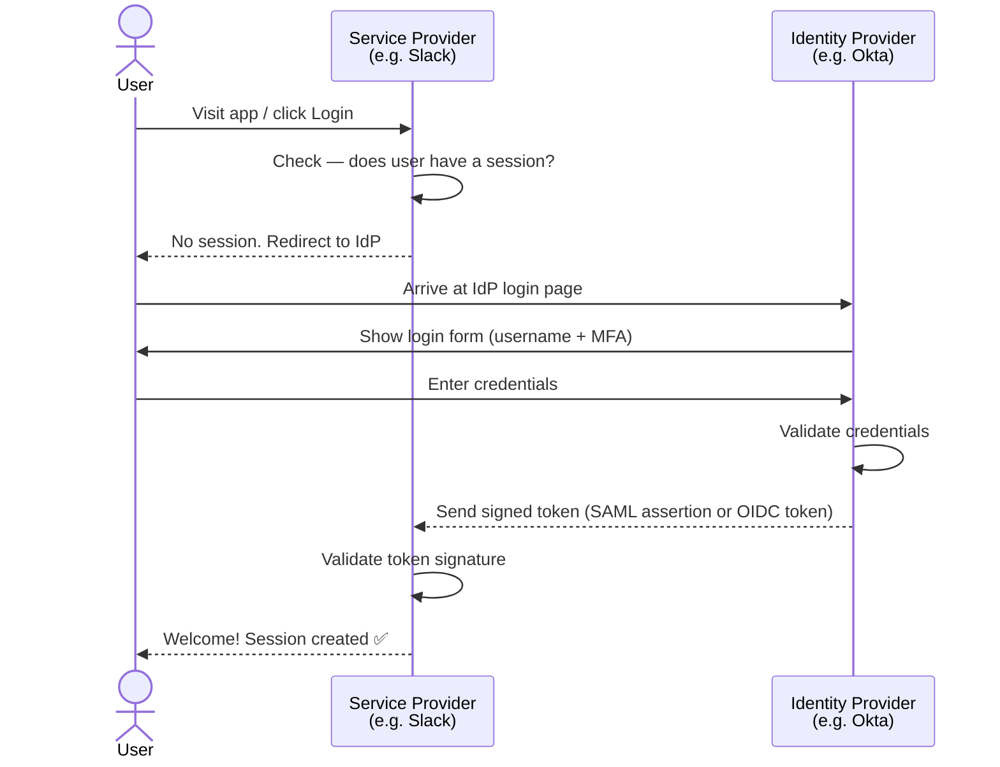
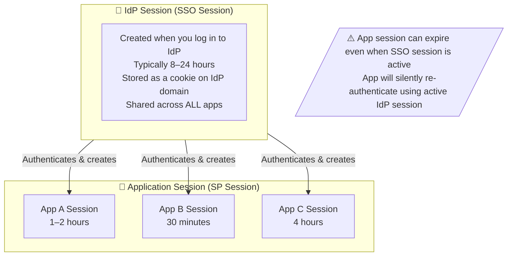
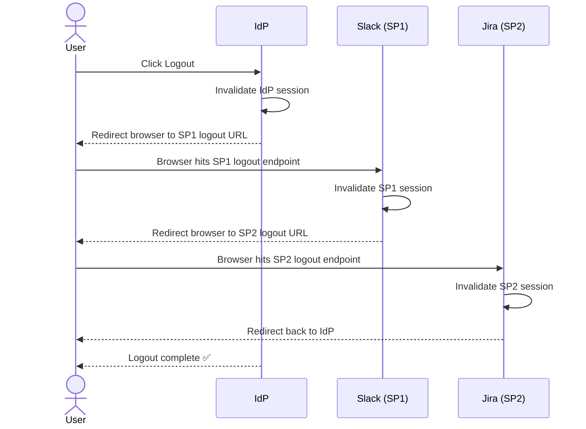
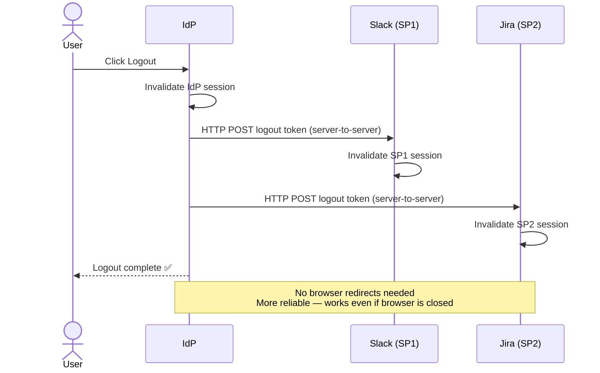
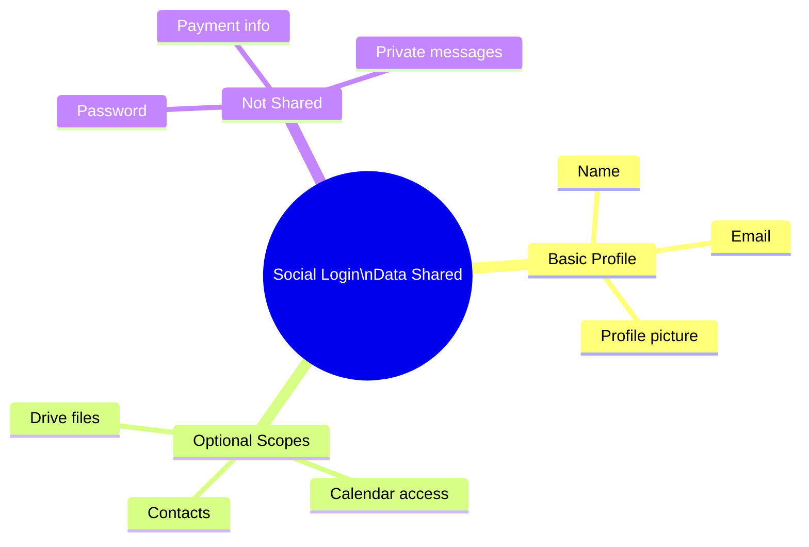
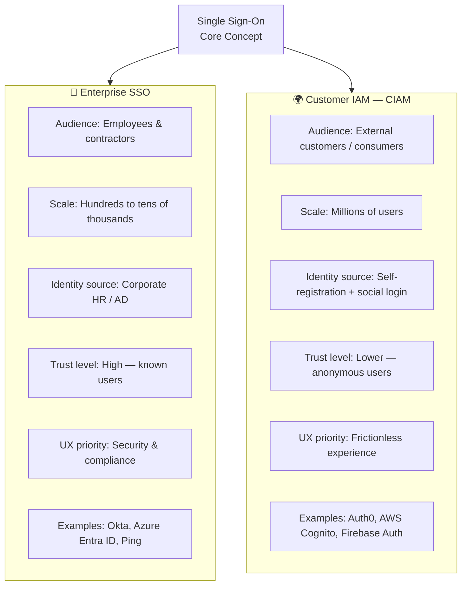
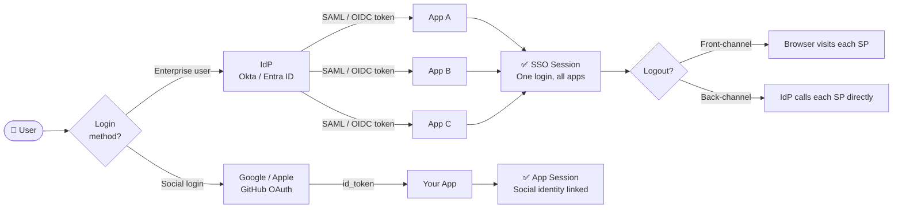

# Single Sign-On (SSO)

> Log in once, access everything — no more password fatigue.

---

## What is SSO?

Imagine a **theme park wristband**. You buy one ticket at the gate, get a wristband, and all rides let you in without buying another ticket. SSO works the same way — log in once, and all your apps just work.

Without SSO, every app is a separate ride with its own ticket booth.



---

## 1. IdP vs SP Roles

Two players make SSO work:

| Role | Full Name | Simple Meaning | Example |
|---|---|---|---|
| **IdP** | Identity Provider | The gatekeeper who verifies who you are | Okta, Azure Entra ID, Google Workspace |
| **SP** | Service Provider | The app you want to use | Salesforce, Slack, Jira |

> Think of IdP as your **passport office** and SP as the **foreign country**. The country (SP) trusts the passport (token) issued by your government (IdP).



---

## 2. SSO Login Flow (Step by Step)

Here is what actually happens behind the scenes when you click "Sign In":



---

## 3. SSO Session vs Application Session

There are **two separate sessions** running when you use SSO. Understanding both prevents confusion around logout.



---

## 4. SSO Logout — Front-Channel vs Back-Channel

Logging out is trickier than logging in. You must kill **all sessions** — both at the IdP and at every SP.

### Front-Channel Logout
The browser is used as the messenger — the IdP redirects the user's browser to each SP's logout URL.



### Back-Channel Logout
The IdP calls each SP directly — no browser involved. More reliable, but SP must expose a logout endpoint.



| | Front-Channel | Back-Channel |
|---|---|---|
| Messenger | User's browser | Direct server call |
| Reliability | Lower — browser must visit each SP | Higher — server-to-server |
| Privacy | Browser URLs visible | Hidden from browser |
| Complexity | Simpler to implement | Requires logout endpoint on each SP |

---

## 5. Social Login (OAuth with Google, Apple, GitHub)

**Social login** lets users reuse their existing accounts (Google, Apple, GitHub) instead of creating new credentials.

> Think of it as "vouching". You say "I know this person" and your friend (Google) vouches for you at the new app.

```mermaid
flowchart TD
    U([👤 User]) -->|Clicks Sign in with Google| APP[Your App\nService Provider]
    APP -->|Redirect to Google with client_id + scope| GOOGLE[Google\nOAuth Server]
    GOOGLE -->|Show consent screen| U
    U -->|User approves| GOOGLE
    GOOGLE -->|Redirect back with auth code| APP
    APP -->|Exchange auth code for tokens\n(server-to-server)| GOOGLE
    GOOGLE -->|Returns: access_token + id_token| APP
    APP -->|Extract identity from id_token| IDENTITY[User: alice@gmail.com\nName: Alice]
    IDENTITY -->|Find or create local account| DB[(App User Database)]
    DB --> SESSION([✅ Session Created — Alice is logged in])
```

### What information does social login share?



---

## 6. Enterprise SSO vs Customer SSO (CIAM)

These look similar but serve very different audiences.



| Dimension | Enterprise SSO | CIAM |
|---|---|---|
| Users | Employees | Customers |
| Scale | Thousands | Millions |
| Identity Source | HR / AD | Self-registration, social |
| Onboarding | IT-provisioned | Self-service |
| Key concern | Compliance, audit | Conversion, UX |
| MFA | Mandatory | Optional / adaptive |

---

## Putting It All Together



---

## Quick Reference Cheat Sheet

| Concept | One-liner | Key Rule |
|---|---|---|
| **IdP** | Verifies identity | Issues the signed token |
| **SP** | Provides the service | Trusts and consumes the token |
| **SSO Session** | IdP-level session | Shared across all apps, longer-lived |
| **App Session** | SP-level session | Per-app, shorter-lived |
| **Front-channel logout** | Browser-based logout relay | Simpler but less reliable |
| **Back-channel logout** | Server-to-server logout | Reliable, requires logout endpoint |
| **Social login** | Use Google/Apple/GitHub identity | OAuth + OIDC under the hood |
| **Enterprise SSO** | Employees, compliance-first | Okta, Entra ID, Ping |
| **CIAM** | Customers, UX-first | Auth0, Cognito, Firebase |
