# Protocols and Standards

[← Back to Index](README.md)

> Protocols are the **agreed languages** that systems use to handle identity, authentication, and authorization. Without them, every app would need its own custom login system.

Think of protocols like electrical plugs — they define a standard so any device (identity provider) can plug into any socket (application) around the world.

---

## 4.1 Federated Identity Protocols

Federated identity lets users log in once and access multiple systems — even across different organisations — without sharing passwords.

---

### SAML 2.0 — Security Assertion Markup Language

SAML is an XML-based protocol for exchanging authentication data between an **Identity Provider (IdP)** and a **Service Provider (SP)**.

> Like a notarised letter: the IdP writes a signed XML "assertion" saying "I vouch for this user." The SP trusts the letter because it's signed by a known IdP.

**SP-Initiated SSO** (most common — user starts at the app):

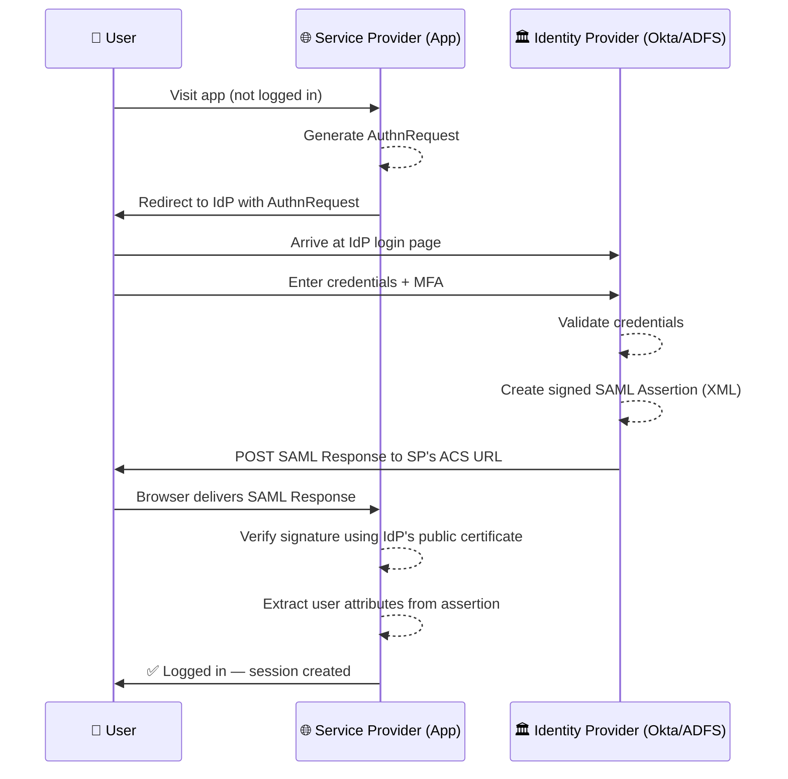

**IdP-Initiated SSO** (user starts at the IdP portal, e.g., company intranet):

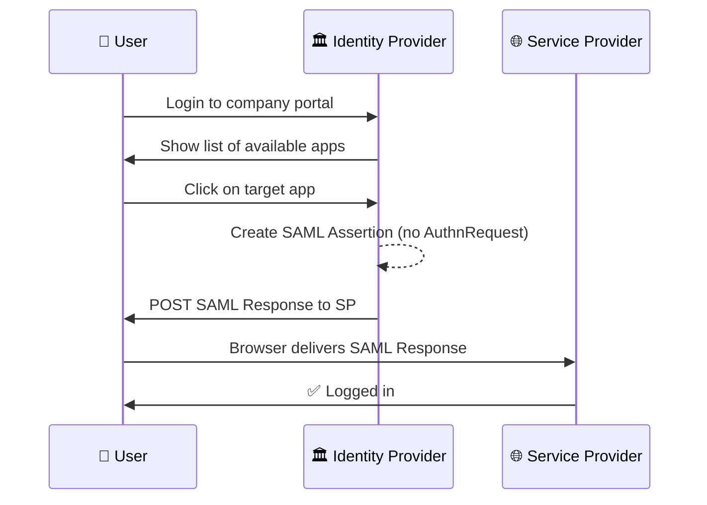

---

### OAuth 2.0 — Open Authorization

OAuth is an **authorization** protocol — it lets a third-party app access resources on your behalf, without giving it your password.

> Like a valet key: you give the valet a key that opens the car door but cannot open the boot or start the engine.

**Authorization Code Flow + PKCE** (for web and mobile apps):

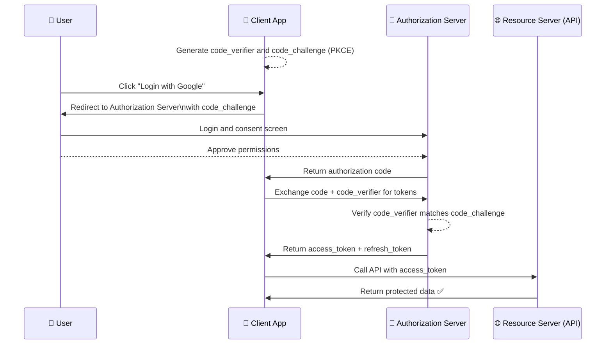

**Client Credentials Flow** (machine-to-machine, no user involved):

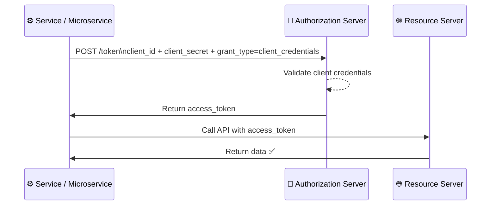

**Device Authorization Flow** (for TVs, CLIs with no browser):

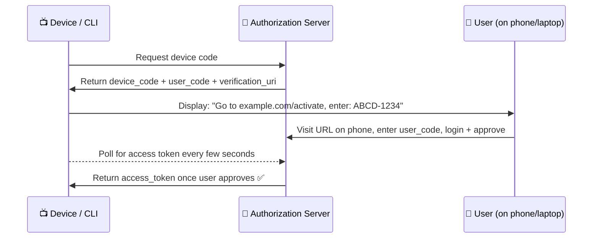

---

### OpenID Connect (OIDC)

OIDC is built **on top of OAuth 2.0** — it adds **authentication**. While OAuth only says "you can access this resource," OIDC also says "here's who the user is."

> OAuth = car valet key. OIDC = valet key **plus** a business card that says who gave the key.

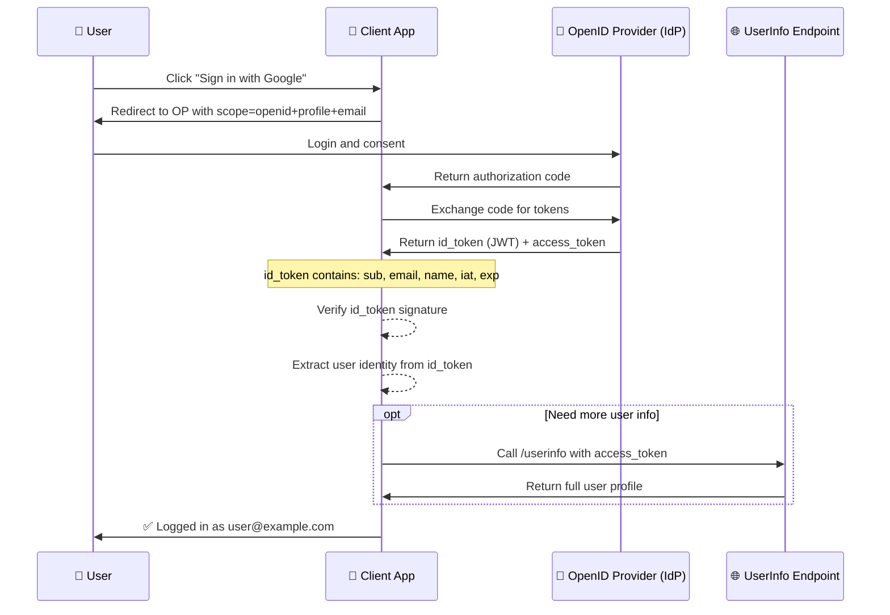

---

### When to Use SAML vs OAuth vs OIDC

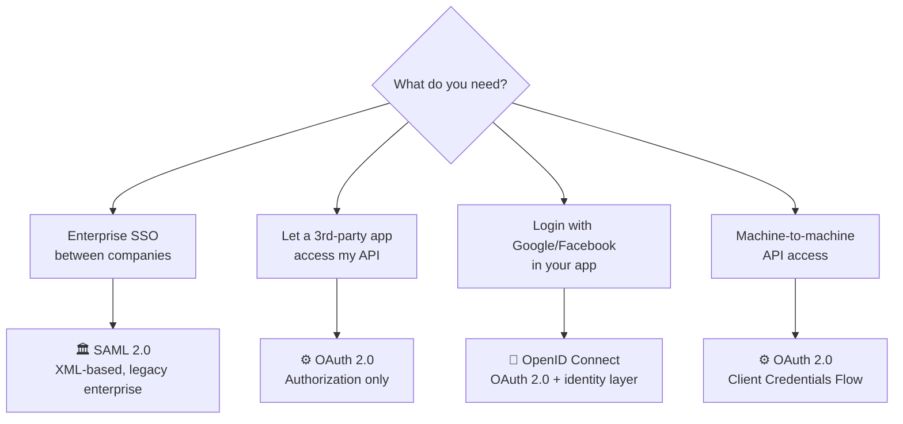

| Protocol | Purpose | Token Format | Best For |
|---|---|---|---|
| **SAML 2.0** | Authentication + SSO | XML Assertion | Enterprise B2B, legacy apps |
| **OAuth 2.0** | Authorization (access delegation) | Access token (opaque or JWT) | API access, mobile apps |
| **OIDC** | Authentication (built on OAuth) | ID token (JWT) + access token | Consumer login, modern web/mobile |

---

## 4.2 Directory and Provisioning

### LDAP — Lightweight Directory Access Protocol

LDAP is a protocol for querying and managing a **directory** — a hierarchical database of users, groups, and resources.

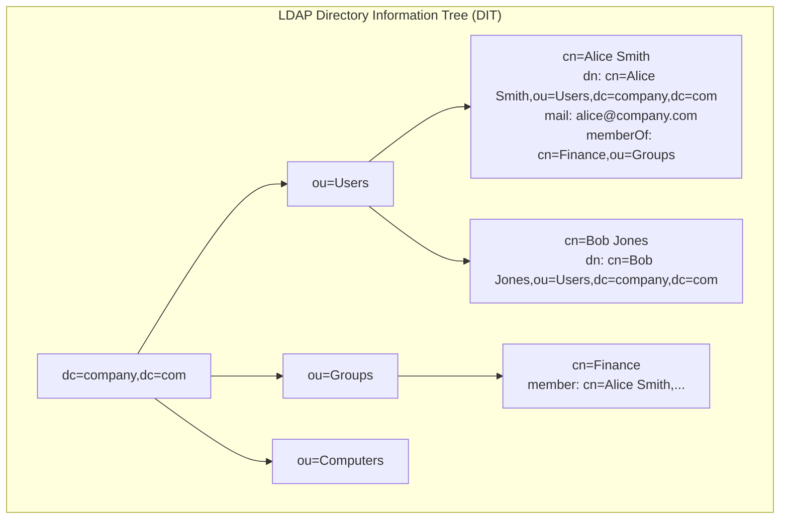

**LDAP Search Query example:**
```
Base DN:  ou=Users,dc=company,dc=com
Filter:   (&(objectClass=person)(department=Finance))
Result:   Returns all people in Finance department
```

---

### Active Directory (AD)

AD is Microsoft's implementation of LDAP + Kerberos — the dominant enterprise directory service.

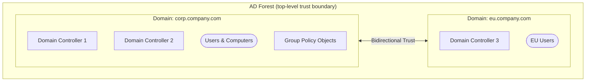

---

### Kerberos Authentication

Kerberos is used by Active Directory for authenticating users on a Windows network. It uses **tickets** instead of passwords.

> Like a theme park wristband system: show your ticket at the gate, get a wristband for each ride — you never show your password to each ride.

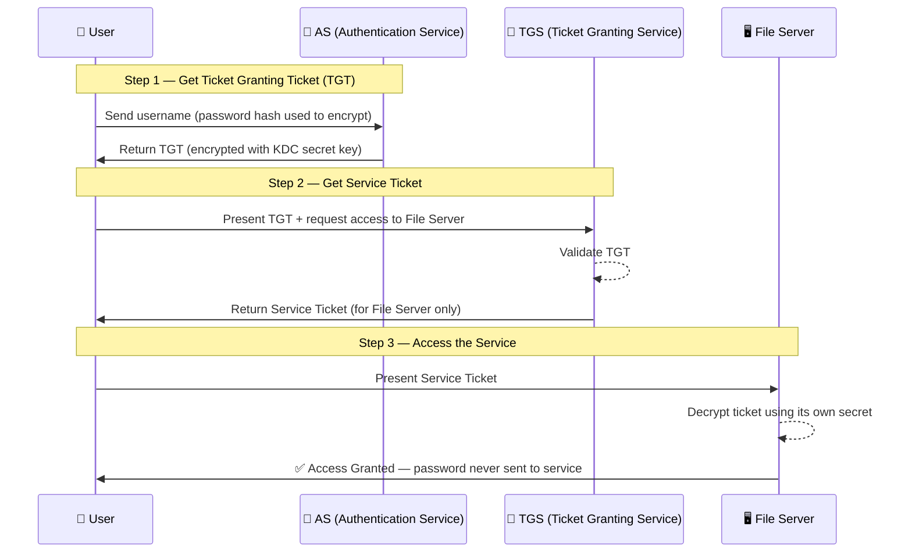

---

### SCIM 2.0 — System for Cross-domain Identity Management

SCIM automates user provisioning and deprovisioning between systems (e.g., Workday → Okta → Salesforce).

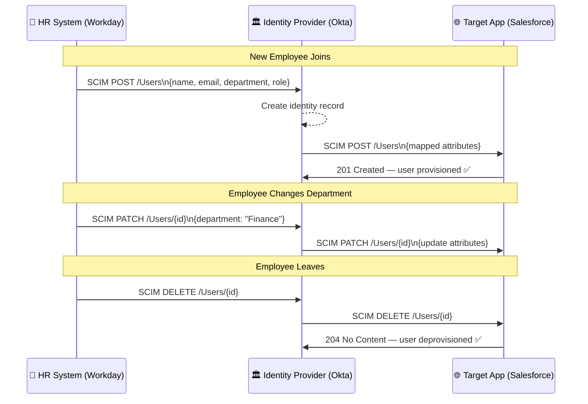

---

### RADIUS — Remote Authentication Dial-In User Service

RADIUS handles authentication for network access — commonly used for Wi-Fi, VPN, and 802.1X port-based access control.

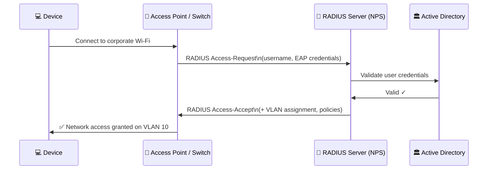

---

## 4.3 Token Formats

### JWT — JSON Web Token

A JWT is a compact, URL-safe token consisting of three Base64-encoded parts separated by dots.

```
eyJhbGciOiJSUzI1NiJ9.eyJzdWIiOiJ1c2VyMTIzIn0.signature
      HEADER                    PAYLOAD              SIGNATURE
```

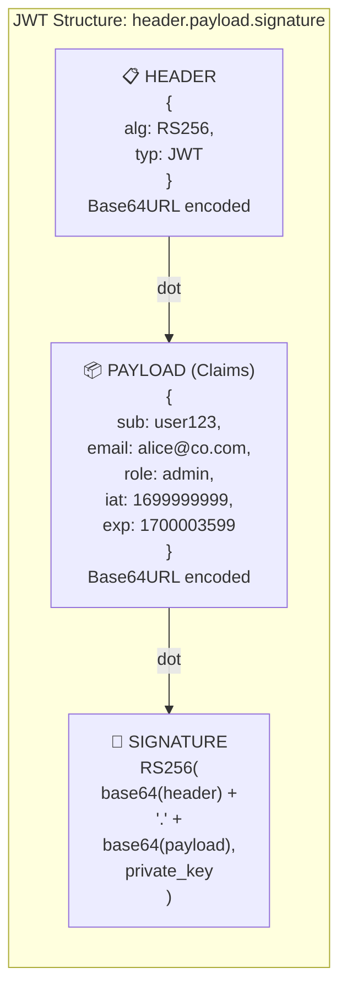

**JWT `alg` pitfalls:**

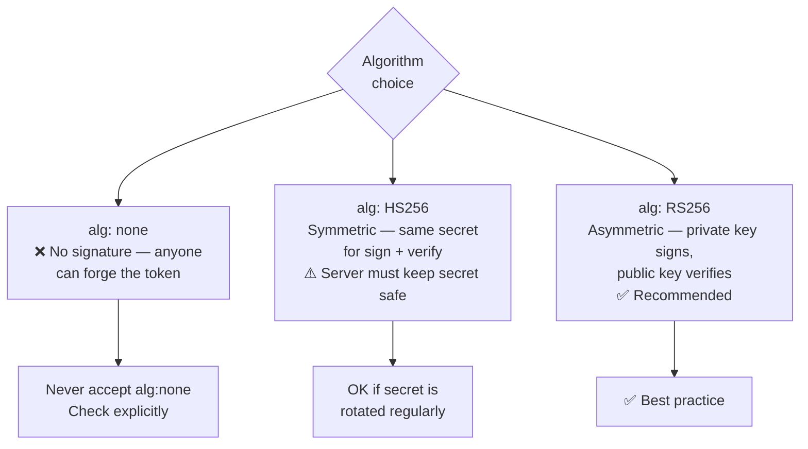

---

### SAML Assertion Structure

A SAML Assertion is an XML document signed by the IdP that describes who the user is.

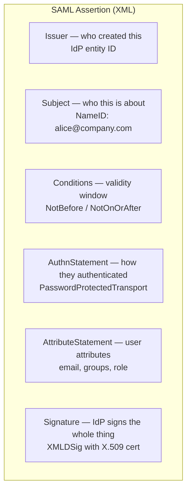

---

### Opaque Tokens and Introspection

An **opaque token** is a random string with no embedded data — the resource server must call the authorization server to find out what it means.

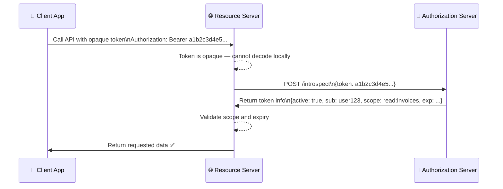

| Token Type | Pros | Cons |
|---|---|---|
| **JWT (self-contained)** | No introspection call needed; fast | Cannot revoke before expiry |
| **Opaque** | Revocable instantly | Requires introspection call every request |

---

## Quick Reference Cheat Sheet

| Protocol / Standard | One-liner | Key Rule |
|---|---|---|
| **SAML 2.0** | XML-based enterprise SSO | IdP signs assertions; SP verifies with public cert |
| **OAuth 2.0** | Authorization framework — delegate access | Use PKCE for public clients; never implicit flow |
| **OIDC** | Authentication layer on top of OAuth 2.0 | ID token = who you are; access token = what you can do |
| **LDAP** | Query/manage hierarchical directory | DN identifies entries; filter queries find them |
| **Kerberos** | Ticket-based auth used by Active Directory | TGT from KDC → Service Ticket → access service |
| **SCIM 2.0** | Automate user provisioning | Standard REST API for create/update/delete users |
| **RADIUS** | Network access authentication | Used for Wi-Fi, VPN, 802.1X |
| **JWT** | Self-contained signed token | Use RS256; validate `alg`, `exp`, `iss`, `aud` |
| **Opaque token** | Random string; meaning stored server-side | Requires introspection; revocable |
| **SAML Assertion** | Signed XML vouching for the user | Verify signature; check NotOnOrAfter |
