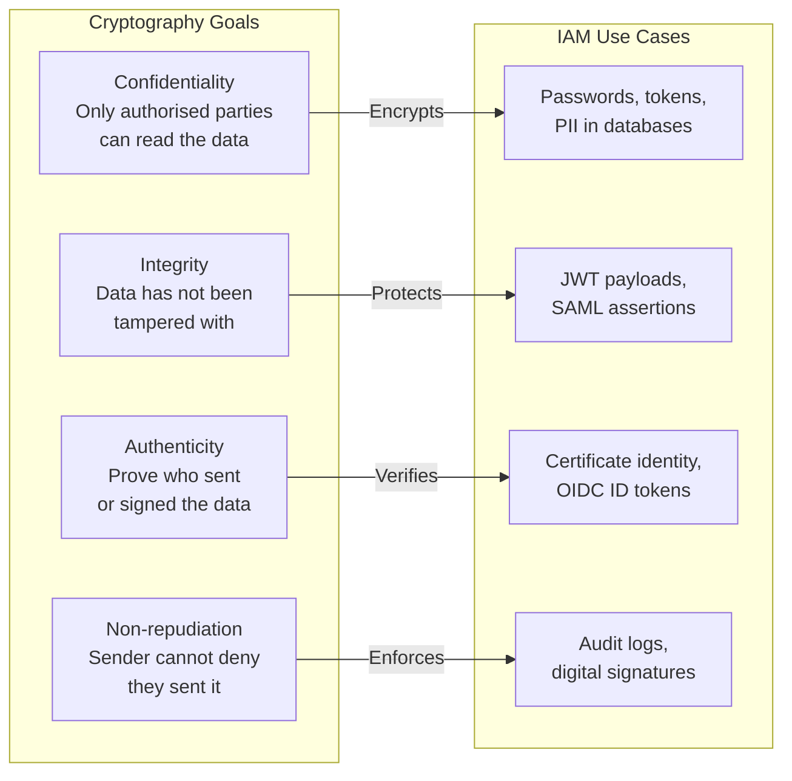
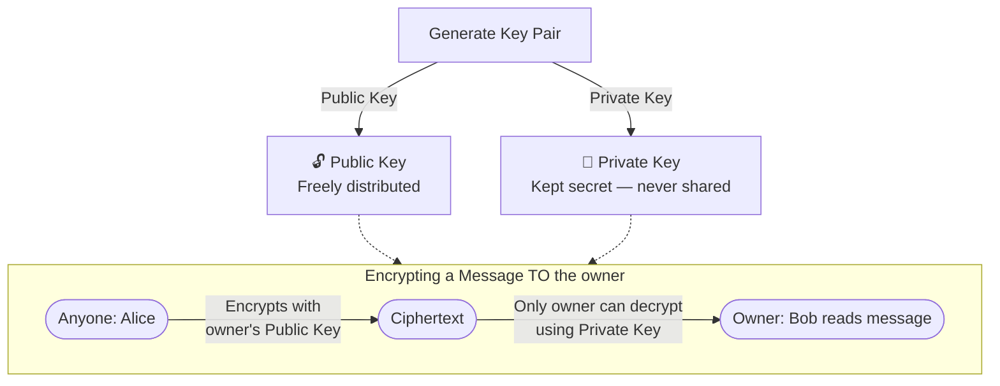
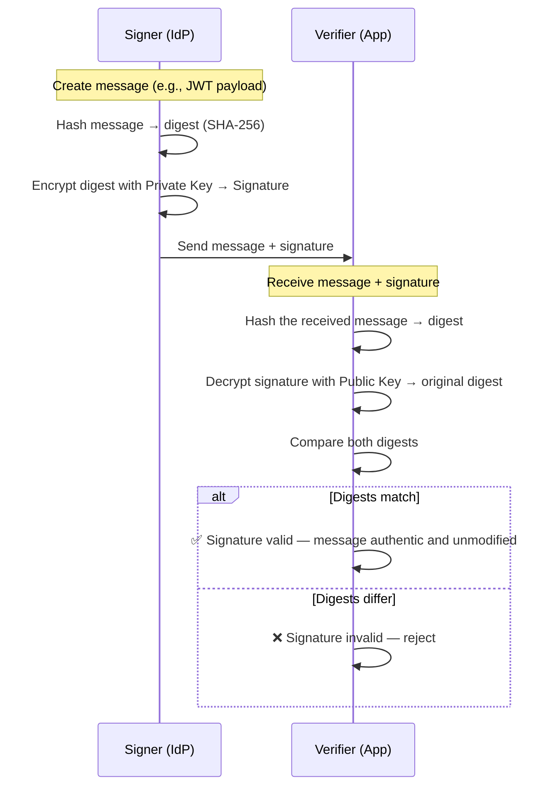
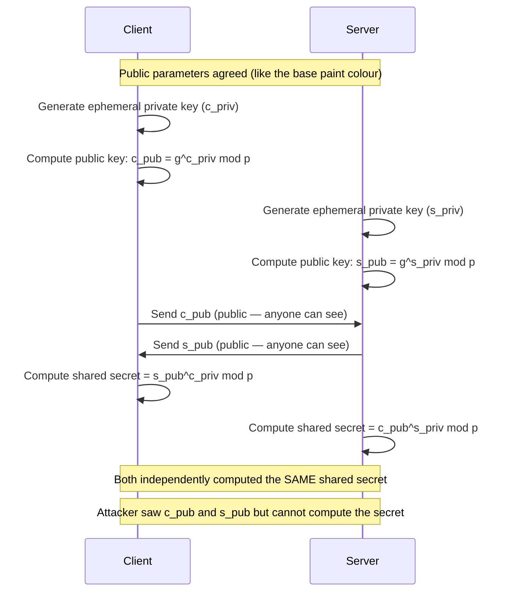
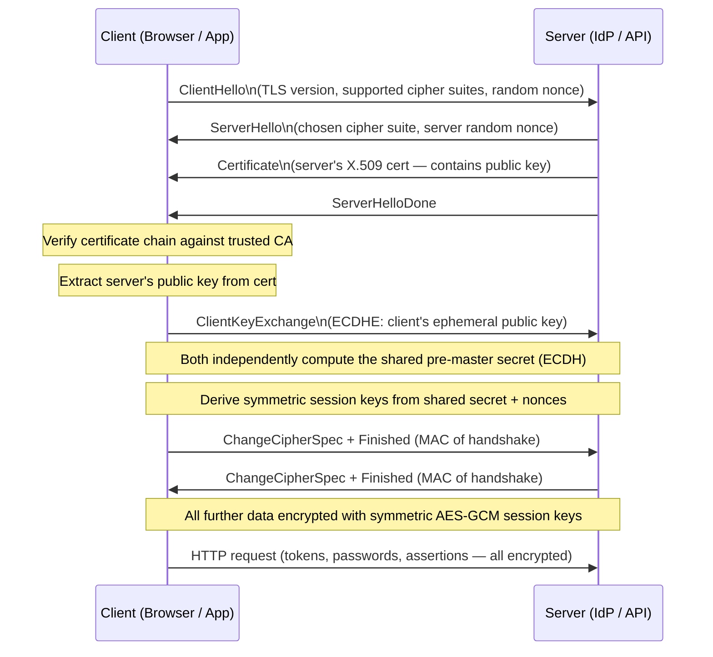
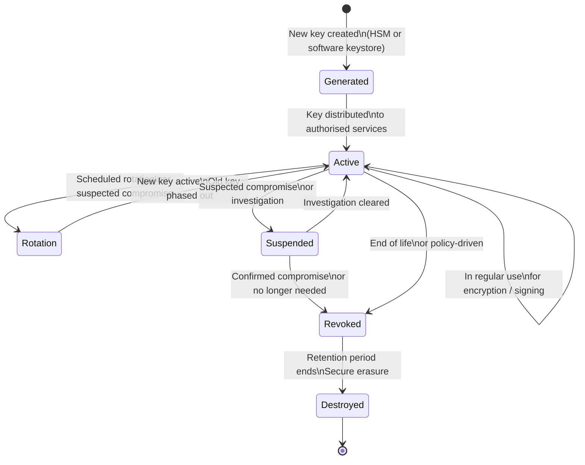
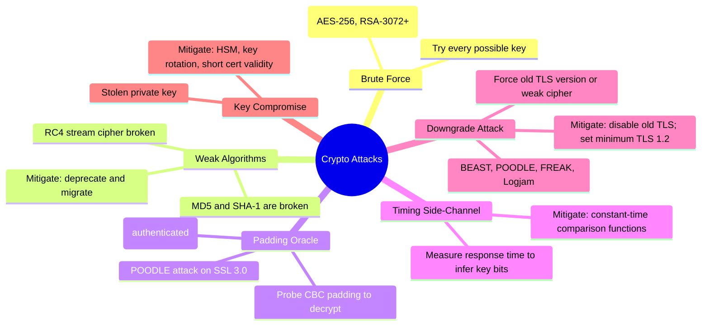

# Cryptography

[← Back to Index](README.md)

> The mathematical foundation behind every secure identity system — how secrets stay secret, how data stays intact, and how you can prove something is genuine.

---

## 1. What is Cryptography?

**Cryptography** is the science of protecting information by transforming it so that only authorised parties can read or verify it.

Think of it like a padlock on a diary:
- Only the person with the key can open it and read the contents
- Anyone can see the locked diary, but the contents are unreadable without the key
- If someone tampers with the lock, it shows



| Goal | Simple Meaning | IAM Example |
|---|---|---|
| **Confidentiality** | Keep secrets secret | Encrypting stored passwords |
| **Integrity** | Detect tampering | JWT signature validation |
| **Authenticity** | Prove who you are | X.509 certificate identity |
| **Non-repudiation** | Cannot deny sending | Signed audit log entries |

---

## 2. Symmetric Encryption

**Simple idea:** One key both locks and unlocks the data — like a physical door key.

If Alice and Bob both have copies of the same key, Alice can encrypt a message and Bob can decrypt it. No one else can read it, because no one else has the key.

```mermaid
flowchart LR
    PT([Plaintext\n"Password: hunter2"]) -->|Encrypt\nusing Secret Key| CT([Ciphertext\n"X7k#9mQp2..."])
    CT -->|Decrypt\nusing Same Secret Key| PT2([Plaintext\n"Password: hunter2"])

    KEY([🔑 Shared Secret Key\nAES-256]) -.->|Same key used\nboth directions| PT
    KEY -.-> PT2
```

### AES — the Standard

**AES (Advanced Encryption Standard)** is the symmetric algorithm used everywhere in IAM:

| Variant | Key Size | Security Level | Use |
|---|---|---|---|
| AES-128 | 128 bits | Good | General encryption |
| AES-192 | 192 bits | Better | Sensitive data |
| AES-256 | 256 bits | Strongest | High-security / government |

### Modes of Operation

The same AES algorithm can run in different **modes** — the mode matters:

| Mode | Behaviour | Verdict |
|---|---|---|
| **GCM** (Galois/Counter Mode) | Encrypts + authenticates (detects tampering) | ✅ Use this |
| **CBC** (Cipher Block Chaining) | Encrypts only, vulnerable to padding oracle if misused | ⚠️ Use carefully |
| **ECB** (Electronic Codebook) | Each block encrypted independently — patterns leak | ❌ Never use |

> **ECB pitfall:** If two blocks of plaintext are identical, they produce identical ciphertext — an attacker can spot patterns without breaking the encryption. The famous "ECB penguin" image illustrates this perfectly.

### Where Symmetric Encryption is Used in IAM

| IAM Area | What Gets Encrypted | Key Type |
|---|---|---|
| Credential vault (PAM) | Stored passwords | AES-256-GCM |
| Session tokens | Token payload at rest | AES-256-GCM |
| Database PII columns | Email, phone, SSN | AES-256-GCM |
| TLS record layer | In-transit data (after handshake) | Negotiated session key |
| HSM key wrapping | Wrapping private keys for storage | AES-256 key-wrap |

**Main challenge with symmetric encryption:** Both parties must securely share the key — which is hard to do over a network. This is where asymmetric encryption helps.

---

## 3. Asymmetric Encryption (Public-Key Cryptography)

**Simple idea:** A special padlock anyone can click shut, but only you have the key to open.

You hand out open padlocks to everyone. Anyone can lock a box for you using your padlock. Only you — with your private key — can open it.



### RSA vs ECC

| Algorithm | Key Size for ~128-bit security | Speed | IAM Use |
|---|---|---|---|
| **RSA** | 3072 bits | Slower | TLS certs, JWT RS256, legacy SSH |
| **ECC (ECDSA/Ed25519)** | 256 bits | Faster | Modern TLS, JWT ES256, SSH, FIDO2 |

> **Why ECC is preferred:** Provides the same security level as RSA with far smaller keys. Smaller keys = faster operations, less data transmitted, lower CPU cost. Important for high-volume auth systems issuing thousands of JWTs per second.

### IAM Uses of Asymmetric Encryption

| Use Case | Private Key Holder | Public Key Holder |
|---|---|---|
| TLS certificate | Web server | Client (browser/app) |
| JWT RS256 signing | Identity Provider (IdP) | Resource servers (JWK endpoint) |
| SSH authentication | End user | Remote server (`authorized_keys`) |
| Email encryption (S/MIME) | Recipient | Sender |
| SAML assertion signing | IdP | Service Provider (SP) metadata |

---

## 4. Digital Signatures

**Simple idea:** A wax seal on a letter. If the seal is intact, you know who sent it and that no one has tampered with the contents.

A digital signature works in reverse to encryption:
- **Sign:** Use your **private key** (only you have it)
- **Verify:** Use your **public key** (anyone can verify)



### Signing Algorithms in IAM

| Algorithm | Based On | Key Type | Used In |
|---|---|---|---|
| **RS256** | RSA + SHA-256 | RSA 2048+ | JWT (most common), SAML |
| **RS384 / RS512** | RSA + SHA-384/512 | RSA 2048+ | JWT (high security) |
| **ES256** | ECDSA + SHA-256 | EC P-256 | Modern JWT, FIDO2 |
| **EdDSA (Ed25519)** | Edwards curve | EC Ed25519 | SSH, modern JWT |
| **HS256** | HMAC-SHA-256 | Shared secret | JWT (symmetric — both sides must share key) |

> **RS256 vs HS256 in JWT:** RS256 lets any app verify a JWT using the IdP's public key (available from JWKS endpoint) without needing the secret. HS256 requires sharing the secret — problematic at scale. Prefer RS256 or ES256.

---

## 5. Key Exchange — Diffie-Hellman & ECDH

**Simple idea:** Two spies publicly mix paint colours. Each adds a secret colour. The mixture they both end up with is identical — but no one watching the exchange can figure out the secret colours.

This lets two parties **agree on a shared secret over a public channel** — without ever sending the secret itself.



### Perfect Forward Secrecy (PFS)

With standard DH, if the server's long-term private key is stolen later, an attacker who recorded past sessions can decrypt them all.

**PFS** solves this: generate a **fresh ephemeral key pair per session**, throw it away after. Even if the server key is stolen later, past sessions are safe.

| Mechanism | PFS? | Used In |
|---|---|---|
| RSA key exchange (old TLS) | ❌ No | TLS 1.1 and earlier |
| DHE (Ephemeral DH) | ✅ Yes | TLS 1.2 |
| ECDHE (Ephemeral ECDH) | ✅ Yes | TLS 1.2 / 1.3 (default) |

> **IAM relevance:** Tokens, passwords, and assertions travel over TLS. PFS ensures that compromising a server key today doesn't expose historical token exchanges.

---

## 6. TLS Handshake — Cryptography in Action

TLS (Transport Layer Security) is where all these cryptographic building blocks come together. Every IAM protocol — OAuth 2.0, OIDC, SAML, SCIM — runs over TLS.



| Phase | Cryptography Used | Why |
|---|---|---|
| Certificate presented | Asymmetric (RSA/ECC) | Server proves its identity |
| Key exchange | ECDH | Establish shared secret without sending it |
| Session encryption | Symmetric (AES-256-GCM) | Efficient bulk encryption |
| Integrity check (MAC) | HMAC | Detect any tampering |

---

## 7. Encryption in IAM — Where It Applies

| IAM Area | What is Encrypted | Algorithm | Why |
|---|---|---|---|
| Passwords at rest | Hash + salt (not reversible) | bcrypt / Argon2 | One-way — no need to decrypt |
| Session tokens (at rest) | Token payload | AES-256-GCM | Protect if DB is compromised |
| PII in database | Email, phone, name | AES-256-GCM | GDPR / compliance |
| Credential vault | Stored passwords / keys | AES-256-GCM + HSM | PAM — no plaintext in DB |
| Data in transit | Everything | TLS 1.2+ (ECDHE + AES) | Prevent interception |
| JWT signing | Token signature | RS256 / ES256 | Verify authenticity |
| SAML assertions | Assertion XML | XML Encryption (AES) + RSA | End-to-end assertion security |
| SCIM API payloads | Provisioning data | TLS (transport) | Protect identity data in sync |
| API secrets / client secrets | Stored secrets | AES-256-GCM | Protect OAuth client credentials |

---

## 8. Key Management Lifecycle

Keys are only as secure as how you manage them. A strong algorithm with poor key management is weak.



### Key Management Best Practices

| Stage | Best Practice | IAM Context |
|---|---|---|
| **Generate** | Use HSM or cloud KMS | IdP signing keys, vault master keys |
| **Distribute** | Never send in plaintext; use secure channels | JWKS endpoint (public keys only) |
| **Store** | HSM for private keys; never in source code | Azure Key Vault, AWS KMS, HashiCorp Vault |
| **Rotate** | Rotate on schedule; support key overlap period | JWT signing key rotation without downtime |
| **Revoke** | Publish CRL / OCSP for certs | Certificate revocation |
| **Destroy** | Cryptographic erasure; overwrite key material | End-of-life key destruction |

> **HSM (Hardware Security Module):** A tamper-resistant physical device that generates and stores keys. The private key never leaves the HSM in plaintext. Required for high-assurance IAM deployments (CA root keys, signing keys for financial transactions).

---

## 9. Common Cryptographic Attacks



| Attack | What Happens | Mitigation |
|---|---|---|
| **Brute Force** | Try all possible keys until one works | Use AES-256; RSA ≥ 2048; ECC ≥ 256 |
| **Padding Oracle (POODLE)** | Exploit CBC padding feedback to decrypt | Use AES-GCM (authenticated encryption) |
| **Timing Side-Channel** | Measure response time to infer key bits | Use constant-time comparison in code |
| **Downgrade** | Force negotiation to weak TLS/cipher | Disable TLS 1.0/1.1; enforce TLS 1.2+ |
| **Weak Algorithm** | MD5 / SHA-1 / RC4 are broken | Migrate to SHA-256+, AES-GCM, ECDHE |
| **Key Compromise** | Private key stolen from server | HSM storage; short certificate validity; rapid rotation |

---

## 10. Algorithm Cheat Sheet

| Algorithm | Type | Key / Output Size | IAM Use Case | Status |
|---|---|---|---|---|
| **AES-256-GCM** | Symmetric | 256-bit key | Encrypt tokens, PII, vault secrets | ✅ Recommended |
| **AES-128-GCM** | Symmetric | 128-bit key | General encryption | ✅ OK |
| **RSA-2048** | Asymmetric | 2048-bit | TLS certs, JWT RS256 (minimum) | ✅ OK (use 3072+ for new) |
| **RSA-4096** | Asymmetric | 4096-bit | High-security signing | ✅ Recommended for CA keys |
| **ECDSA P-256** | Asymmetric | 256-bit | JWT ES256, TLS, FIDO2 | ✅ Recommended |
| **Ed25519** | Asymmetric | 256-bit | SSH keys, modern JWT | ✅ Recommended |
| **ECDH P-256** | Key exchange | 256-bit | TLS key exchange (ECDHE) | ✅ Recommended |
| **DH-2048** | Key exchange | 2048-bit | TLS (older) | ⚠️ Use ECDH instead |
| **SHA-256** | Hash | 256-bit output | HMAC, digital signatures | ✅ Recommended |
| **SHA-1** | Hash | 160-bit output | Legacy signatures | ❌ Deprecated — collision attacks |
| **MD5** | Hash | 128-bit output | Legacy checksums | ❌ Broken — do not use |
| **3DES** | Symmetric | 168-bit | Legacy systems | ❌ Deprecated — Sweet32 attack |
| **RC4** | Symmetric stream | Variable | Legacy TLS (before TLS 1.2) | ❌ Broken — do not use |

---

## Quick Reference

| Concept | Simple Meaning |
|---|---|
| **Cryptography** | Science of protecting data through mathematical transformation |
| **Symmetric Encryption** | Same key encrypts and decrypts; fast but requires secure key sharing |
| **Asymmetric Encryption** | Key pair: public key encrypts, private key decrypts (or sign/verify) |
| **Digital Signature** | Proves authenticity and integrity; sign with private key, verify with public key |
| **AES-256-GCM** | Gold standard for symmetric encryption; encrypts and authenticates |
| **RSA** | Common asymmetric algorithm; large key sizes needed for high security |
| **ECC** | Modern asymmetric algorithm; same security as RSA with much smaller keys |
| **Diffie-Hellman** | Key exchange protocol; lets two parties agree on a secret over public channel |
| **Perfect Forward Secrecy** | Each session uses a fresh ephemeral key; past sessions safe if key is later stolen |
| **TLS** | Protocol that wraps all IAM traffic; uses asymmetric auth + symmetric encryption |
| **HSM** | Hardware device that generates and stores keys; private key never leaves hardware |
| **Key Rotation** | Regularly replacing keys to limit exposure window if a key is compromised |
| **Padding Oracle** | Attack on CBC mode; use GCM to avoid |
| **Downgrade Attack** | Force old, weak cipher; mitigate by disabling legacy TLS versions |

---

*Next: [Hashing](08-hashing.md)*
