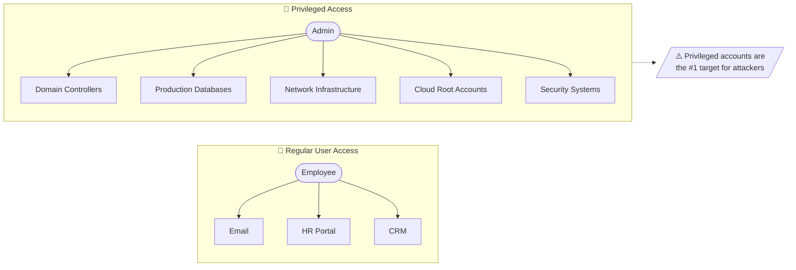
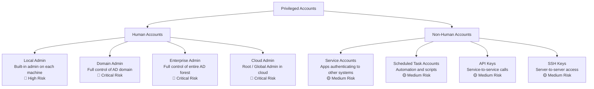
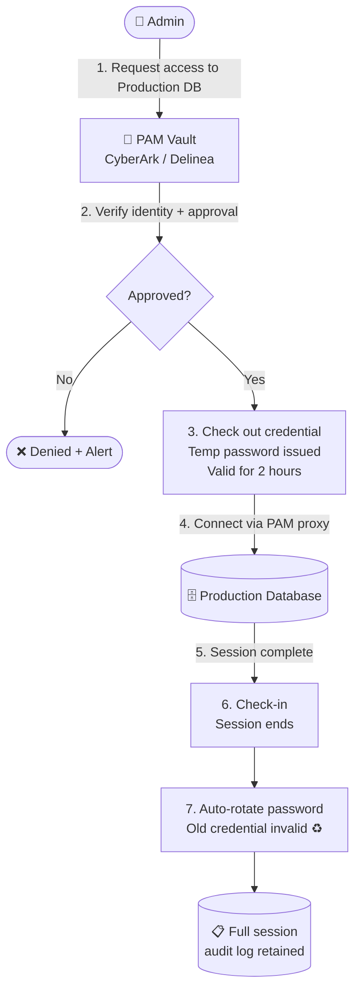
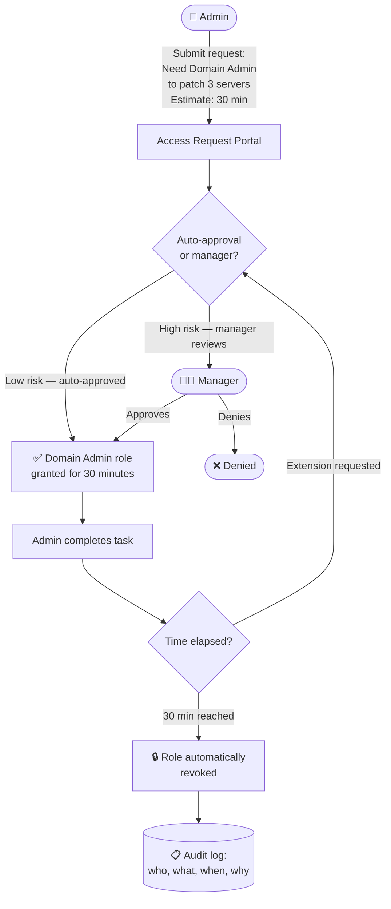
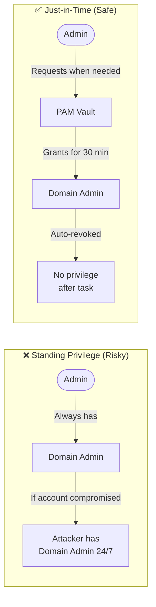
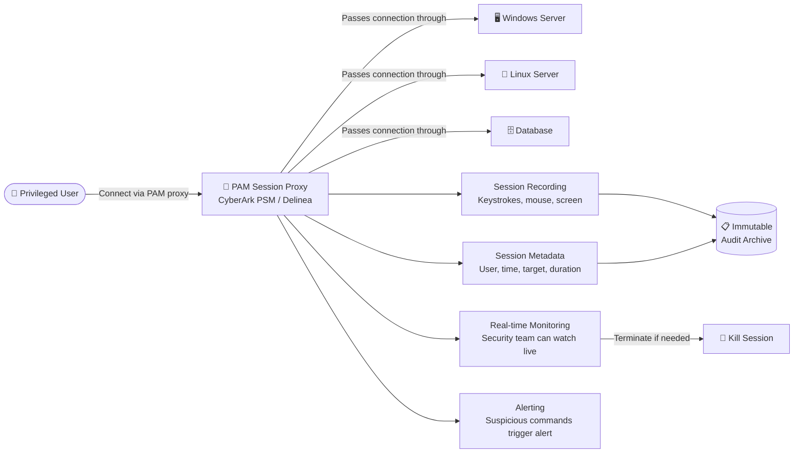
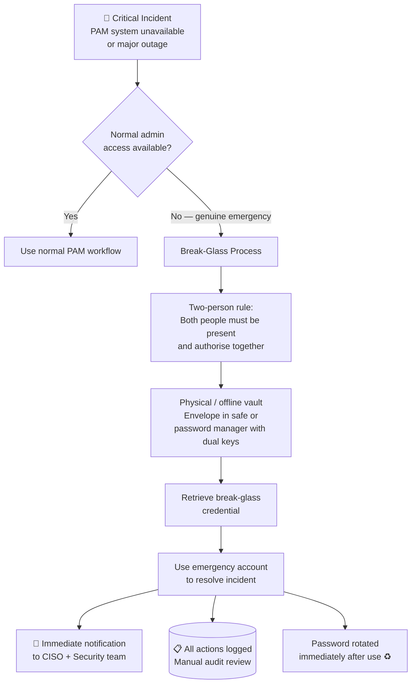
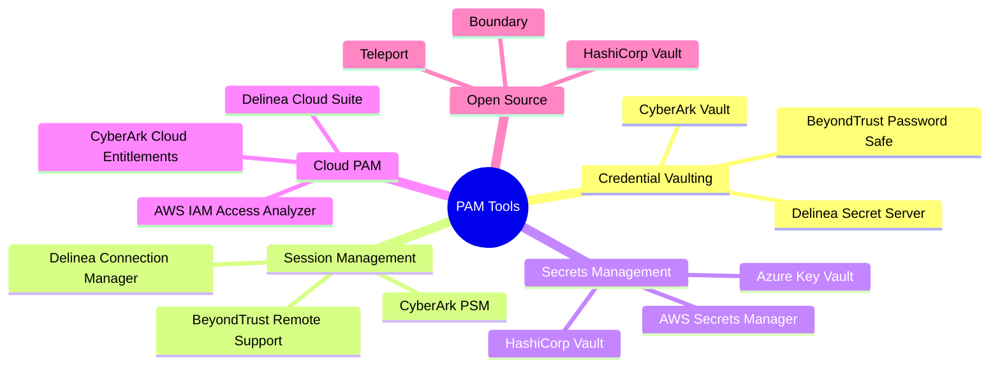
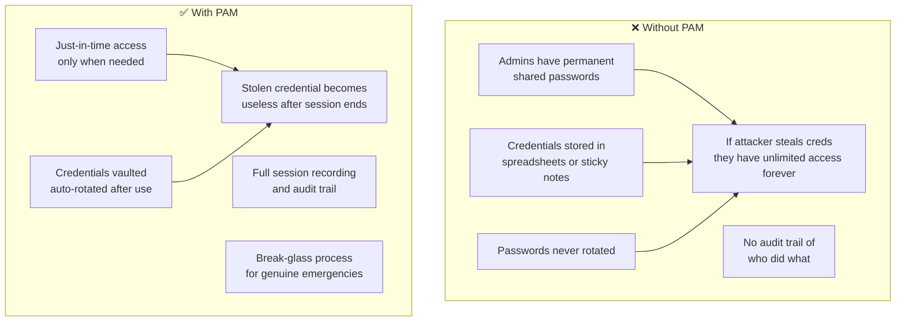

# Privileged Access Management (PAM)

> PAM is about locking down the most powerful keys to your kingdom — and knowing exactly who used them, when, and why.

---

## What is Privileged Access?

A regular employee has access to their email and a few business apps. A **privileged user** has access to the systems that run the business — servers, databases, network devices, cloud infrastructure.

> Think of a regular key vs a **master key**. A master key opens every door. PAM is the system that controls who gets the master key, for how long, and watches everything they do with it.

---

## 1. Types of Privileged Accounts

| Account Type | Risk | Why It's Dangerous |
|---|---|---|
| Domain Admin | Critical | Full AD control — can create backdoor accounts |
| Local Admin | High | Can install malware, bypass endpoint controls |
| Service Account | Medium | Often has no expiry, password never changed |
| Root / Cloud Admin | Critical | Can destroy or exfiltrate entire infrastructure |
| SSH Key | Medium | Often forgotten, gives persistent server access |

---

## 2. Credential Vaulting — Check-In / Check-Out

Instead of giving admins a permanent password, PAM tools store credentials in a **vault** and issue them temporarily — like a hotel key card that expires at checkout.

> **Why auto-rotate?** Even if the admin copied the password, it's useless after their session ends.

---

## 3. Just-in-Time (JIT) Privileged Access

**JIT access** means privilege is granted only when needed, for a limited time — then automatically removed. No permanent standing privilege.

> Old model: "Alice is permanently a Domain Admin."
> JIT model: "Alice can be a Domain Admin for the next 30 minutes to complete this task."

### Standing Privilege vs JIT

---

## 4. Session Monitoring and Recording

Every privileged session is **proxied through the PAM system**, recorded, and can be reviewed or terminated in real time.

> Like a **security camera** on every admin action — not to spy, but to investigate incidents and prove compliance.

---

## 5. Break-Glass (Emergency) Accounts

What if the PAM system itself goes down? Or there's a critical incident at 3am? **Break-glass accounts** are emergency backdoors — powerful, rarely used, and tightly controlled.

> Like the **fire extinguisher** behind glass on the wall — only break it in an emergency, and everyone will know you did.

---

## 6. PAM Tools Ecosystem

---

## 7. Without PAM vs With PAM

---

## Quick Reference Cheat Sheet

| Concept | One-liner | Key Rule |
|---|---|---|
| **Privileged Account** | Account with elevated system access | Treat every privileged account as a critical asset |
| **Credential Vault** | Secure store for privileged passwords | Check out, use, check in — then auto-rotate |
| **JIT Access** | Privilege only when needed | No standing privilege; time-bound elevation |
| **Session Recording** | Record all privileged sessions | PAM proxy captures keystrokes, screen, metadata |
| **Break-Glass** | Emergency backdoor account | Dual-person rule, immediate notification, rotate after use |
| **Service Account** | Non-human privileged identity | Treat like any privileged account — vault and rotate |
| **CyberArk** | Leading enterprise PAM tool | Vault, session management, threat analytics |
| **HashiCorp Vault** | Secrets management, cloud-native PAM | Great for DevOps / cloud-native environments |
