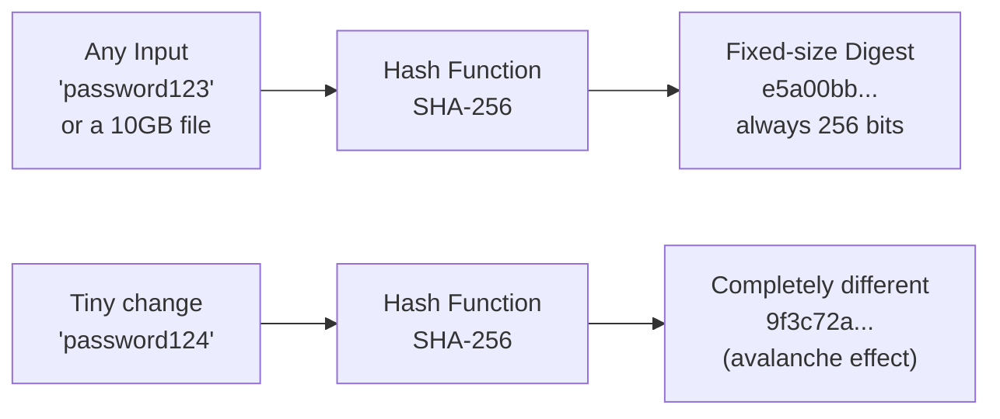
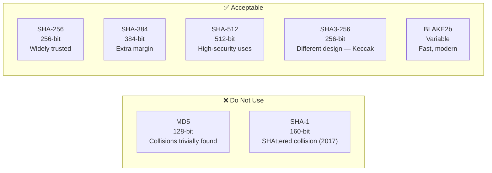
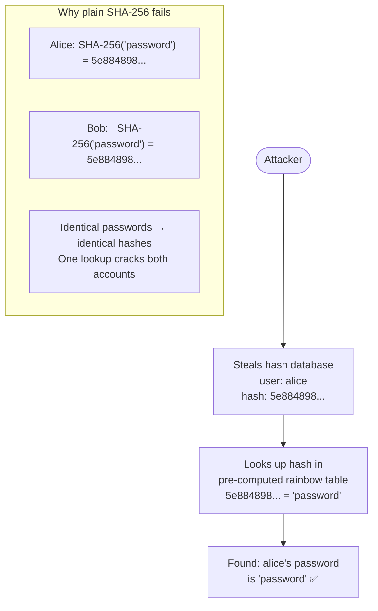
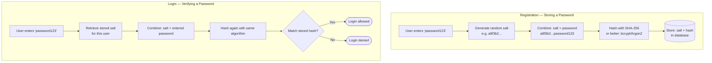
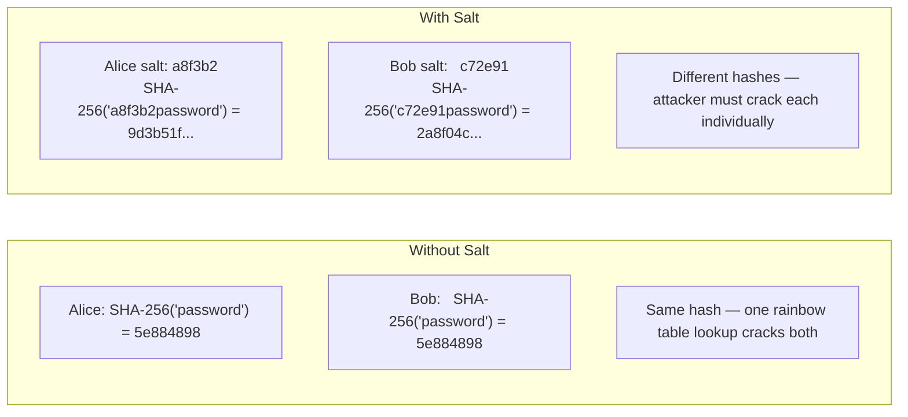
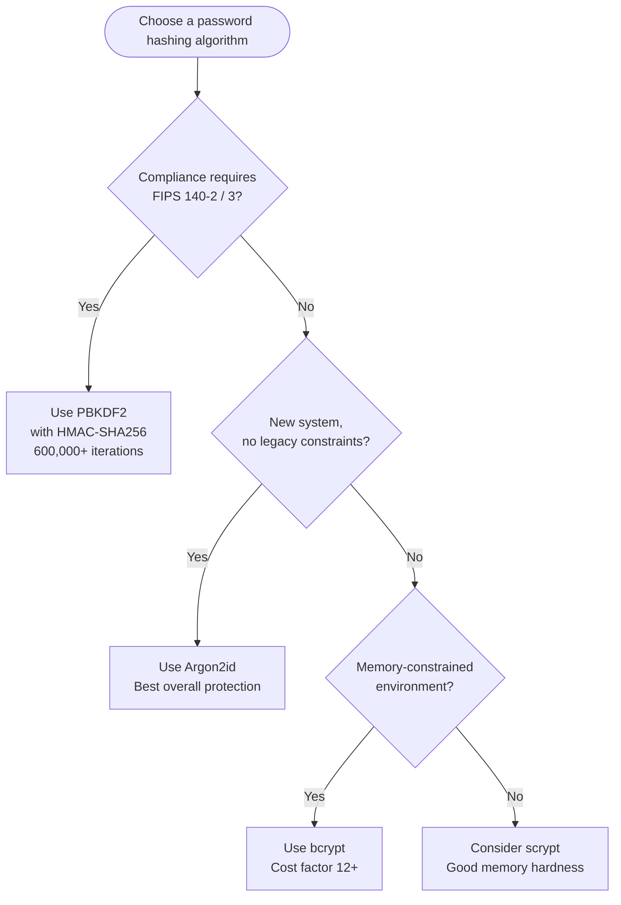
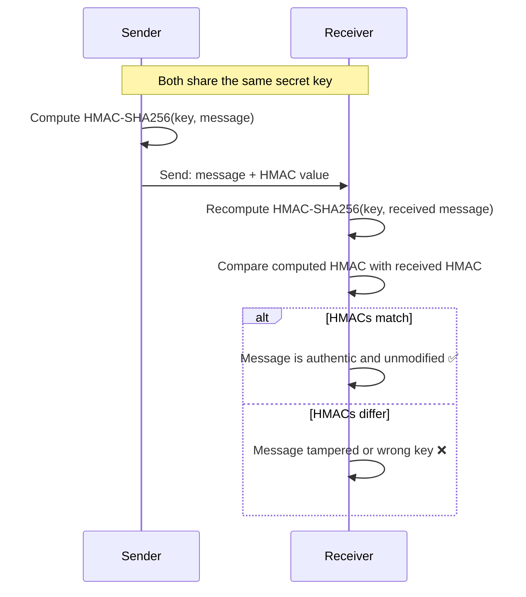
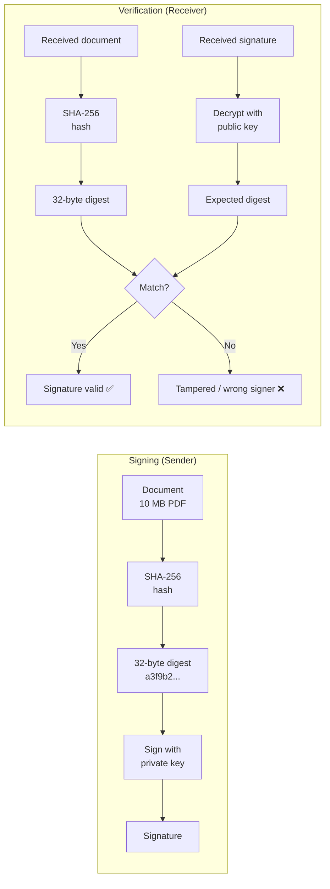
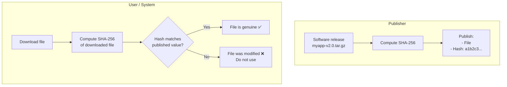
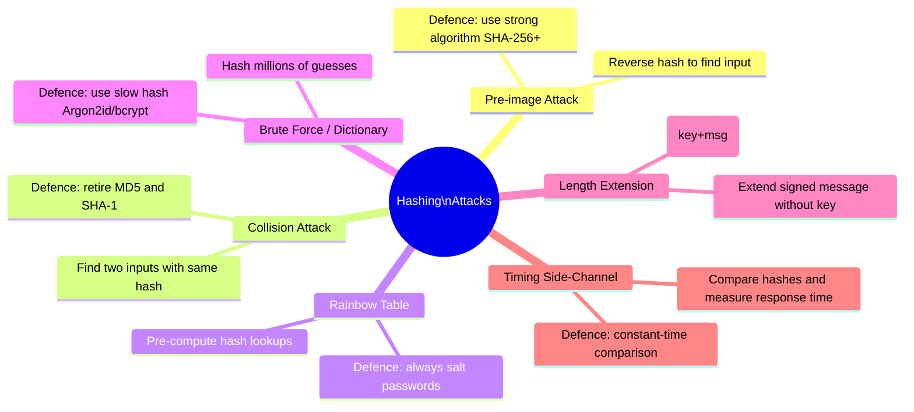

# Hashing

[← Back to Index](README.md)

> One-way transformation that turns any input into a fixed-size fingerprint — the backbone of password storage, digital signatures, and integrity checks in IAM.

---

## 1. What is Hashing?

A **hash function** takes any input (a password, a file, a message) and produces a fixed-size output called a **digest** or **hash**. Think of it like a fingerprint:

- Every person has a unique fingerprint
- You can go from person → fingerprint easily
- You **cannot** reconstruct a person from their fingerprint alone



### Four Key Properties

| Property | Meaning | Why It Matters |
|---|---|---|
| **Deterministic** | Same input always → same output | You can verify a password by re-hashing |
| **One-way (Pre-image resistance)** | Cannot reverse hash → input | Stored hashes don't expose the password |
| **Collision resistant** | Hard to find two inputs with the same hash | Prevents forgery |
| **Avalanche effect** | Tiny input change → completely different hash | Cannot guess original from similar hashes |

### Hashing vs Encryption

| | Hashing | Encryption |
|---|---|---|
| **Reversible?** | No — one-way only | Yes — decrypt with the key |
| **Purpose** | Verify (integrity, auth) | Protect and retrieve (confidentiality) |
| **Key needed?** | No (or optional for HMAC) | Yes |
| **Use for passwords?** | Yes | Never — if key leaks, all passwords exposed |

---

## 2. Common Hash Algorithms



| Algorithm | Output Size | Status | IAM Use Case |
|---|---|---|---|
| **MD5** | 128-bit | **Broken — do not use** | Legacy password hashes (migrate away) |
| **SHA-1** | 160-bit | **Deprecated** | Old TLS certs, Git objects (non-security) |
| **SHA-256** | 256-bit | Secure | JWT signing, TLS fingerprints, password hashing (with salt) |
| **SHA-384** | 384-bit | Secure | Higher-assurance certificate signatures |
| **SHA-512** | 512-bit | Secure | High-security HMAC, internal integrity |
| **SHA3-256** | 256-bit | Secure | Alternative where SHA-2 family is restricted |
| **BLAKE2b** | Variable | Secure | Fast integrity checks, modern applications |

> **Why are MD5 and SHA-1 broken?** Researchers found "collision attacks" — they can produce two different files with the same hash. This breaks digital signatures: an attacker could forge a certificate or document that has the same hash as a trusted one.

---

## 3. Why Plain Hashing Is Not Enough for Passwords

If you store `SHA-256("password123")`, every user with the same password has the **identical hash**. An attacker who steals the hash database can use a **rainbow table** — a pre-computed lookup of billions of common passwords and their hashes.



**The problem in plain terms:** An attacker doesn't even need to crack a hash. They just check if the hash appears in a pre-built table. Modern rainbow tables cover billions of common passwords. If your password is in them, it's cracked in milliseconds.

---

## 4. Salting

A **salt** is a random value generated per-user and combined with the password before hashing. It's like a chef adding a unique secret spice to each dish — even if two customers order the same meal, the result tastes different.



### How Salting Defeats Rainbow Tables



> **Key rule:** Salts do not need to be secret — they are stored alongside the hash. Their purpose is uniqueness, not secrecy. The salt ensures an attacker cannot reuse a pre-computed rainbow table.

---

## 5. Password Hashing Algorithms

Plain SHA-256 with a salt is better, but still too **fast** — a modern GPU can compute billions of SHA-256 hashes per second. Password hashing algorithms are **deliberately slow** to make brute force impractical.

| Algorithm | Year | Key Feature | Recommended Work Factor |
|---|---|---|---|
| **bcrypt** | 1999 | Cost factor (2^cost iterations), widely supported | Cost = 12 (adjust to ~300ms on your hardware) |
| **PBKDF2** | 2000 | NIST/FIPS approved, any HMAC inside, used in passkeys | 600,000+ iterations (SHA-256), OWASP 2024 |
| **scrypt** | 2009 | Memory-hard — requires large RAM, resists GPU/ASIC | N=32768, r=8, p=1 minimum |
| **Argon2id** | 2015 | PHC winner; memory + time + parallelism; most modern | m=19456 KB, t=2, p=1 |

### Which Algorithm to Choose?



> **Never use:** MD5, SHA-1, SHA-256, or SHA-512 alone for passwords — they are too fast. Even with a salt, a GPU can test billions per second.

---

## 6. HMAC — Hash-Based Message Authentication Code

An **HMAC** proves both the **integrity** (message wasn't changed) and **authenticity** (message came from someone who knows the secret key). Think of a wax envelope with a secret embossed seal — only someone with the same seal can produce a matching imprint, and any tampering breaks the seal.

```
HMAC(key, message) = Hash(key ⊕ opad || Hash(key ⊕ ipad || message))
```

The key is mixed in in a specific way (ipad/opad padding) to prevent length-extension attacks that plain `Hash(key || message)` would suffer from.



### HMAC in IAM

| Use Case | HMAC Variant | How It Works |
|---|---|---|
| **JWT HS256** | HMAC-SHA256 | Server signs `header.payload` with shared secret; client verifies |
| **OAuth 1.0 signatures** | HMAC-SHA256 | Signs request method + URL + params with consumer secret |
| **AWS SigV4** | HMAC-SHA256 | Signs API requests; AWS re-computes to verify identity |
| **Webhook verification** | HMAC-SHA256 | GitHub/Stripe signs payload; your endpoint re-computes to verify origin |
| **TOTP (MFA)** | HMAC-SHA1 / SHA256 | Generates time-based one-time codes (HOTP = HMAC-based OTP) |

---

## 7. Hashing in Digital Signatures

Signing a large document directly with RSA or ECDSA is slow and has size limits. Instead, we hash the document first to get a small, fixed-size digest, then sign the digest.



### How This Applies to JWT RS256

```
JWT RS256 = Base64(header) + "." + Base64(payload)
          → SHA-256 digest of that string
          → RSA-sign the digest with server's private key
          → Append as the third segment

Verification: re-hash header.payload → RSA-verify signature with public key
```

---

## 8. Hashing for Integrity Verification

Hashing is also used to verify that a file, certificate, or object hasn't been tampered with — even when there's no secret key involved.



| Use Case | Algorithm | What's Being Verified |
|---|---|---|
| Software download checksum | SHA-256 | File wasn't corrupted or tampered |
| TLS certificate fingerprint | SHA-256 | Certificate is the one you pinned |
| Git commit hash | SHA-1 (legacy), SHA-256 (new) | Commit content wasn't altered |
| Docker image digest | SHA-256 | Container image is exactly what was pushed |
| OCSP / CRL | SHA-1 / SHA-256 | Certificate serial in revocation list |

---

## 9. Hash in IAM Protocols

| Protocol / Technology | Where Hashing Appears | Algorithm |
|---|---|---|
| **JWT HS256** | HMAC over `header.payload` | HMAC-SHA256 |
| **JWT RS256 / ES256** | Hash `header.payload`, then sign | SHA-256 |
| **SAML XML-DSig** | Hash the signed XML element | SHA-256 |
| **TLS certificate fingerprint** | Hash of the DER-encoded certificate | SHA-256 |
| **OAuth 1.0 signature** | HMAC over normalised request string | HMAC-SHA256 |
| **LDAP userPassword** (hashed) | Stored password hash | bcrypt / PBKDF2 |
| **SCIM password attribute** | Server hashes on receipt | Argon2id / bcrypt |
| **TOTP / HOTP (MFA codes)** | HMAC over counter or timestamp | HMAC-SHA1 / SHA256 |
| **PKCE code_challenge** | Hash of the code_verifier | SHA-256 |
| **AWS SigV4** | HMAC-chain of date, region, service, body | HMAC-SHA256 |

---

## 10. Common Hashing Attacks and Defences



| Attack | Simple Explanation | Defence |
|---|---|---|
| **Pre-image** | Try to reverse a hash to find the original input | Use SHA-256+ — computationally infeasible |
| **Collision** | Find two different inputs that produce the same hash | Never use MD5 or SHA-1 for security |
| **Rainbow table** | Lookup table of pre-computed password hashes | Always salt every password uniquely |
| **Brute force / dictionary** | Hash billions of guesses until one matches | Use bcrypt / Argon2id — deliberate slowness |
| **Length extension** | Craft a valid extension to a `Hash(key+msg)` without knowing the key | Use HMAC instead of naive key prepending |
| **Timing side-channel** | Measure how long comparison takes to guess matching bytes | Use constant-time comparison functions |

---

## 11. Hashing vs Encryption — When to Use Which

| Scenario | Use Hashing | Use Encryption | Reason |
|---|---|---|---|
| **Storing passwords** | Yes (Argon2id / bcrypt) | Never | You only need to verify, never retrieve; encryption exposes all passwords if key leaks |
| **Storing PII you need to retrieve** | No | Yes (AES-256-GCM) | You must be able to decrypt the data later |
| **Verifying file integrity** | Yes (SHA-256 checksum) | No | One-way verification is enough |
| **Transmitting a secret** | No | Yes (TLS / envelope encryption) | The receiver must read the plaintext |
| **Signing a JWT** | Hash then sign (RS256 / ES256) | No | Signing provides authenticity, not secrecy |
| **Storing session token server-side** | Yes (hash the token value) | No | Protects against DB theft; session ID in browser is the secret |
| **Storing API keys** | Yes (SHA-256 of the key) | No | Same pattern as passwords — only verify on use |
| **Webhook payload verification** | Yes (HMAC-SHA256) | No | Verifying origin, not hiding content |

---

## Quick Reference

| Concept | Simple Meaning |
|---|---|
| **Hash** | One-way fingerprint of data — same input always gives same output |
| **Digest** | The fixed-size output of a hash function |
| **Deterministic** | Same input → always the same hash |
| **Pre-image resistance** | Cannot reverse a hash to find the original input |
| **Collision resistance** | Cannot find two different inputs with the same hash |
| **Avalanche effect** | Tiny input change → completely different hash |
| **Salt** | Random value added to a password before hashing to defeat rainbow tables |
| **Slow hash** | Hash algorithm deliberately designed to be slow (bcrypt, Argon2id) |
| **bcrypt** | Popular slow password hashing algorithm with a configurable cost factor |
| **Argon2id** | Modern winner — memory-hard, recommended for new systems |
| **PBKDF2** | NIST/FIPS-approved slow hash using repeated HMAC iterations |
| **HMAC** | Keyed hash — proves both integrity and authenticity |
| **Rainbow table** | Pre-computed lookup table of common password hashes; defeated by salting |
| **Length extension** | Attack on naive `Hash(key+message)` — HMAC prevents it |
| **Constant-time compare** | Hash comparison that doesn't leak timing information |

---

*Next: [JWT (JSON Web Tokens)](09-jwt.md)*
