# Cloud IAM

> Cloud IAM controls who (or what) can do what to which cloud resources. Each major cloud provider has its own model, but the core idea is the same: attach policies to identities, then those identities can act on resources.

---

## 1. Why Cloud IAM is Different

**Traditional IAM:** You manage users in Active Directory inside your data centre.
**Cloud IAM:** Everything — servers, databases, functions, storage — is an API call. Every API call needs an authorised identity.

> Think of cloud IAM as the bouncer for every door in a skyscraper that has millions of doors, all accessible from the internet.

---

## 2. AWS IAM

### Core Building Blocks

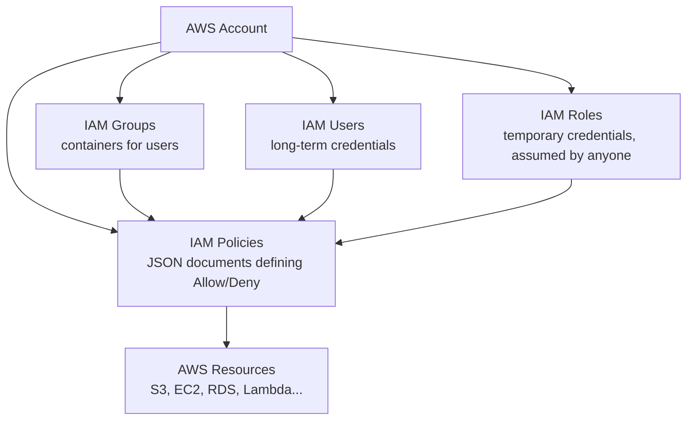

> **Key rule:** Users and roles do nothing on their own. Policies define what they can do.

### Identity Policy vs Resource Policy

| Policy Type | Attached To | Example |
|---|---|---|
| **Identity Policy** | User / Group / Role | "This role can read S3 bucket X" |
| **Resource Policy** | The resource itself | "This S3 bucket can be read by role Y" |
| **SCP** | AWS Organization OU | "No account in this OU can disable CloudTrail" |

### Role Assumption — How AWS Services Get Credentials

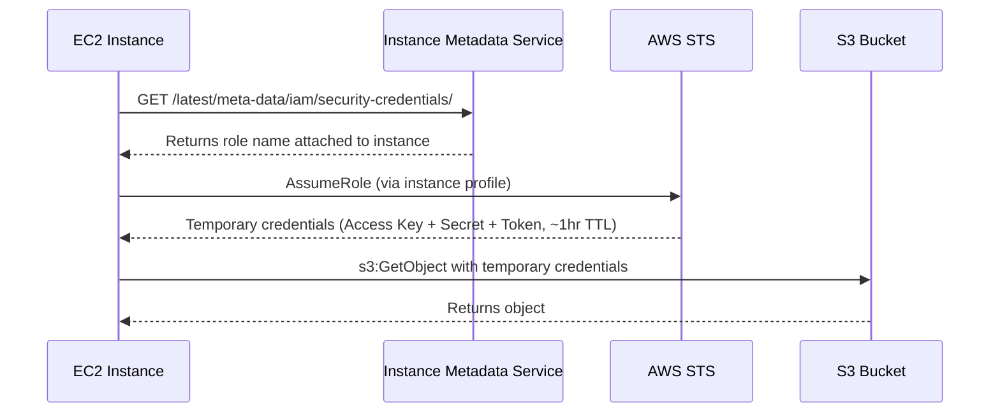

> **Best practice:** Never use long-term IAM user access keys on EC2. Always use IAM roles with temporary credentials.

### AWS Organizations and Service Control Policies (SCPs)

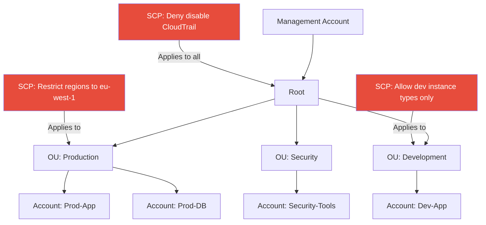

> **SCPs are guardrails, not grants.** An SCP can only restrict; it cannot grant access. Access is the intersection of the SCP and the identity policy.

### Permission Boundaries

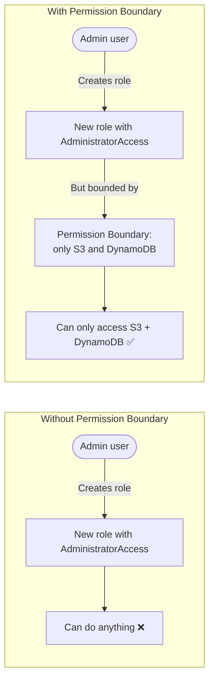

---

## 3. Azure RBAC and Entra ID

### Azure Management Hierarchy

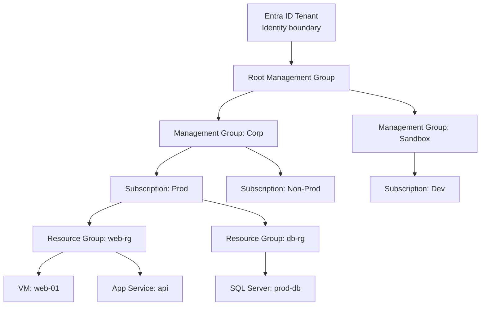

> **RBAC roles are inherited downward.** A role assigned at Management Group level applies to all subscriptions, resource groups, and resources below it.

### Azure Built-in RBAC Roles

| Role | Can Read | Can Write | Can Manage Access |
|---|---|---|---|
| **Owner** | ✅ | ✅ | ✅ |
| **Contributor** | ✅ | ✅ | ❌ |
| **Reader** | ✅ | ❌ | ❌ |
| **User Access Administrator** | ✅ | ❌ | ✅ |

### Azure PIM — Privileged Identity Management

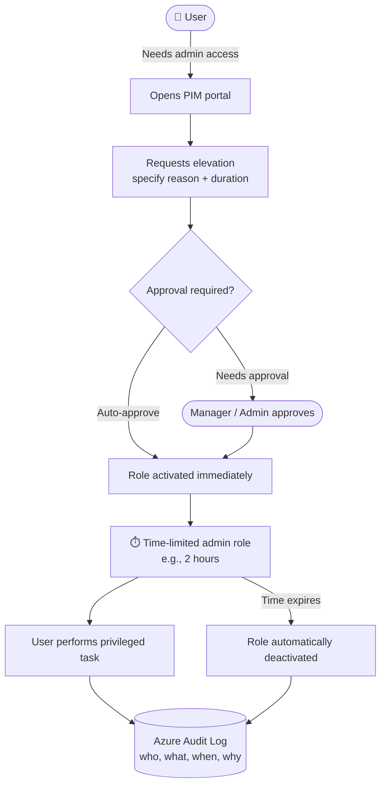

---

## 4. GCP IAM

### GCP Resource Hierarchy

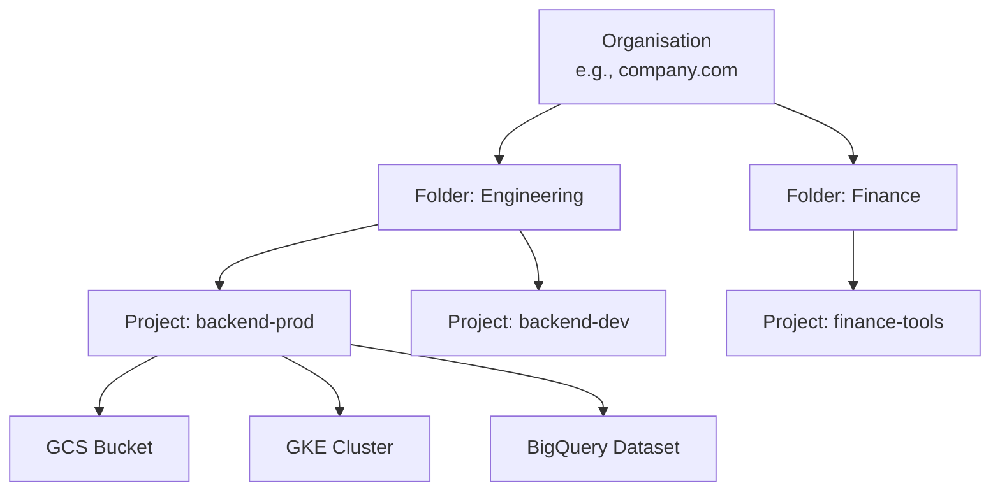

### GCP IAM Concepts

| Concept | Meaning |
|---|---|
| **Principal** | Who — a user, service account, or group |
| **Role** | What — a collection of permissions |
| **Policy** | Binds a principal to a role on a resource |

> GCP IAM uses **allow policies** (additive). There are no explicit deny policies in standard GCP IAM — the most permissive binding wins (but Org Policies can restrict).

---

## 5. Workload Identity Federation

**Simple idea:** Instead of creating long-lived service account keys, let external workloads (GitHub Actions, on-prem servers, another cloud) exchange a short-lived identity token for cloud access.

> Like a temporary visitor pass: show your company ID, get a timed badge, return it when done. No permanent key card issued.

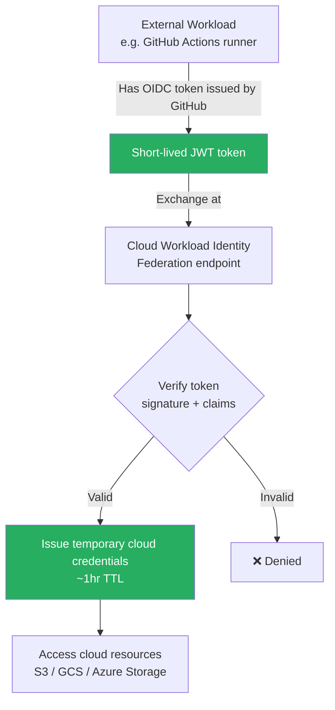

### Why this matters: No more long-lived keys

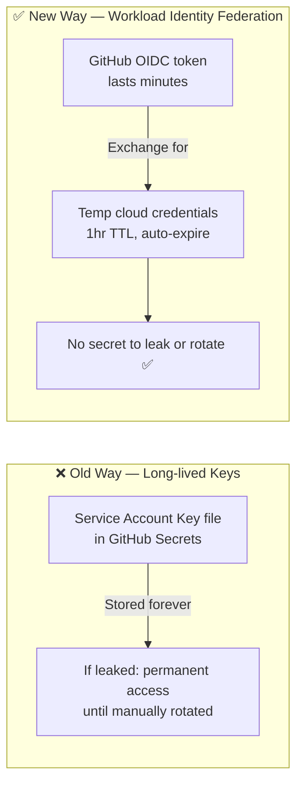

---

## 6. IMDS Credential Exposure Risk

**Simple idea:** Cloud VMs automatically get IAM credentials via the Instance Metadata Service (IMDS). If an attacker runs code on your VM (e.g., via SSRF), they can steal those credentials.

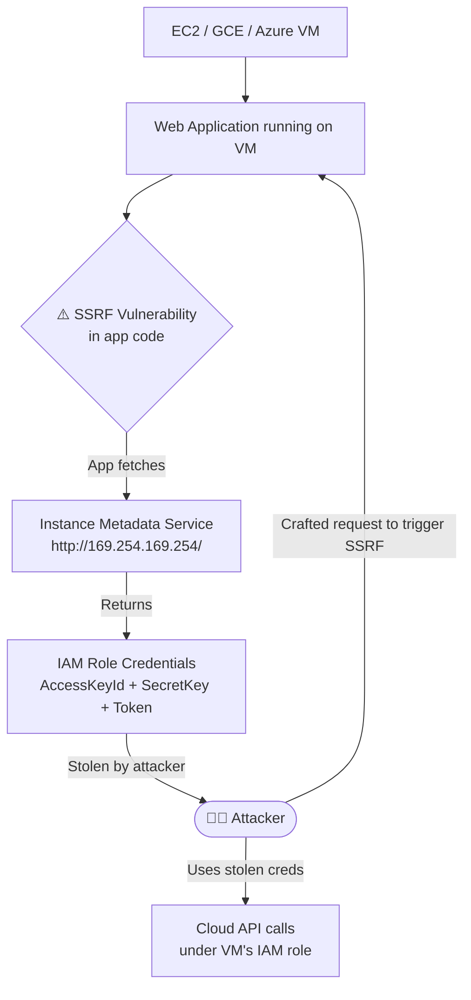

### Mitigations

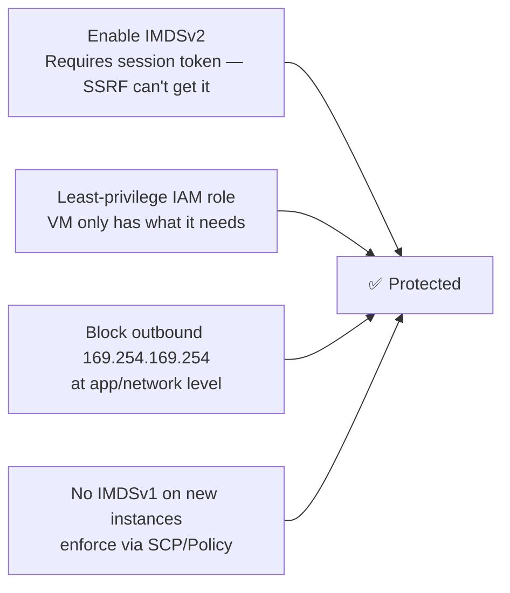

---

## 7. Cross-Cloud Identity — Key Patterns

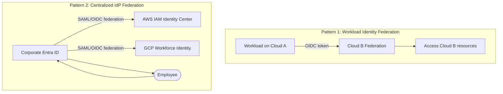

---

## Quick Reference Cheat Sheet

| Concept | AWS | Azure | GCP |
|---|---|---|---|
| **Identity units** | Users, Roles, Groups | Users, Service Principals, Managed Identities | Users, Service Accounts, Groups |
| **Policy attachment** | Identity + Resource policies | RBAC role assignments | IAM bindings (principal + role) |
| **Org-level guardrails** | SCPs | Azure Policy + Management Groups | Org Policies |
| **Privileged access** | IAM roles + temporary keys | PIM (time-bounded activation) | PAM (Privileged Access Manager) |
| **Workload identity** | IAM Roles for EC2/EKS/Lambda | Managed Identity | Workload Identity |
| **Federated external workloads** | OIDC Federation | Workload Identity Federation | Workload Identity Federation |
| **Audit logs** | CloudTrail | Azure Monitor / Activity Log | Cloud Audit Logs |
