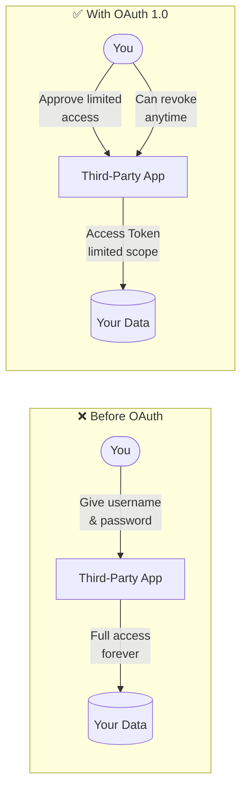
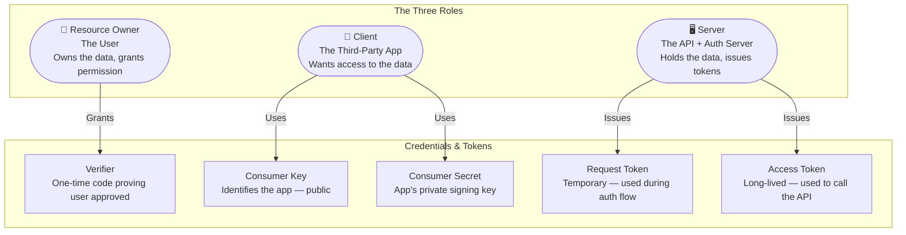
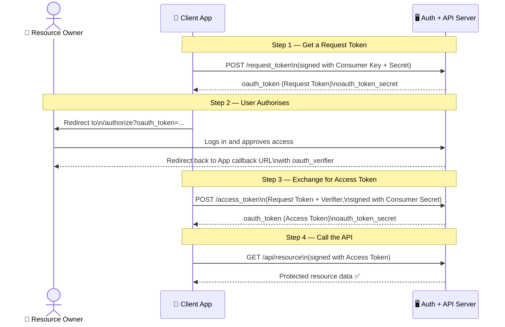
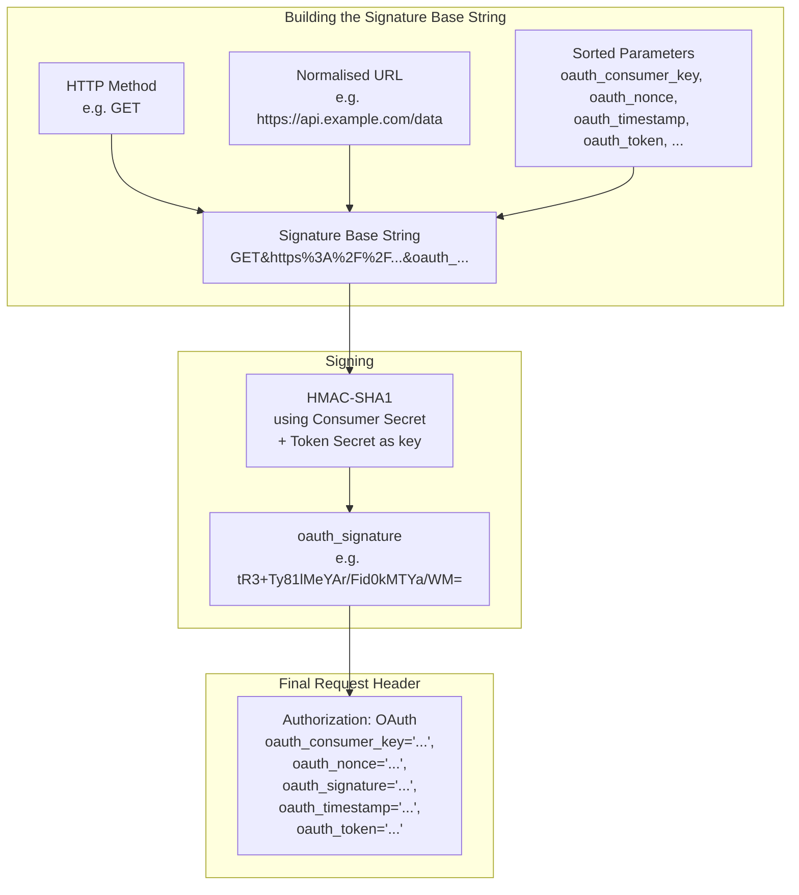
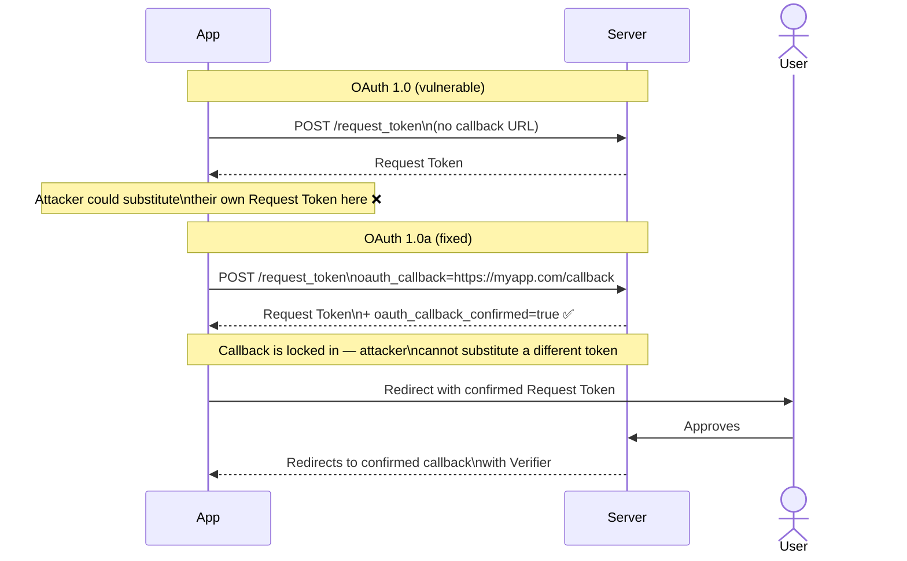
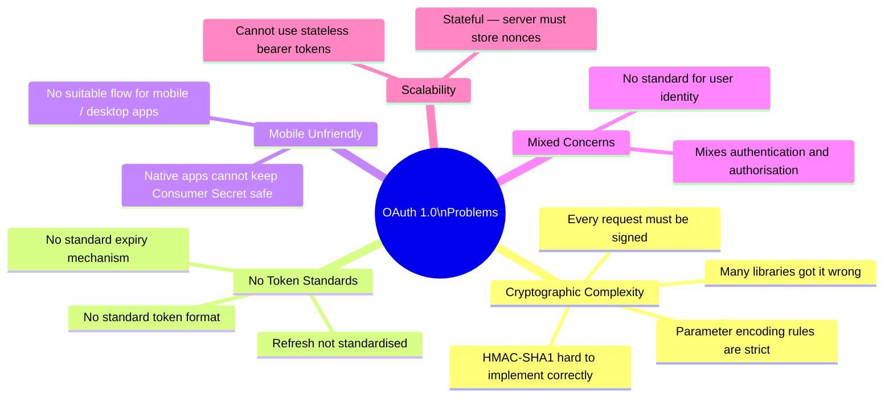
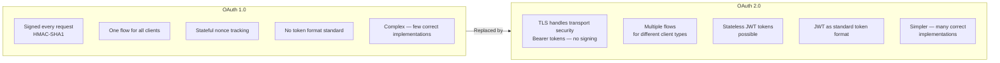
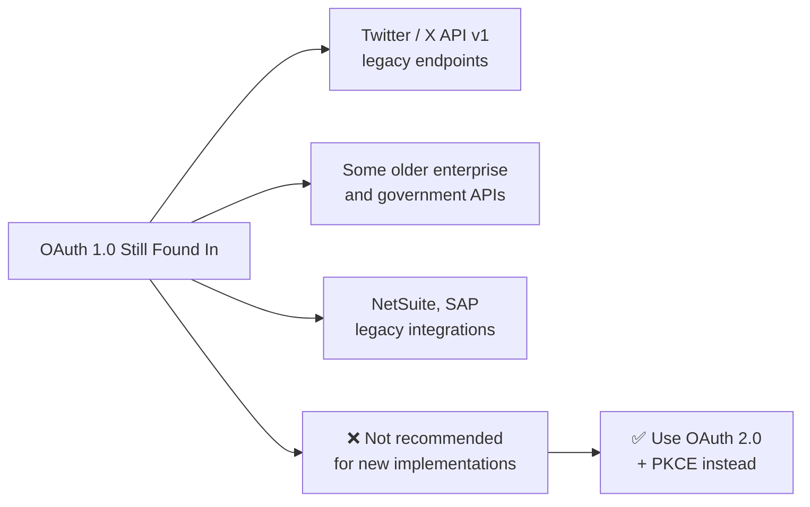

# OAuth 1.0

> The original delegated authorisation standard — how apps were first allowed to act on behalf of users without ever seeing their passwords.

---

## 1. What is OAuth 1.0?

Before OAuth existed, apps that needed access to your data would simply ask for your username and password — storing them, using them forever, and giving you no way to revoke access without changing your password.

**OAuth 1.0** (RFC 5849, 2010) solved this by introducing *delegated authorisation*: a user can grant a third-party app limited access to their data on another service, without sharing credentials.

> **Analogy:** A valet key — it only unlocks the car door and starts the engine. It cannot open the glove box, the boot, or the garage. You hand the valet the special key, not your master key.

**Why it was created:**
- Twitter needed apps to post tweets on users' behalf without storing passwords
- Early APIs (Flickr, Google, Netflix) faced the same problem
- No standard existed — every service invented its own scheme

---

## 2. Core Concepts

| Term | What it is |
|---|---|
| **Resource Owner** | The user whose data is being accessed |
| **Client** | The app requesting access |
| **Server** | The service hosting the data and handling auth |
| **Consumer Key** | Public ID of the client app |
| **Consumer Secret** | Secret key the client uses to sign requests |
| **Request Token** | Temporary token used only during the auth handshake |
| **Verifier** | Proof that the user approved access |
| **Access Token** | The credential used to call the API after authorisation |

---

## 3. OAuth 1.0 Flow (3-Legged)

The "3 legs" are the three parties: Resource Owner, Client, and Server.

---

## 4. Request Signing

Every API call in OAuth 1.0 is **cryptographically signed**. This means even if someone intercepts the request, they cannot replay or forge it.

**Why nonce and timestamp?**
- **Nonce** — a unique random value per request; the server rejects any repeated nonce
- **Timestamp** — requests older than a few minutes are rejected
- Together they prevent **replay attacks** — capturing a valid request and re-sending it

---

## 5. OAuth 1.0a (Revised)

The original OAuth 1.0 had a **session fixation vulnerability**: an attacker could inject their own Request Token into the user's authorisation flow and hijack the resulting Access Token.

**OAuth 1.0a** (the revision) fixed this:

> **Rule:** Always use OAuth **1.0a**, never the original 1.0.

---

## 6. Problems with OAuth 1.0

---

## 7. OAuth 1.0 vs OAuth 2.0 — Why the Change

| Feature | OAuth 1.0 | OAuth 2.0 |
|---|---|---|
| **Request signing** | Required (HMAC-SHA1) | Not required — relies on TLS |
| **Token format** | Opaque string | Bearer token (often JWT) |
| **Client types** | One flow for all | Separate flows (web, mobile, machine) |
| **Mobile support** | Poor | Good (PKCE flow) |
| **Complexity** | High | Lower |
| **Nonce tracking** | Required server-side | Not needed |
| **Still used?** | Legacy only | Current standard |

---

## 8. Where OAuth 1.0 Still Exists

> If you encounter OAuth 1.0 in an integration, check whether the provider offers an OAuth 2.0 endpoint. Almost all do now.

---

## 9. Quick Reference

### OAuth 1.0 Three-Legged Flow Summary

| Step | Action | Who does it |
|---|---|---|
| 1 | Request a temporary Request Token | Client → Server |
| 2 | Redirect user to authorisation page | Client → User |
| 3 | User approves, gets Verifier | User → Server → Client |
| 4 | Exchange Request Token + Verifier for Access Token | Client → Server |
| 5 | Use Access Token to call protected API | Client → Server |

### Key Terms Cheat Sheet

| Term | Simple Meaning |
|---|---|
| **Consumer Key** | Your app's public ID |
| **Consumer Secret** | Your app's private signing key — never expose |
| **Request Token** | Temporary token for the auth handshake only |
| **Verifier** | Proof the user said yes |
| **Access Token** | The credential your app uses to call the API |
| **Token Secret** | Paired with Access Token for signing API calls |
| **Nonce** | Random unique value — prevents request replay |
| **HMAC-SHA1** | The signing algorithm used to protect every request |
| **3-legged** | Involves three parties: user, app, and server |
| **OAuth 1.0a** | The fixed version — always use this, never plain 1.0 |
