# OAuth 2.0

> The industry-standard framework for delegated authorisation — letting apps access resources on a user's behalf without ever seeing their password.

---

## 1. What is OAuth 2.0?

**OAuth 2.0** (RFC 6749, 2012) is a delegated authorisation framework. It lets a user grant a third-party application limited access to their resources — without giving the app their password.

**Real-world analogy — the hotel key card:**
> You check into a hotel. The front desk (Authorisation Server) gives you a key card (Access Token) that opens only your room and the gym (Scopes). It does NOT give you the master key (your password). When you check out, the key card stops working (token expiry/revocation).

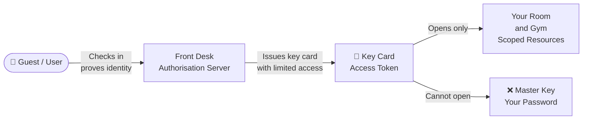

> **Important:** OAuth 2.0 is an **authorisation** framework — it controls what an app can *do*. It is NOT an authentication protocol (it does not prove who you are). That is the job of **OpenID Connect (OIDC)**, which is built on top of OAuth 2.0.

---

## 2. Core Roles

OAuth 2.0 defines four roles that interact in every flow:

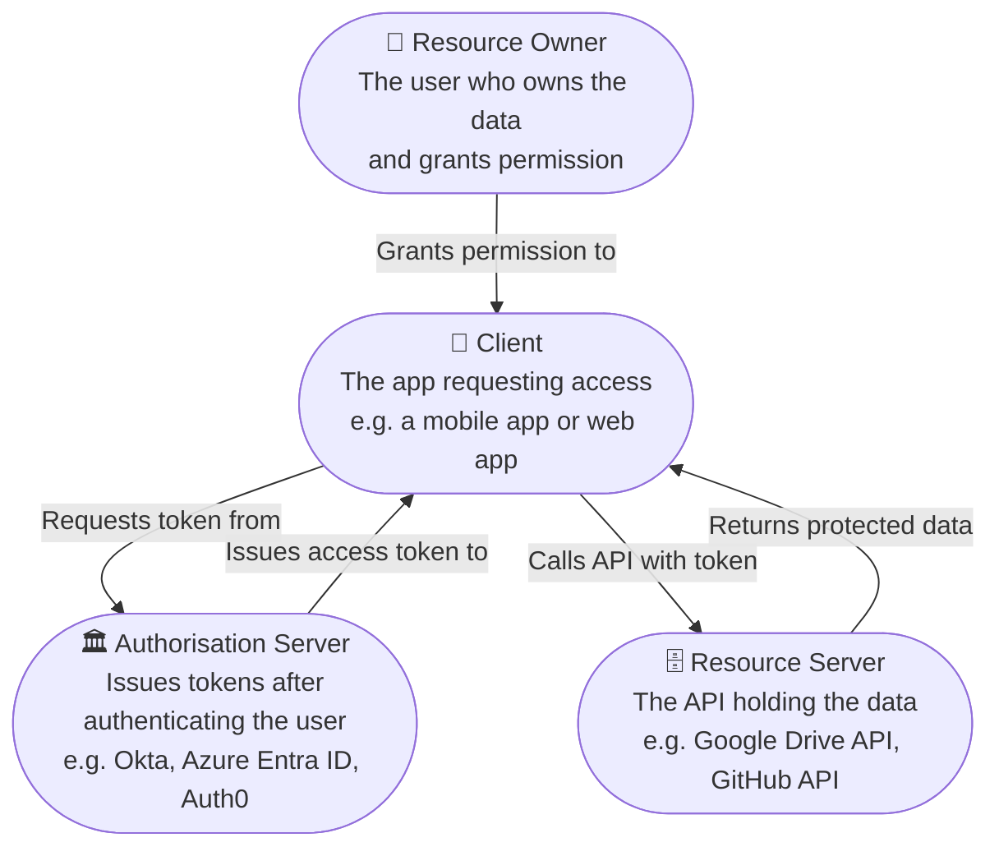

| Role | Who they are | Example |
|---|---|---|
| **Resource Owner** | The user | You, logging in |
| **Client** | The app | A photo-printing app |
| **Authorisation Server** | Issues tokens | Google Accounts, Okta |
| **Resource Server** | Holds the data | Google Photos API |

---

## 3. Tokens

### Access Token
- Short-lived credential (minutes to hours)
- Sent with every API call in the `Authorization: Bearer <token>` header
- Scoped to specific permissions

### Refresh Token
- Long-lived credential (days to months)
- Used to silently get a new access token when the current one expires
- Never sent to the resource server — only to the authorisation server

### Token Response Anatomy

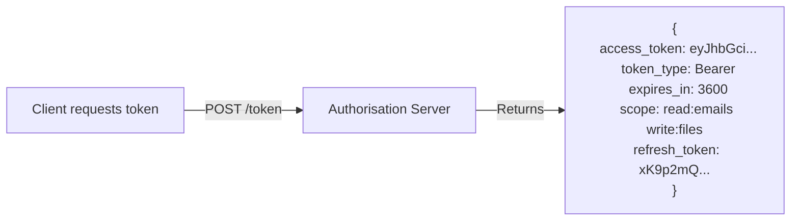

### Bearer vs DPoP (Proof-of-Possession)

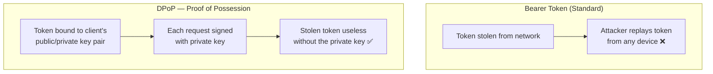

### Scopes

Scopes limit what the access token can do. The user sees and approves them on the consent screen.

| Scope | What it allows |
|---|---|
| `read:profile` | Read user's name and email |
| `write:files` | Create and edit files |
| `delete:posts` | Delete social media posts |
| `openid` | OIDC — authenticate the user |

---

## 4. Grant Types (Flows) in Depth

### 4.1 Authorization Code + PKCE (Recommended for all user-facing apps)

The most secure flow for apps where a human user is present. PKCE prevents auth code interception attacks.

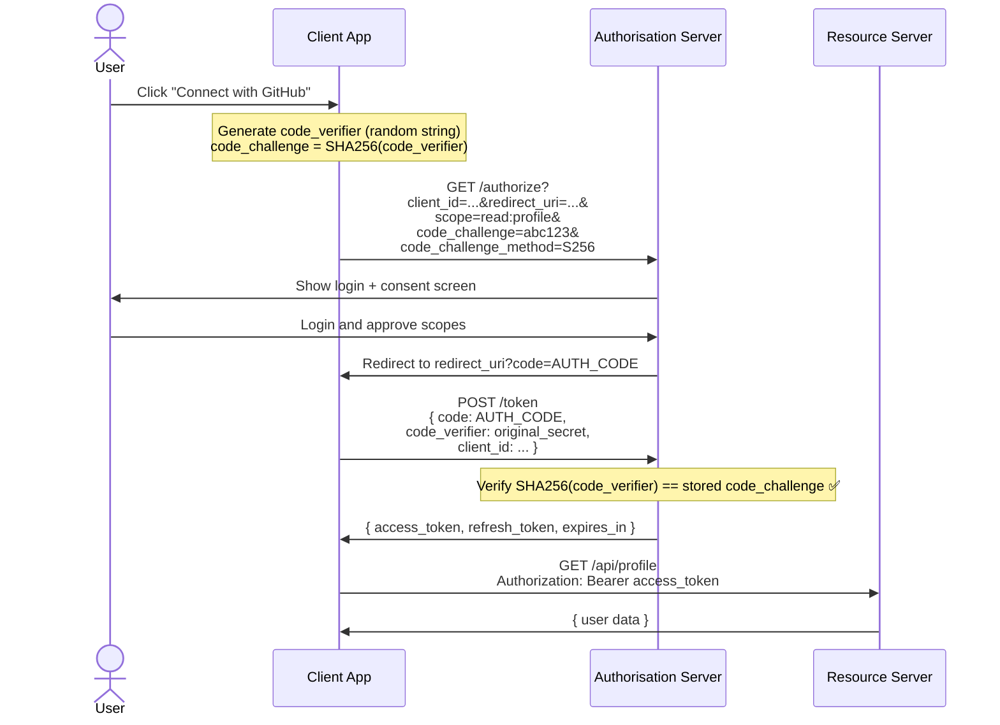

---

### 4.2 Client Credentials (Machine-to-Machine)

No user involved. Used for service-to-service communication.

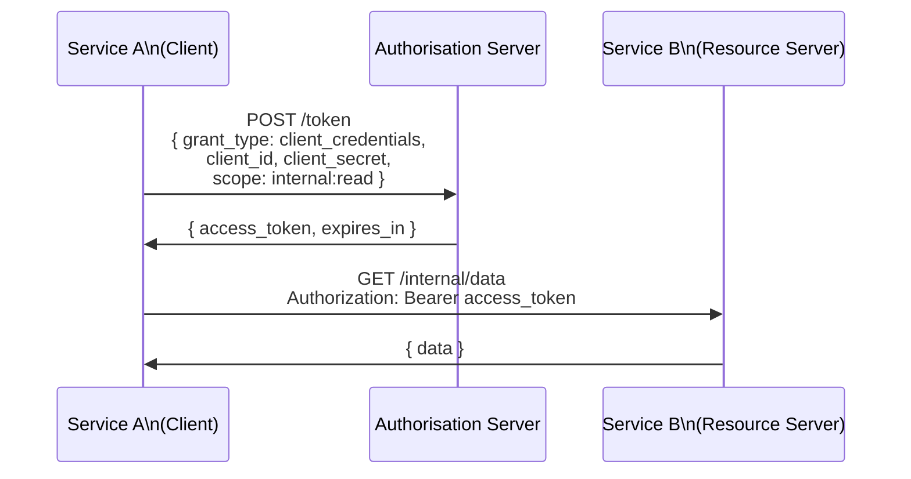

---

### 4.3 Device Authorization Grant (Browserless Devices)

For smart TVs, CLI tools, and IoT devices that cannot open a browser.

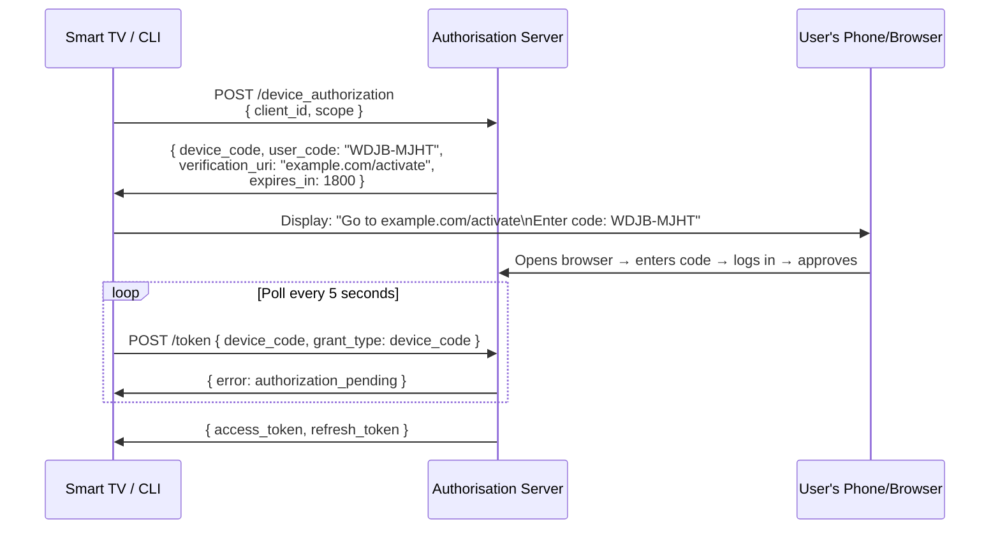

---

### 4.4 Implicit Flow ⛔ Deprecated

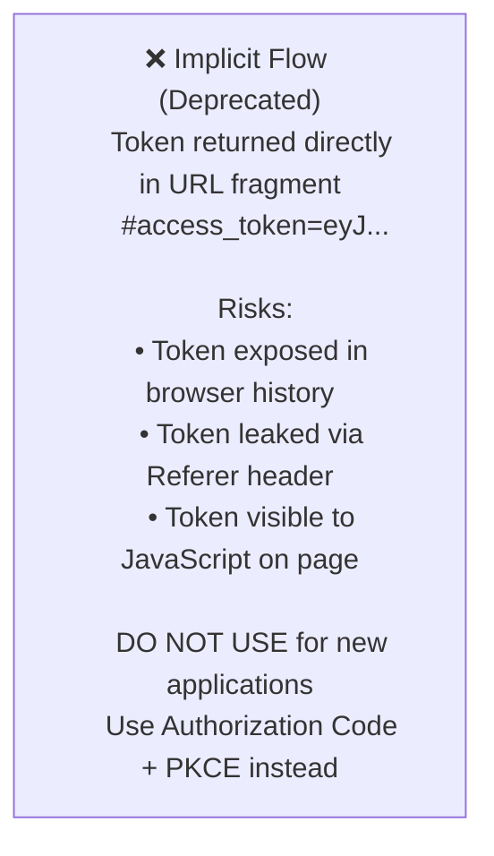

---

### 4.5 Resource Owner Password Credentials ⛔ Deprecated

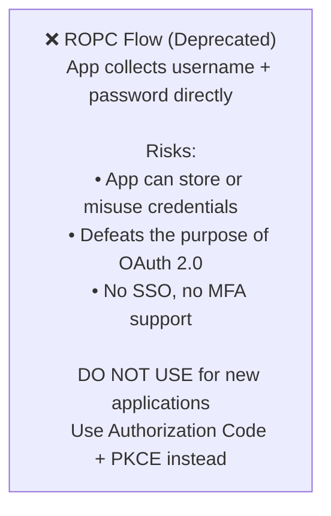

---

## 5. Scopes and Consent

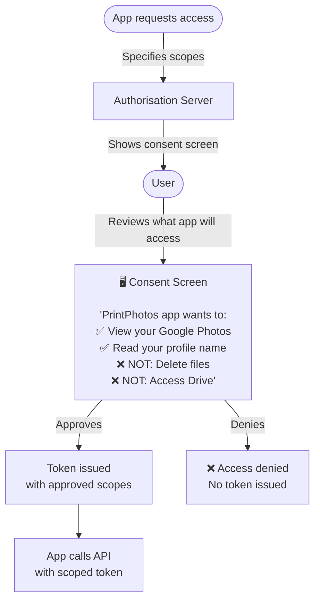

**Incremental authorisation** — request only the scopes you need right now. Ask for more later when the user triggers a feature that needs them.

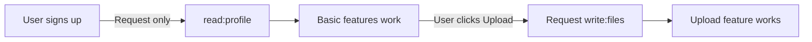

---

## 6. Token Introspection and Revocation

### Introspection (RFC 7662)
The Resource Server checks with the Authorisation Server whether a token is still valid.

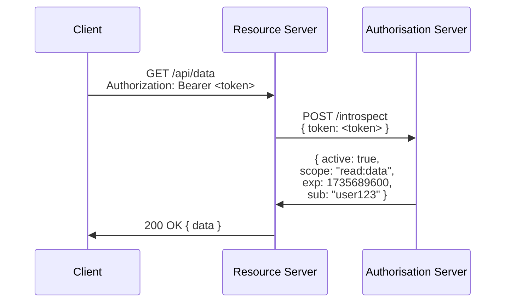

### Revocation (RFC 7009)
Immediately invalidate an access or refresh token.

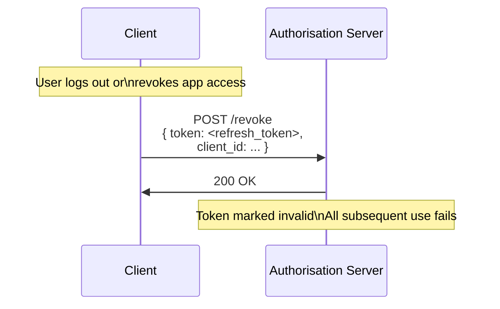

---

## 7. PKCE Deep Dive

PKCE (Proof Key for Code Exchange, RFC 7636) prevents an attacker who intercepts the auth code from exchanging it for a token.

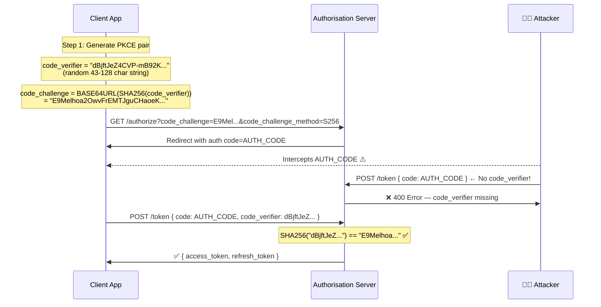

---

## 8. OAuth 2.0 Security Best Practices (RFC 9700)

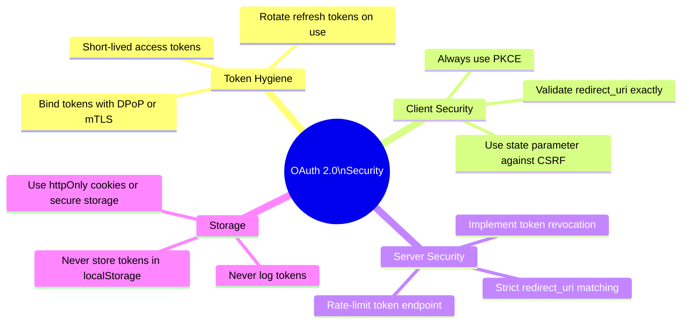

**OAuth 2.0 attack surface:**

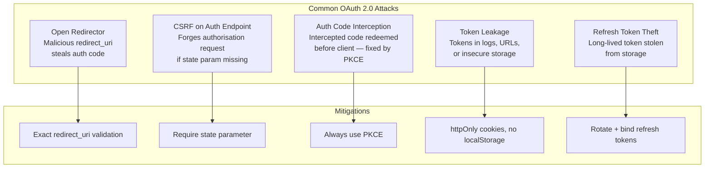

---

## 9. OAuth 2.0 vs OAuth 1.0

| Feature | OAuth 1.0 | OAuth 2.0 |
|---|---|---|
| **Year** | 2010 (RFC 5849) | 2012 (RFC 6749) |
| **Signatures** | Required on every request (HMAC-SHA1) | Not required — relies on HTTPS |
| **Token types** | Single access token | Access + Refresh tokens |
| **Flows** | One flow | Multiple grant types |
| **Mobile support** | Poor | Designed for mobile and SPAs |
| **Complexity** | Complex to implement | Simpler (but more footguns) |
| **HTTPS requirement** | Optional (signatures compensate) | Mandatory |
| **Status** | Legacy, being replaced | Current standard |

---

## 10. Quick Reference

### Grant Type Selection

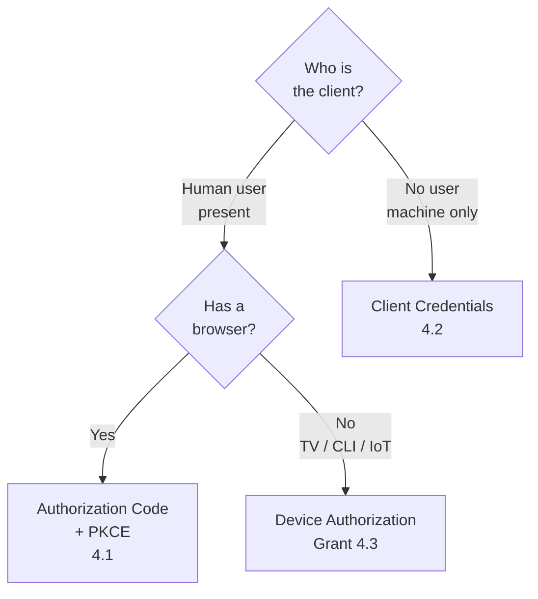

### OAuth 2.0 Endpoints

| Endpoint | Purpose |
|---|---|
| `/authorize` | Start the auth flow — redirect user here |
| `/token` | Exchange code or credentials for tokens |
| `/introspect` | Check if a token is active |
| `/revoke` | Invalidate a token |
| `/.well-known/oauth-authorization-server` | Discovery document |
| `/jwks` | Public keys to verify signed tokens |

### Security Checklist

- [ ] Use PKCE for all public clients
- [ ] Validate `redirect_uri` as exact match
- [ ] Use `state` parameter to prevent CSRF
- [ ] Store tokens in `httpOnly` cookies, not `localStorage`
- [ ] Use short-lived access tokens (≤ 1 hour)
- [ ] Rotate refresh tokens on every use
- [ ] Implement token revocation on logout
- [ ] Never log tokens or put them in URLs
- [ ] Use HTTPS everywhere — no exceptions
