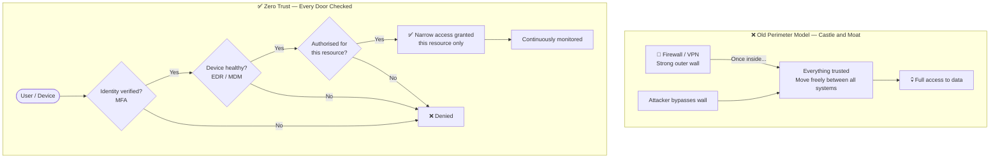
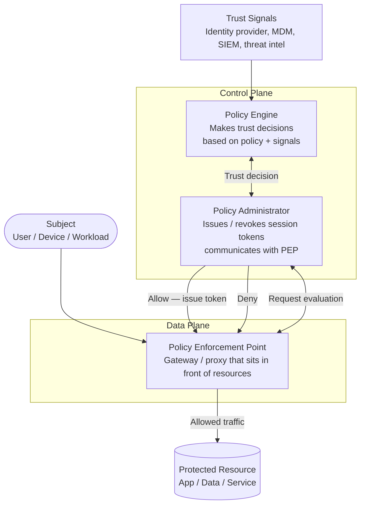
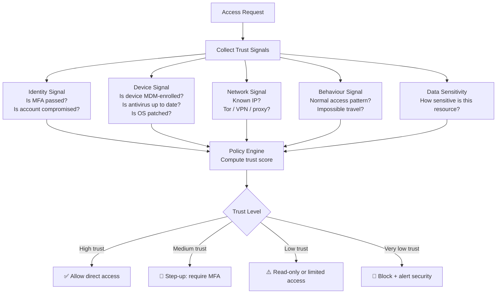
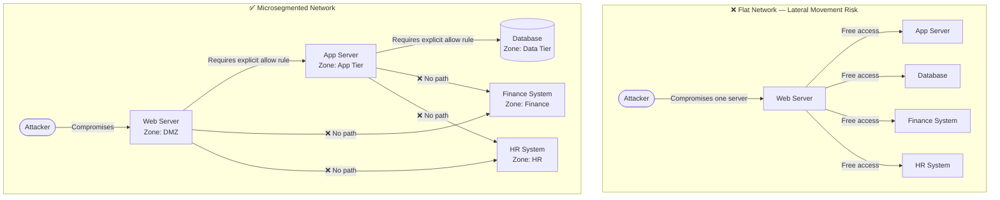
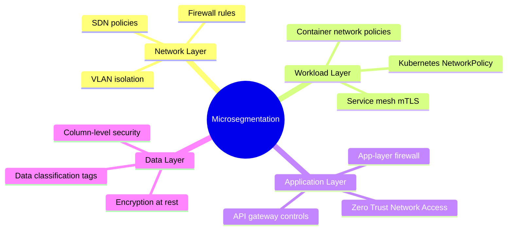
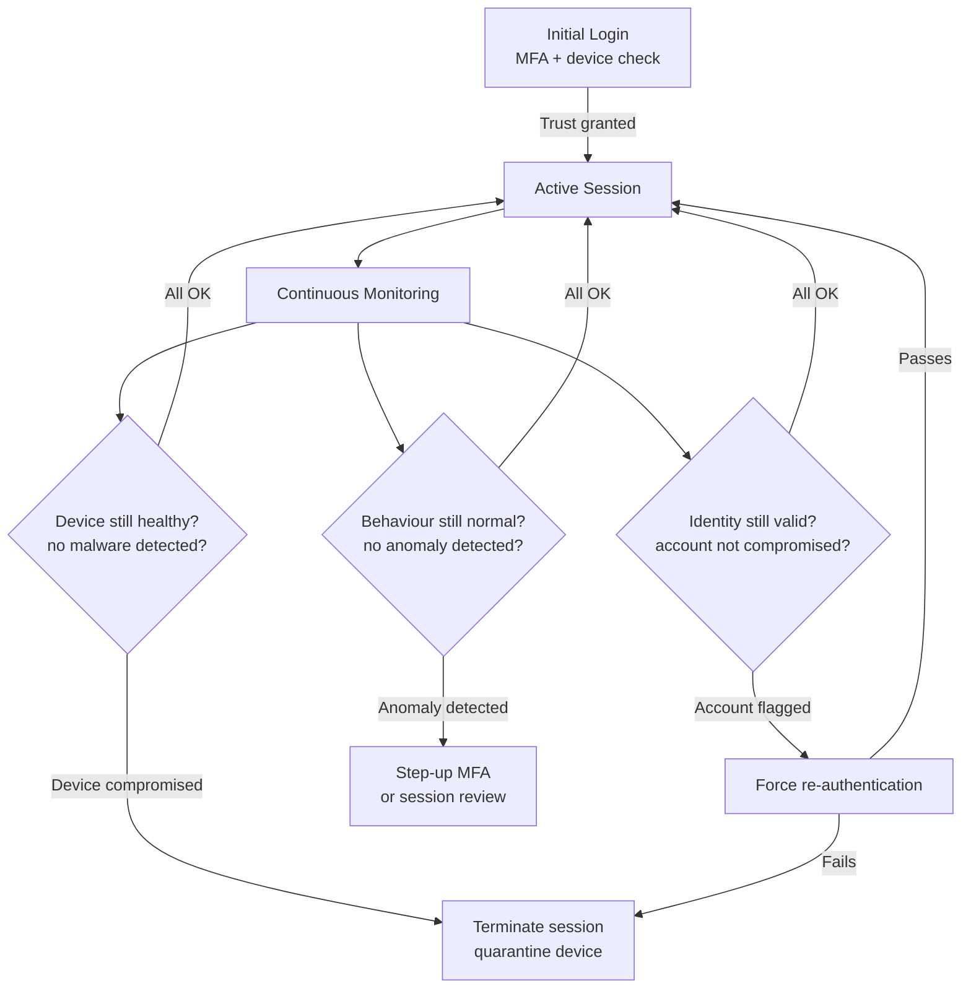
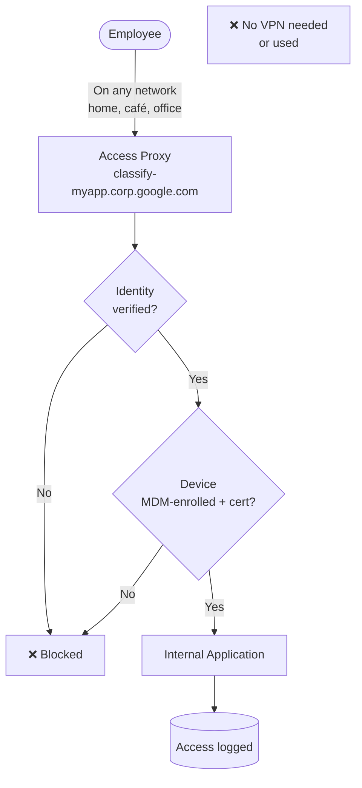
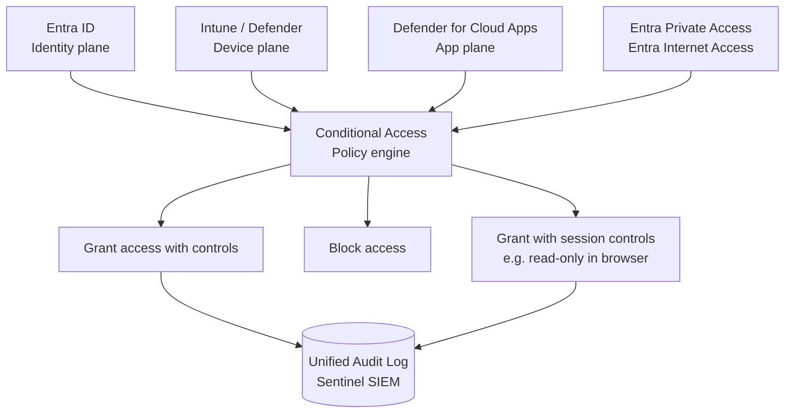

# Zero Trust Architecture (ZTA)

> Zero Trust is a security philosophy: stop trusting based on location (like "inside the network") and start trusting based on verified identity, device health, and context — every single time.

---

## 1. The Old Way vs Zero Trust

**The old model:** Build a strong wall around the network. Everyone inside the wall is trusted.
**The problem:** Attackers can get inside (phishing, VPN compromise, insider threat). Once inside — total freedom.

**Zero Trust says:** There is no "inside". Verify everyone, every time, regardless of where they are.

> Old model = castle with a moat. Zero Trust = every room in the castle has its own lock, and you need ID to enter each one.



---

## 2. NIST SP 800-207 — ZTA Reference Architecture

The US government's official ZTA standard defines three core components.



| Component | Role | Real-world Example |
|---|---|---|
| **Policy Engine (PE)** | Decides allow or deny | Entra ID Conditional Access rules |
| **Policy Administrator (PA)** | Manages session, issues access tokens | Okta / Azure AD |
| **Policy Enforcement Point (PEP)** | Sits between subject and resource; enforces the decision | Reverse proxy, ZTNA gateway, App Gateway |

---

## 3. Trust Signal Evaluation

**Simple idea:** Every access request is scored using multiple signals. The policy engine weighs them all to decide: allow, allow with extra step, or deny.



---

## 4. Microsegmentation

**Simple idea:** Instead of one big flat network, split it into tiny zones. Each zone has its own access rules. Compromise in one zone cannot spread to others.

> Like a submarine with watertight compartments. If one floods, the others stay dry.



### Segmentation layers



---

## 5. Continuous Verification

**Simple idea:** Trust is not granted once at login and never checked again. It is continuously re-evaluated throughout the session.

> Like a nightclub: they check your ID at the door, but security also watches you inside. If you start trouble, you're out.



---

## 6. Device Trust

**Simple idea:** Only allow access from devices that are known, managed, and healthy.

```mermaid
flowchart TD
    DEVICE([Device requests access]) --> CHECK[Device Trust Check]

    CHECK --> ENROLL{Is device\nMDM-enrolled?}
    ENROLL -->|No| DENY[❌ Denied\nEnrol device first]
    ENROLL -->|Yes| PATCH{Is OS patched\nand up to date?}

    PATCH -->|No| RESTRICT[⚠️ Limited access\nupdates required]
    PATCH -->|Yes| AV{Is antivirus\nrunning and current?}

    AV -->|No| RESTRICT
    AV -->|Yes| CERT{Does device\nhave valid cert?]
    CERT -->|No| DENY
    CERT -->|Yes| ALLOW[✅ Device trusted\nFull access allowed]

    ALLOW --> MONITOR[Device continuously monitored\nvia EDR]
```

---

## 7. BeyondCorp — Google's Zero Trust Model

Google built BeyondCorp after the Aurora breach in 2010. The core idea: **no VPN**. All access goes through an access proxy that enforces identity + device trust.



> **Key insight:** An employee on the internet and an attacker on the corporate network get the same treatment — both must prove identity and device trust.

---

## 8. Microsoft Zero Trust / SASE



---

## Quick Reference Cheat Sheet

| Concept | One-liner | Practical Example |
|---|---|---|
| **Never trust, always verify** | Location doesn't equal trust | VPN users still get MFA challenged |
| **Least privilege** | Minimum access, time-limited | PIM for admin roles |
| **Assume breach** | Act as if attackers are already inside | Segment network, encrypt everything |
| **Policy Engine** | The brain that decides allow/deny | Entra Conditional Access |
| **Policy Enforcement Point** | The gate that blocks/allows traffic | Reverse proxy, ZTNA gateway |
| **Microsegmentation** | Watertight compartments | Kubernetes NetworkPolicy |
| **Device trust** | Only managed, healthy devices allowed | MDM enrollment required |
| **Continuous verification** | Trust re-evaluated every request | Session risk scoring |
| **BeyondCorp** | No VPN, all via access proxy | Identity + device cert required |
