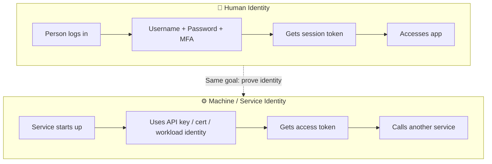
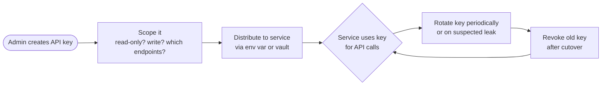
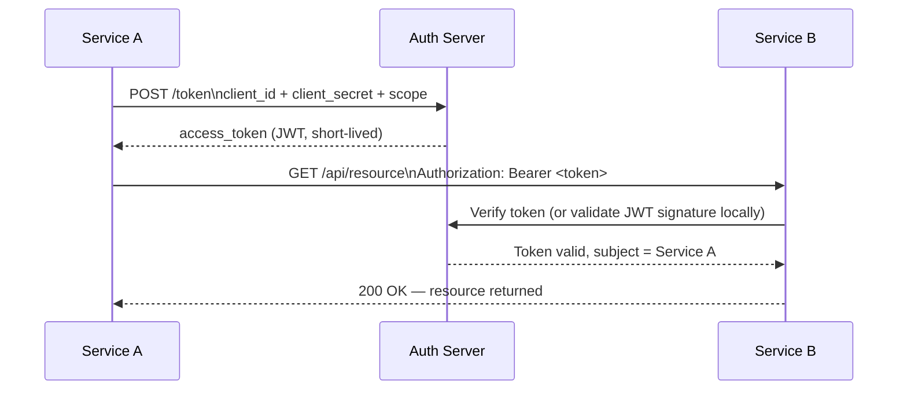
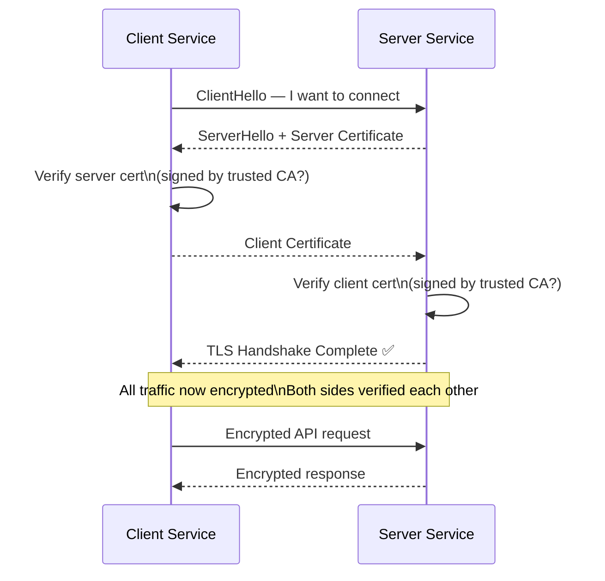
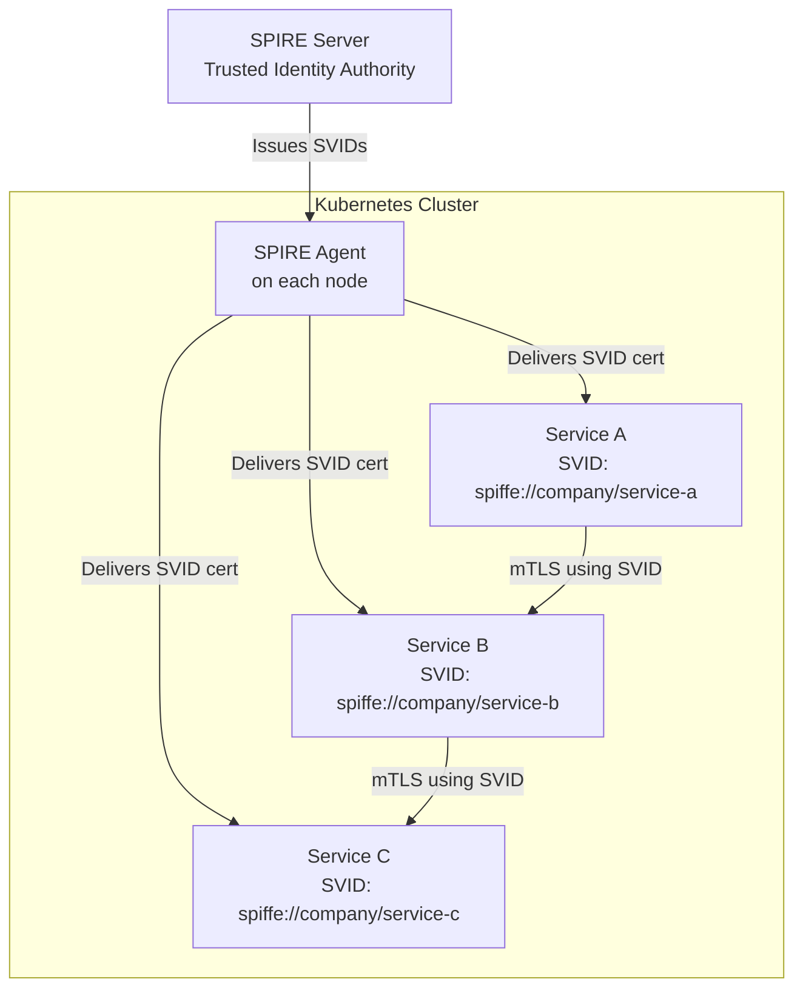
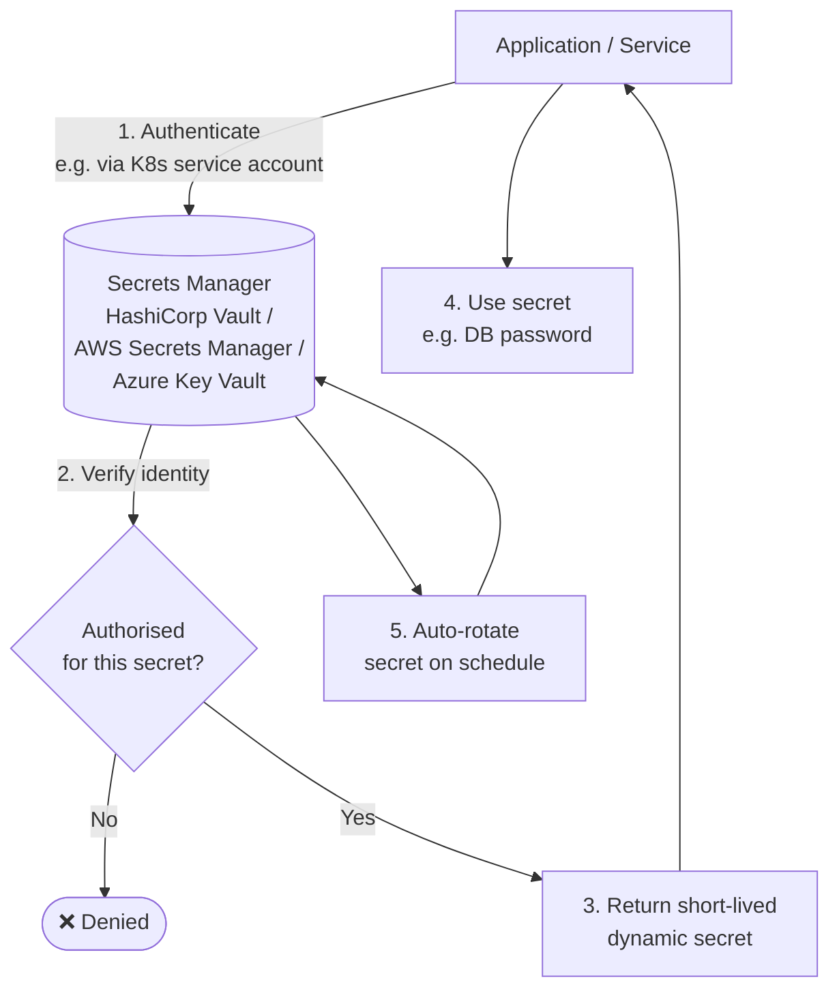
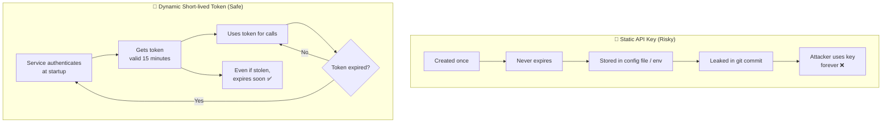

# API and Service Identity

> Simple explanations with diagrams for how machines and services prove who they are — not humans.

---

## 1. Human vs Machine Identity

We usually think of IAM for people — employees logging in with usernames and passwords. But modern applications are made of **hundreds of services** that also need to talk to each other securely.

> Think of it like this: a human shows their employee badge at the door. A service needs its own "badge" too — one that can't be forgotten, stolen from a desk, or shared around.

---

## 2. API Keys

An **API key** is a secret string that a service includes in its requests to prove its identity — like a password for a machine.

> Like a gym membership card. You hand it to the reader, it verifies you're a member, and lets you in.

### API Key Lifecycle

### Risks of API Keys

| Risk | What happens |
|---|---|
| **No expiry** | A leaked key works forever |
| **Over-scoped** | Key can do more than the service needs |
| **Stored in code** | Accidentally committed to git — public forever |
| **Shared between services** | One leak compromises everything that uses it |
| **No audit trail** | Can't tell which service made which call |

---

## 3. OAuth 2.0 Client Credentials Flow

This is the standard way for a **service to get a token** without any human involvement.

> Think of it as a service calling the front desk, saying "I'm Service A, here's my ID and secret", and getting a visitor badge to access another floor.

**Key points:**
- No user involved — purely machine-to-machine
- Token is **short-lived** (minutes/hours), limiting damage if stolen
- Service authenticates with `client_id` + `client_secret` (or certificate)

---

## 4. Mutual TLS (mTLS)

Normal TLS: **your browser verifies the server's certificate** (is this really google.com?).
mTLS: **both sides verify each other** — the server also checks the client's certificate.

> Like a spy movie where both agents must show their credentials before either talks.

**Why mTLS over API keys?**
- Certificate is tied to a cryptographic keypair — can't be copy-pasted like a string
- Automatically expired and rotated
- Identity is verified at the **transport layer**, before any application logic runs

---

## 5. Service Mesh Identity — SPIFFE / SPIRE

In a **service mesh** (e.g., Kubernetes with Istio), every microservice automatically gets a cryptographic identity called a **SVID (SPIFFE Verifiable Identity Document)**.

> Like a government issuing each citizen a chip-and-pin ID card automatically at birth. Every citizen (service) gets one, and they use it to prove identity to each other.

**Benefits:**
- Zero manually managed secrets between services
- Certs automatically rotated (every hour by default)
- Works across clouds, clusters, and VMs

---

## 6. Secrets Management

Services need **database passwords, API keys, TLS certificates** — these are secrets. Hardcoding them is dangerous. A secrets manager stores and delivers them securely.

> Think of it like a secure safe-deposit box at a bank. The service proves its identity, the bank hands over the contents, and the box auto-reseals with a new combination after each opening.

### Secrets Management Tools Compared

| Tool | Best for | Key feature |
|---|---|---|
| **HashiCorp Vault** | Multi-cloud, on-prem | Dynamic secrets, fine-grained policies |
| **AWS Secrets Manager** | AWS-native apps | Automatic RDS password rotation |
| **Azure Key Vault** | Azure-native apps | Managed HSM, tight Azure RBAC |

---

## 7. Static API Keys vs Dynamic Tokens

---

## Quick Reference Cheat Sheet

| Concept | Simple Meaning | Best Practice |
|---|---|---|
| **API Key** | Password for a service | Scope tightly, rotate regularly, never commit to code |
| **Client Credentials Flow** | Machine gets OAuth token | Use short expiry, prefer cert-based client auth |
| **mTLS** | Both sides show certificates | Use in service-to-service comms |
| **SPIFFE/SPIRE** | Auto-issued identity for every service | Use in Kubernetes / microservices |
| **Secrets Manager** | Secure vault for passwords/keys | Use dynamic secrets, never hardcode |
| **Dynamic tokens** | Short-lived, auto-expiring access | Always prefer over long-lived static keys |
