# OpenID Connect (OIDC)

[← Back to Index](README.md)

> OIDC is the identity layer built on top of OAuth 2.0 — it answers not just "what can you do?" but "who are you?"

---

## 1. What is OpenID Connect?

**OAuth 2.0** is an authorisation framework — it lets an app act on your behalf (e.g. post to Twitter). But OAuth 2.0 never defined a standard way to verify *who* you are.

**OpenID Connect (OIDC)** fixes that. It adds an identity layer on top of OAuth 2.0 so apps can authenticate users and get profile information in a standard way.

> Analogy: OAuth 2.0 gives you a hotel key card that opens your room. OIDC also tells the hotel your name, booking reference, and check-out date — it identifies you, not just grants you access.

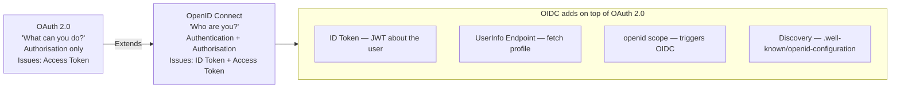

---

## 2. How OIDC Extends OAuth 2.0

OIDC makes four key additions to OAuth 2.0:

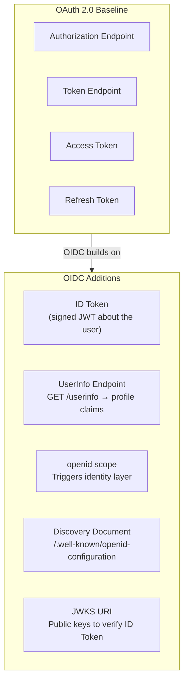

| OAuth 2.0 | OIDC adds |
|---|---|
| Access Token (what you can do) | ID Token (who you are) |
| Token Endpoint | UserInfo Endpoint |
| `scope: read write` | `scope: openid profile email` |
| No standard discovery | `.well-known/openid-configuration` |

---

## 3. The ID Token

The **ID Token** is a signed JWT issued by the Identity Provider (IdP) after the user authenticates. It is proof of authentication — not for accessing APIs.

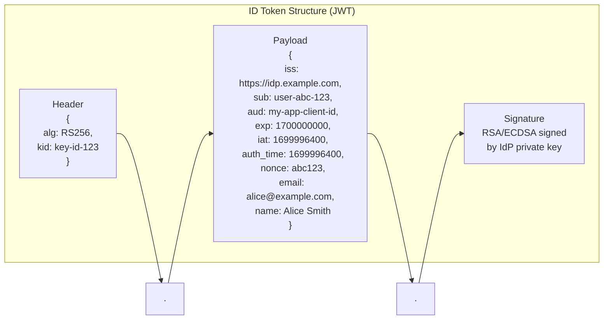

**Key claims explained:**

| Claim | Meaning | Why it matters |
|---|---|---|
| `iss` | Issuer — who issued the token | Validate it matches your IdP |
| `sub` | Subject — unique user ID | Stable identifier — never changes |
| `aud` | Audience — intended recipient | Must match your client ID |
| `exp` | Expiry timestamp | Reject tokens past this time |
| `iat` | Issued at timestamp | Token freshness check |
| `auth_time` | When user actually authenticated | For max_age enforcement |
| `nonce` | Random value from your request | Prevents replay attacks |
| `acr` | Authentication Context Class Ref | What auth method was used |
| `amr` | Authentication Methods References | e.g. `["pwd","mfa"]` |

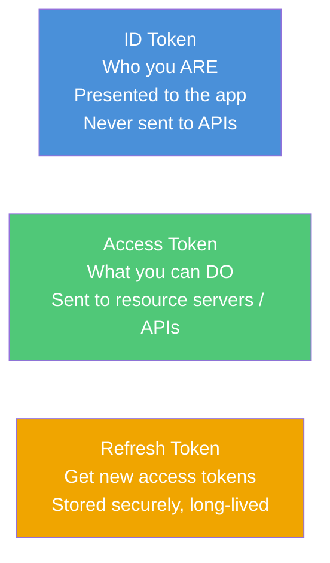

---

## 4. OIDC Authentication Flows

### 4.1 Authorization Code Flow (Recommended)

The most secure flow — the token never passes through the browser.

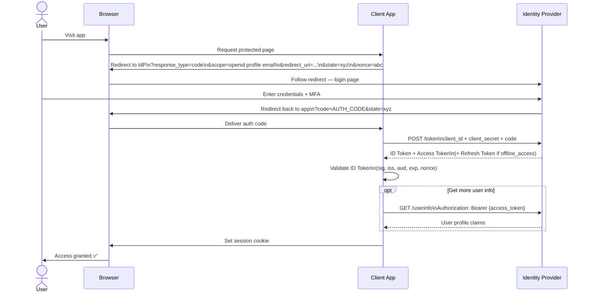

### 4.2 Authorization Code + PKCE (for public clients)

Used by SPAs and mobile apps that cannot keep a client secret.

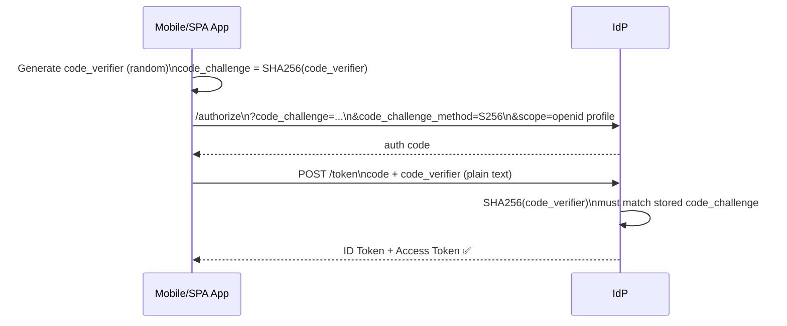

### 4.3 Implicit Flow (Deprecated — do not use)

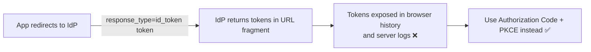

---

## 5. UserInfo Endpoint

After authentication, the app can call the **UserInfo endpoint** using the access token to fetch additional profile claims.

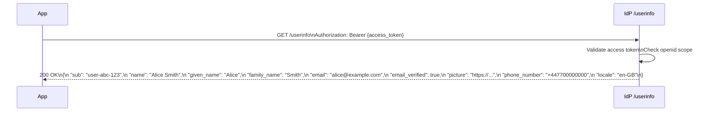

> **Note:** Claims in the ID Token are minimal by design. The UserInfo endpoint provides richer profile data without bloating every token.

---

## 6. OIDC Discovery

OIDC providers publish a **discovery document** so clients can configure themselves automatically without hardcoding endpoints.

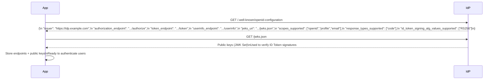

---

## 7. OIDC Scopes and Claims

The `openid` scope is **mandatory** — including it is what makes an OAuth 2.0 request become an OIDC authentication request.

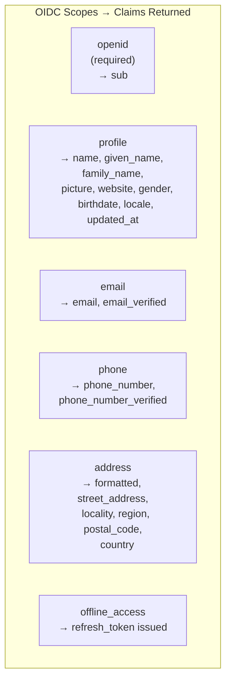

**Example request with scopes:**
```
GET /authorize
  ?client_id=my-app
  &scope=openid profile email
  &response_type=code
  &redirect_uri=https://app.example.com/callback
  &nonce=random-value
```

---

## 8. OIDC in Practice

### 8.1 Social Login ("Sign in with Google")

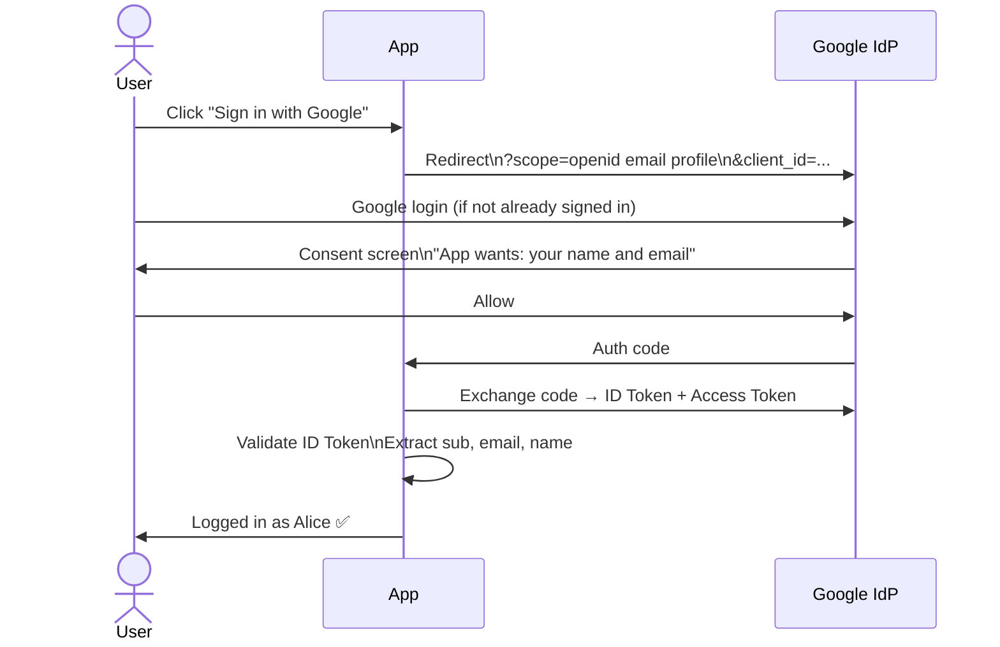

### 8.2 Enterprise SSO via Okta / Entra ID

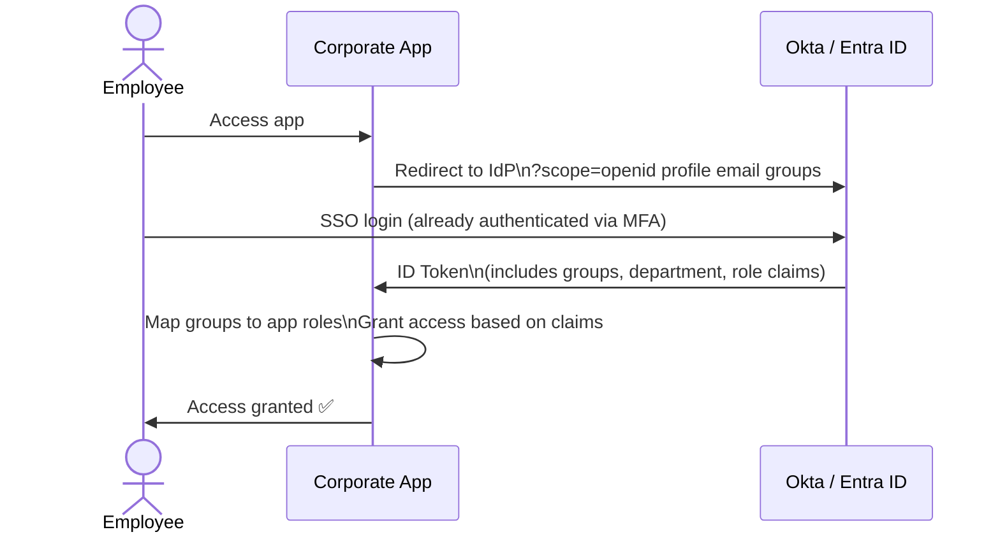

### 8.3 Mobile App (Authorization Code + PKCE)

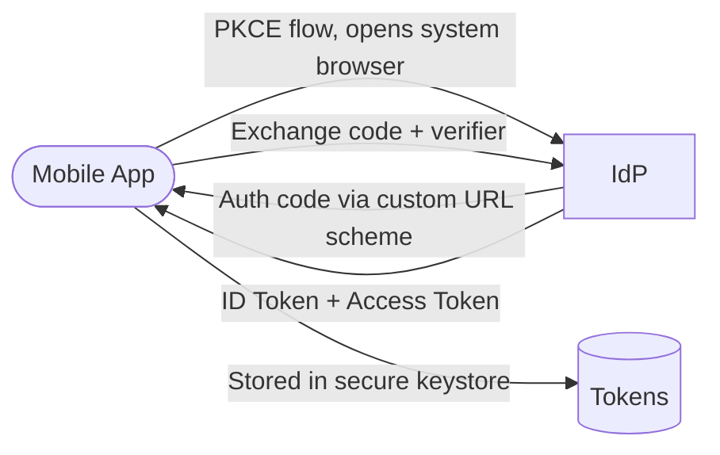

---

## 9. OIDC vs SAML

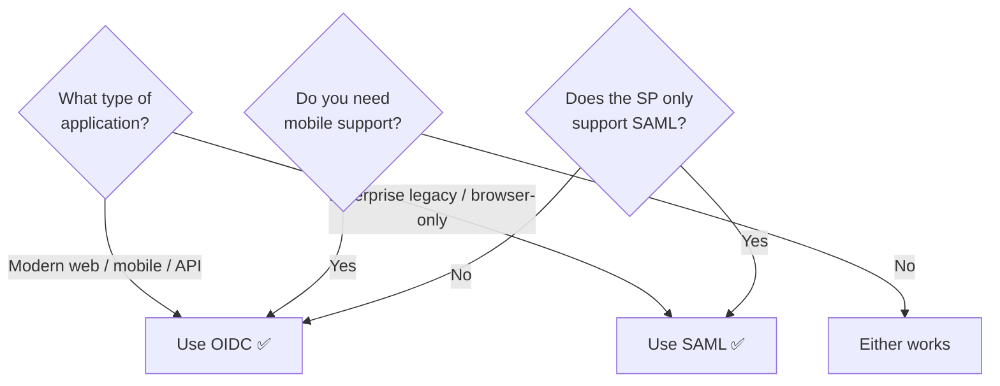

| Feature | OIDC | SAML 2.0 |
|---|---|---|
| Token format | JWT (JSON) | XML Assertion |
| Transport | REST / HTTP | Browser redirect / POST |
| Mobile support | Native ✅ | Poor ❌ |
| API access | Built-in (access token) | Needs workaround |
| Setup complexity | Low | Medium–High |
| Enterprise adoption | Growing | Dominant (legacy) |
| Spec complexity | Moderate | High |
| Discovery | Automatic | Manual metadata exchange |

---

## 10. OIDC Security Considerations

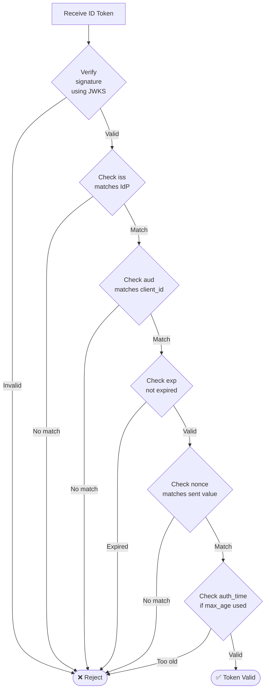

**Security checklist:**

| Check | Why |
|---|---|
| Verify signature (RS256/ES256) | Ensures token came from the real IdP |
| Validate `iss` | Prevents tokens from rogue IdPs |
| Validate `aud` | Prevents token substitution attacks |
| Check `exp` | Reject stale tokens |
| Validate `nonce` | Prevents replay attacks |
| Use PKCE | Protects auth code from interception |
| Validate `redirect_uri` | Prevents open redirect attacks |
| Never use `alg: none` | Unsigned tokens are always invalid |

---

## 11. Quick Reference

### OIDC Endpoints

| Endpoint | Purpose |
|---|---|
| `/.well-known/openid-configuration` | Discovery — all other endpoints |
| `/authorize` | Start authentication, get auth code |
| `/token` | Exchange code for ID + Access Token |
| `/userinfo` | Fetch user profile claims |
| `/jwks.json` | Public keys to verify ID Token |
| `/logout` | End session at IdP |

### ID Token Claims Cheat Sheet

| Claim | Required | Description |
|---|---|---|
| `iss` | ✅ | Issuer URL |
| `sub` | ✅ | Unique user identifier |
| `aud` | ✅ | Your client_id |
| `exp` | ✅ | Expiry (Unix timestamp) |
| `iat` | ✅ | Issued at (Unix timestamp) |
| `nonce` | If sent | Replay prevention value |
| `auth_time` | If requested | When user authenticated |
| `acr` | Optional | Auth context (e.g. MFA level) |
| `amr` | Optional | Methods used (pwd, mfa, etc.) |

### OIDC vs OAuth 2.0 vs SAML

| | OIDC | OAuth 2.0 | SAML 2.0 |
|---|---|---|---|
| Purpose | AuthN + AuthZ | AuthZ only | AuthN |
| Token | ID Token (JWT) + Access Token | Access Token | XML Assertion |
| Standard body | OpenID Foundation | IETF | OASIS |
| Discovery | ✅ Automatic | ❌ | ❌ Manual metadata |
| Mobile-friendly | ✅ | ✅ | ❌ |
| Enterprise legacy | Growing | N/A | Dominant |
