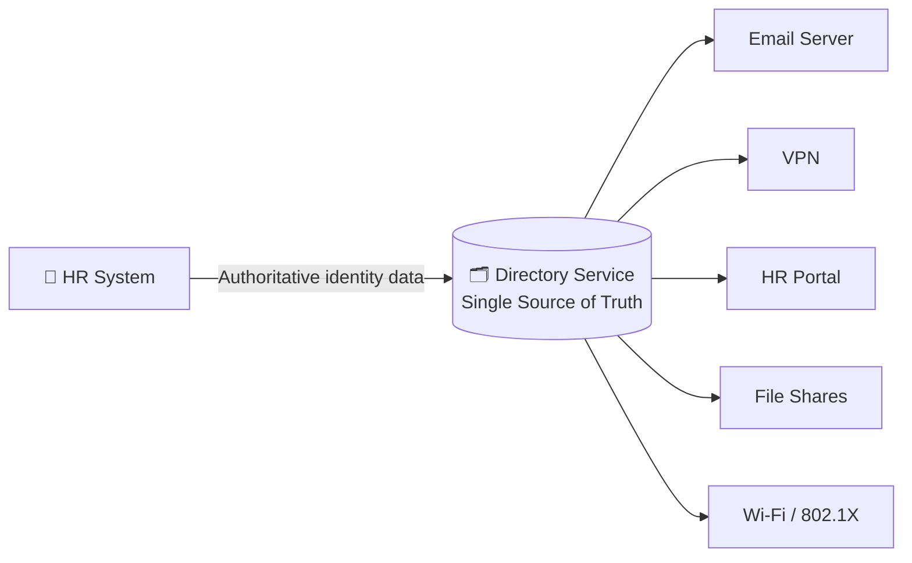
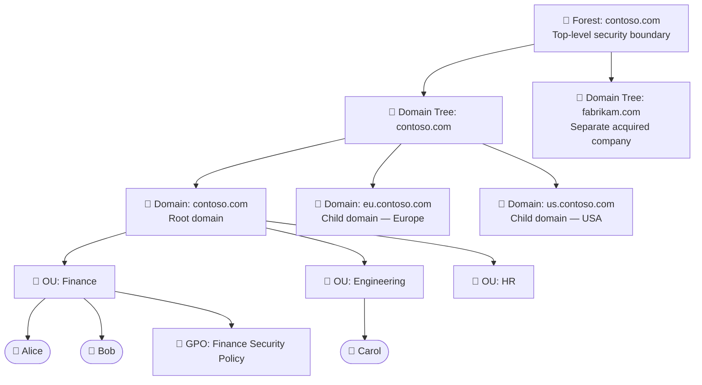
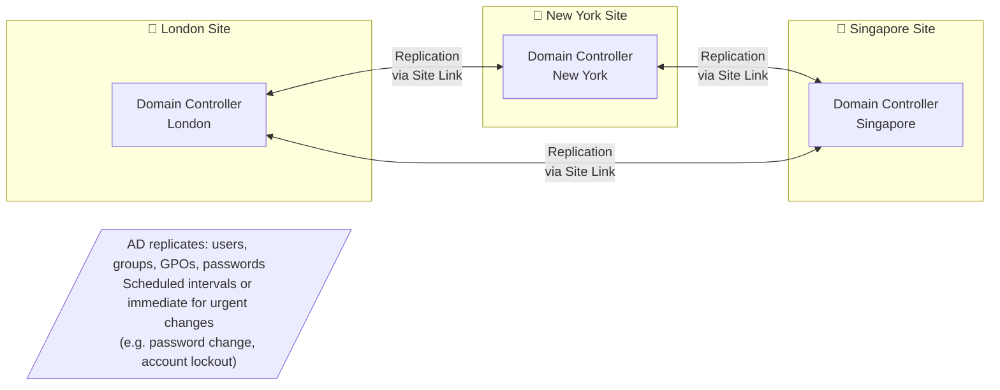
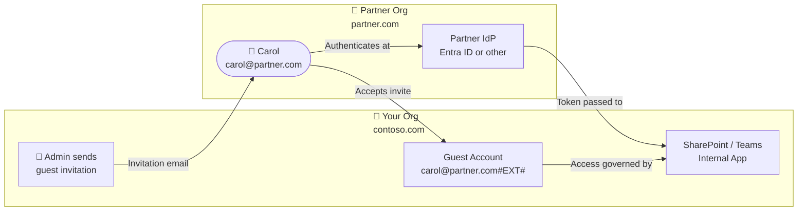
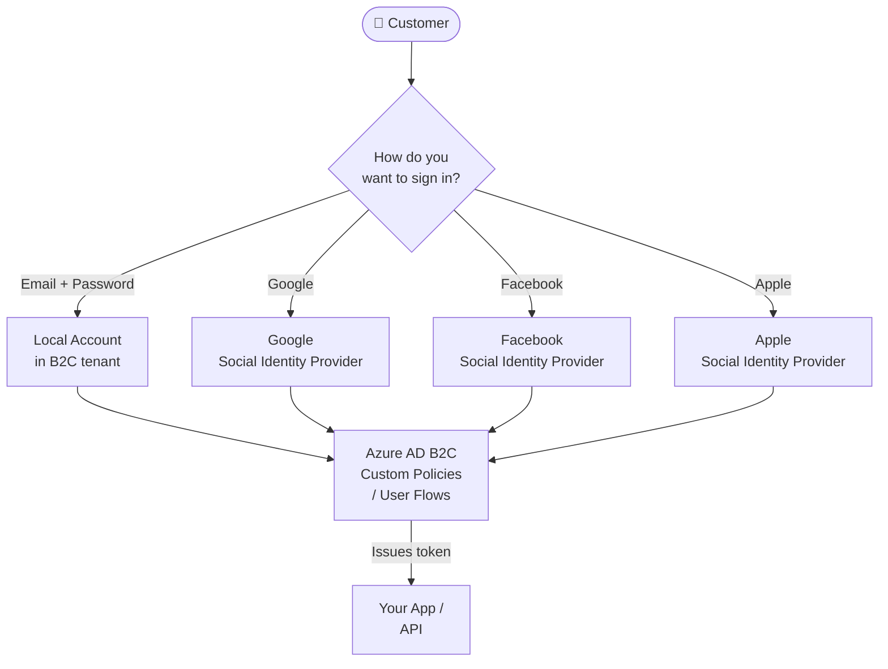
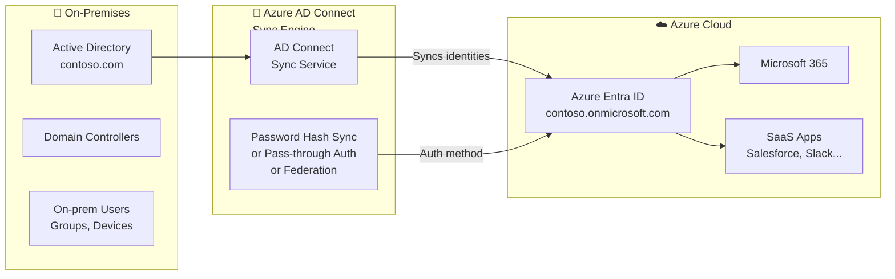
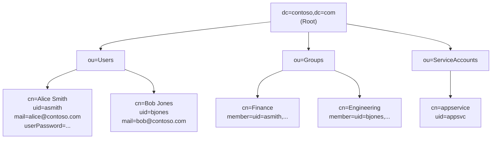
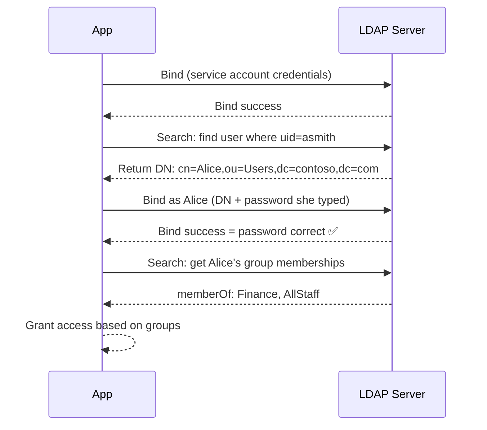
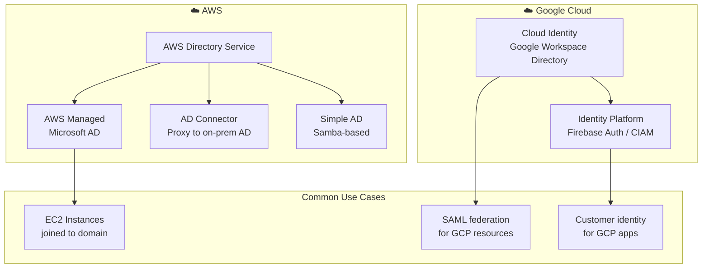

# Directory Services

[← Back to Index](README.md)

> A directory service is the phonebook of your IT environment — it stores who exists, what groups they belong to, and what they're allowed to do.

---

## What is a Directory Service?

Imagine your company has 5,000 employees. Every app — email, HR system, file server, VPN — needs to know who those people are, what their role is, and whether they're still employed.

A **directory service** is the central store for all that identity data. Apps ask the directory instead of maintaining their own user database.



---

## 1. Active Directory (AD)

**Active Directory Domain Services (AD DS)** is Microsoft's on-premises directory service. It organises users and computers into a hierarchy.

> Think of AD like a **company org chart**, but for IT. At the top is the company (forest), then departments (domains), then teams (OUs).

### AD Structure



### AD Replication Between Sites

Companies have offices in multiple cities. Each site has its own **Domain Controller (DC)**. Changes replicate between them.



---

## 2. Azure Entra ID (formerly Azure AD)

**Azure Entra ID** is Microsoft's cloud-based identity platform. It is NOT just AD in the cloud — it uses different protocols (OIDC/OAuth instead of Kerberos/LDAP) and has different concepts.

> Think of Entra ID as the **cloud evolution** of Active Directory — designed for internet-scale, SaaS apps, and remote workers.

### Entra ID Tenant Structure

```mermaid
flowchart TD
    TENANT[☁️ Entra ID Tenant\ncontoso.onmicrosoft.com\nTop-level security boundary]

    TENANT --> USERS[👥 Users]
    TENANT --> GROUPS[👨‍👩‍👦 Groups]
    TENANT --> APPS[📱 Enterprise Applications\nSaaS registrations]
    TENANT --> DEVICES[💻 Devices\nAzure AD joined / registered]
    TENANT --> ROLES[🔑 Directory Roles\nGlobal Admin, etc.]

    USERS --> U1([Alice — Member])
    USERS --> U2([Bob@partner.com — Guest])

    APPS --> APP1[Salesforce]
    APPS --> APP2[Slack]
    APPS --> APP3[Custom Internal App]
```

### Azure AD B2B — External Partner Access

B2B (Business-to-Business) lets partners use their own identity to access your resources — no need to create accounts for them.



### Azure AD B2C — Customer Identity

B2C (Business-to-Consumer) is for external customers — think millions of users registering on your website.



### Hybrid Identity — On-Prem AD + Azure Entra ID

Most companies start with on-prem AD and gradually move to cloud. **Azure AD Connect** bridges the two.



---

## 3. OpenLDAP — LDAP Directory

**LDAP (Lightweight Directory Access Protocol)** is the open standard that Active Directory is also built on. OpenLDAP is the open-source implementation.

> LDAP is the **language** directories speak. AD is a directory that speaks LDAP (among others).

### LDAP Directory Information Tree (DIT)



> Every entry in LDAP has a **Distinguished Name (DN)** — a unique path.
> Example: `cn=Alice Smith,ou=Users,dc=contoso,dc=com`

### How an App Authenticates Against LDAP



---

## 4. Cloud Directory Services



---

## Directory Services Comparison

| Feature | On-Prem AD DS | Azure Entra ID | OpenLDAP |
|---|---|---|---|
| **Protocol** | Kerberos, LDAP, NTLM | OIDC, OAuth 2.0, SAML | LDAP, LDAPS |
| **Location** | On-premises | Cloud (SaaS) | On-prem or cloud |
| **Management** | Group Policy (GPOs) | Conditional Access, Intune | Manual / overlays |
| **Device join** | Domain join | Azure AD join / Hybrid | N/A |
| **Best for** | Traditional corp IT | Cloud-first / hybrid | Linux, open-source apps |
| **MFA** | Via ADFS / NPS | Built-in | Via RADIUS/LDAP proxy |
| **Cost** | Windows Server license | Per-user subscription | Free / open-source |

---

## Quick Reference Cheat Sheet

| Concept | One-liner | Key Rule |
|---|---|---|
| **AD Forest** | Top-level security boundary | Cross-forest trust = explicit configuration needed |
| **AD Domain** | Replication and policy boundary | GPOs apply at domain/OU level |
| **OU** | Organisational container | Used to scope GPOs and delegate admin |
| **DC** | Domain Controller | Holds a copy of AD, handles authentication |
| **Entra ID** | Cloud identity platform | OIDC/OAuth, not Kerberos/LDAP |
| **B2B** | Guest access for partners | They authenticate at their own IdP |
| **B2C** | Consumer identity at scale | Supports social login, millions of users |
| **Hybrid Join** | On-prem AD + cloud Entra ID | Azure AD Connect syncs identities |
| **LDAP DN** | Unique path to a directory entry | `cn=Alice,ou=Users,dc=contoso,dc=com` |
| **OpenLDAP** | Open-source LDAP server | Protocol-compatible with AD for simple lookups |
