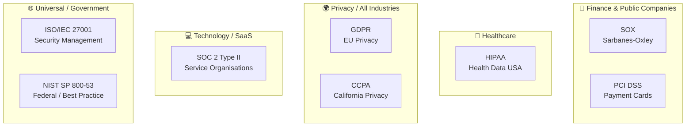
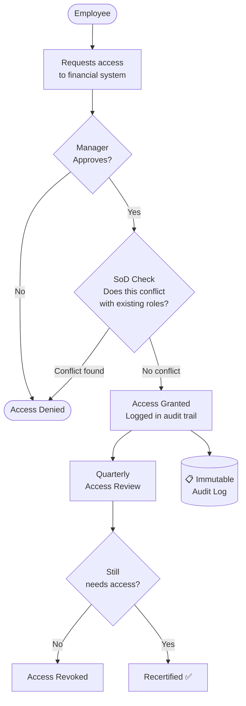
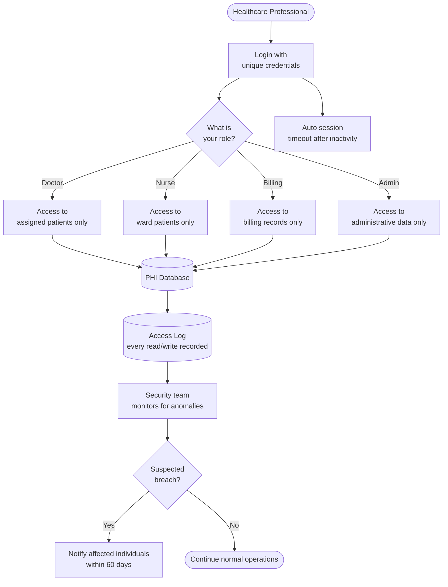
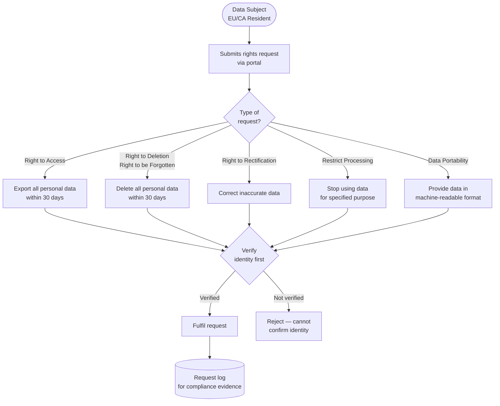
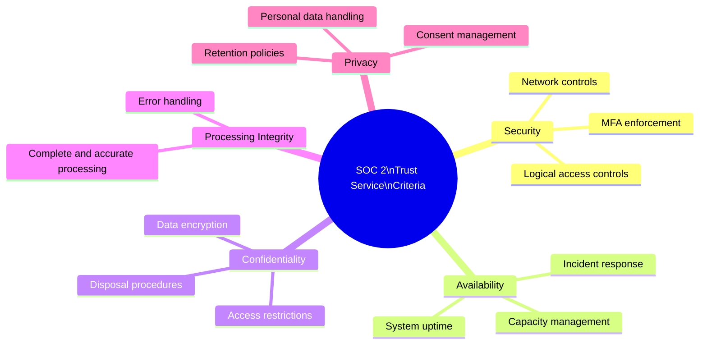
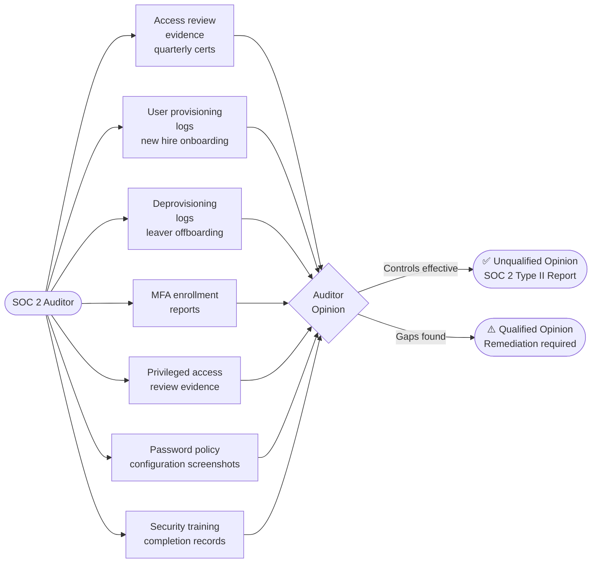
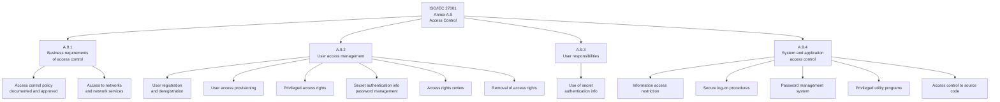
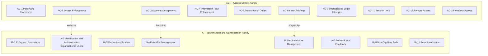
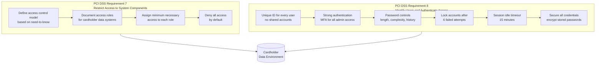
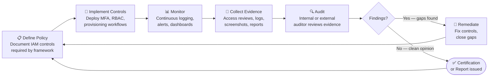

# IAM Compliance and Regulatory Frameworks

> Simple explanations of the major laws and standards that shape how organisations manage identity and access.

---

## Why Compliance Matters for IAM

Think of compliance frameworks as **building codes for identity security**. Just as a building code tells architects what fire exits are required, compliance frameworks tell organisations what access controls, audit trails, and identity practices they must have.

Non-compliance can mean fines, legal liability, or losing the right to operate in certain markets.

---

## 1. The Compliance Landscape

Different regulations apply to different industries. The same organisation may need to comply with multiple frameworks simultaneously.

---

## 2. SOX — Sarbanes-Oxley Act

**Who it applies to:** Publicly traded US companies and their auditors.

**Simple analogy:** SOX is like requiring that two separate cashiers count the money — no single person controls the entire financial process.

**What it requires for IAM:**
- Separation of Duties on financial systems
- Quarterly access reviews (who has access to financial data)
- Audit trails showing who accessed what, when
- Controls preventing unauthorised changes to financial records

**Key IAM controls for SOX:**
- Role-based access to ERP systems (SAP, Oracle Financials)
- SoD rules: same person cannot create AND approve a payment
- Automated quarterly access certifications
- Privileged access monitoring for financial admins

---

## 3. HIPAA — Health Insurance Portability and Accountability Act

**Who it applies to:** US healthcare providers, health plans, healthcare clearinghouses, and their business associates.

**Simple analogy:** A doctor only reads the medical records they need for their patient right now — not every patient's records ever created.

**What it requires for IAM:**
- Minimum necessary access to PHI (Protected Health Information)
- Unique user identification (no shared accounts)
- Automatic session timeout
- Audit controls — logs of PHI access
- Breach notification within 60 days

**Key IAM controls for HIPAA:**
- Role-based access mapped to job function
- No shared/generic accounts
- MFA for remote access to PHI
- Session timeout (typically 15 minutes of inactivity)
- Full PHI access logging and anomaly alerting

---

## 4. GDPR / CCPA — Data Privacy Regulations

**Who it applies to:**
- **GDPR**: Any organisation handling EU residents' personal data
- **CCPA**: Organisations handling California residents' personal data

**Simple analogy:** GDPR/CCPA is like giving people a remote control over their own data — they can pause it, rewind it, or delete it entirely.

**Data subject rights IAM must support:**

**Key IAM controls for GDPR/CCPA:**
- Consent management — capture and record user consent
- Data minimisation — collect only what's needed
- Identity verification before fulfilling data requests
- Audit trail of all data access and changes
- Data retention policies — delete data after retention period
- Processor agreements — third-party vendors accessing data must comply

---

## 5. SOC 2 Type II

**Who it applies to:** Technology service providers and SaaS companies handling customer data.

**Simple analogy:** SOC 2 Type II is like a continuous CCTV recording — not just a photo of the building on one day, but proof that your security controls worked consistently over 6–12 months.

**The five Trust Service Criteria (TSC):**

**IAM evidence SOC 2 auditors look for:**

---

## 6. ISO/IEC 27001 — A.9 Access Control

**Who it applies to:** Any organisation wanting to certify their information security management system (ISMS).

**Simple analogy:** ISO 27001 is the international standard for a security management system — like ISO 9001 is for quality management. A.9 is specifically the access control chapter.

**A.9 Access Control domains:**

---

## 7. NIST SP 800-53 — AC and IA Control Families

**Who it applies to:** US Federal agencies (mandatory), and widely adopted as best practice globally.

**Simple analogy:** NIST 800-53 is the most detailed security cookbook in existence — it lists exactly what security controls you should have, with multiple implementation levels.

**NIST control baselines:**

| Control | Low Baseline | Moderate Baseline | High Baseline |
|---|---|---|---|
| MFA (IA-2) | Privileged only | All users | All + phishing-resistant |
| Session Lock (AC-11) | 30 min | 15 min | 15 min |
| Account Review (AC-2) | Annual | Semi-annual | Quarterly |
| Least Privilege (AC-6) | Basic | Enforced | JIT + reviewed |

---

## 8. PCI DSS — Requirements 7 and 8

**Who it applies to:** Any organisation that stores, processes, or transmits payment card data.

**Simple analogy:** Think of a vault — not everyone in the bank gets into the vault (Requirement 7 — restrict access), and everyone going into the vault must sign in and show ID (Requirement 8 — authenticate).

**PCI DSS key IAM requirements summary:**

| Requirement | Control | Specifics |
|---|---|---|
| 7.1 | Access control model | Documented, need-to-know basis |
| 7.2 | Access control systems | Cover all system components |
| 8.2 | Unique IDs | No shared/generic accounts |
| 8.3 | MFA | Required for all admin and remote access |
| 8.3.6 | Password length | Minimum 12 characters |
| 8.3.9 | Password change | Every 90 days if no MFA |
| 8.6 | Service accounts | Managed, documented, reviewed |

---

## 9. The Compliance Audit Cycle

All frameworks follow a similar cycle. Build it once; evidence it continuously.

---

## Quick Reference Cheat Sheet

| Framework | Industry | Key IAM Requirements | Penalty for Non-Compliance |
|---|---|---|---|
| **SOX** | Public companies | SoD, quarterly access reviews, audit trails | Criminal charges for executives |
| **HIPAA** | Healthcare (US) | Minimum necessary access, unique IDs, PHI logging | $100–$50,000 per violation |
| **GDPR** | EU data (all industries) | Consent, data subject rights, breach notification | Up to 4% global annual revenue |
| **CCPA** | California data | Opt-out, deletion rights, disclosure | $100–$750 per consumer per incident |
| **SOC 2 Type II** | SaaS / tech providers | Logical access controls, evidence over time | Loss of customer trust / contracts |
| **ISO 27001** | Universal | A.9 access control policy and controls | Loss of certification |
| **NIST 800-53** | US Federal (+ best practice) | AC + IA control families, baselines | Loss of ATO (Authority to Operate) |
| **PCI DSS** | Payment card industry | Unique IDs, MFA, need-to-know, session controls | Fines + loss of card processing rights |
