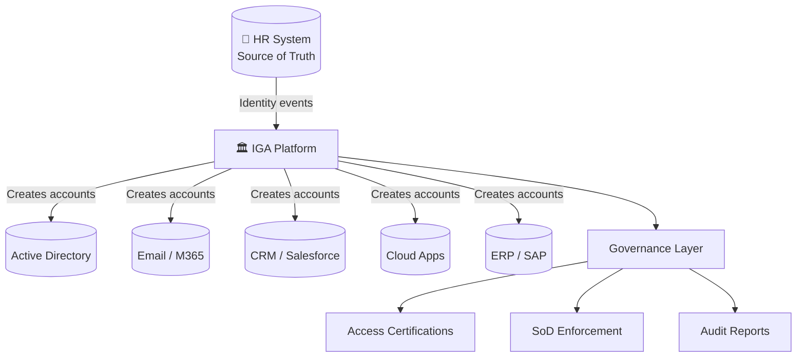
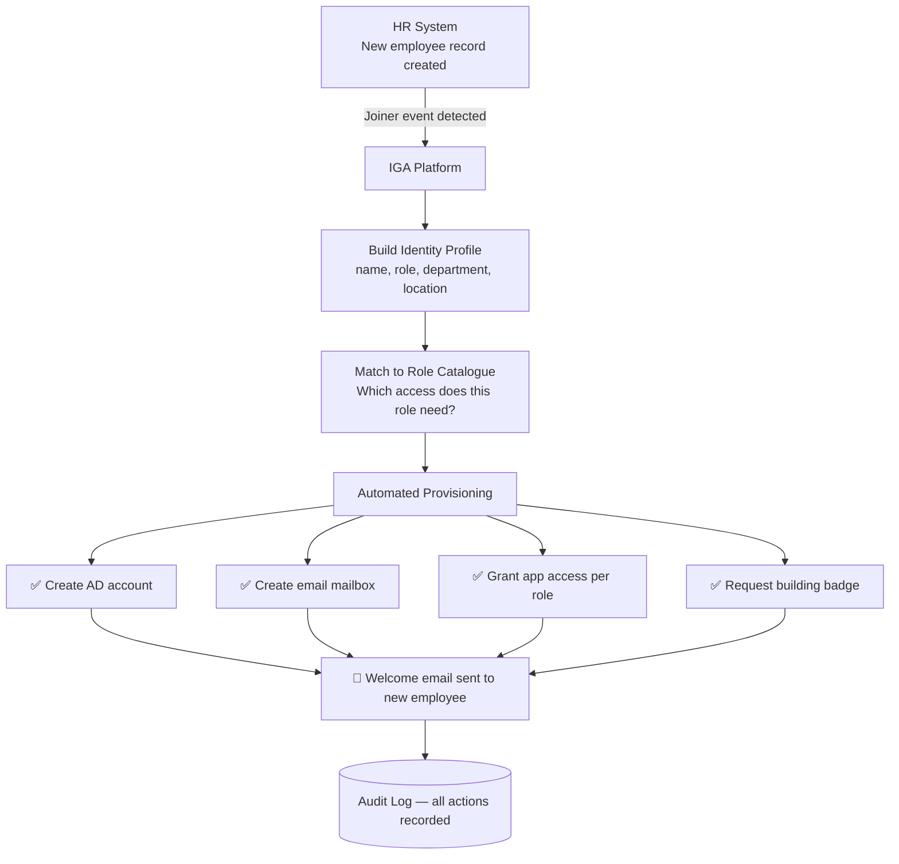
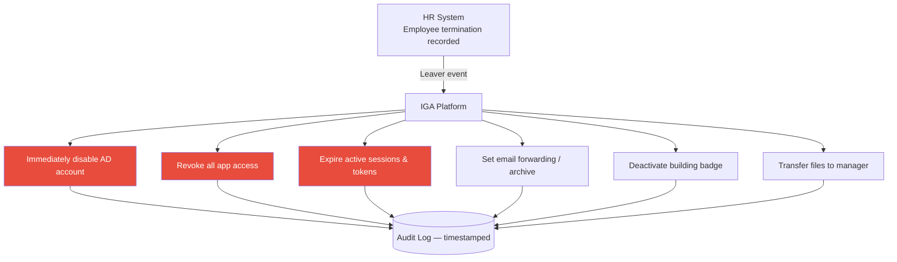
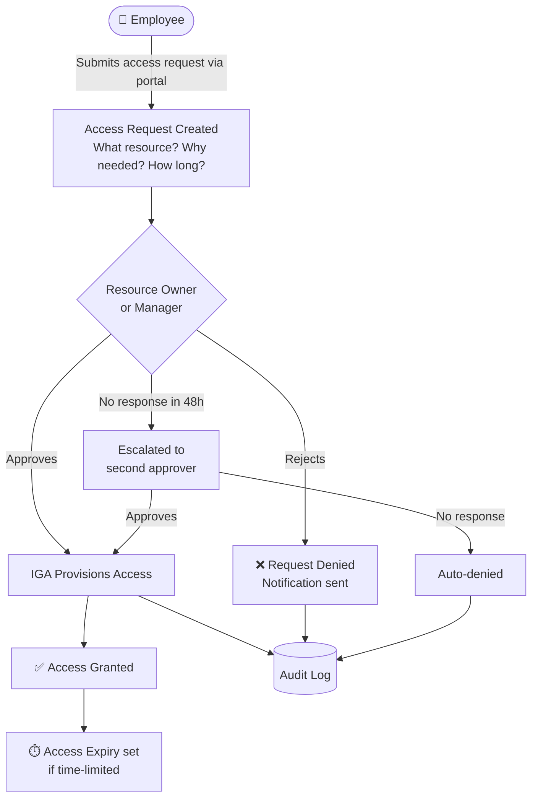
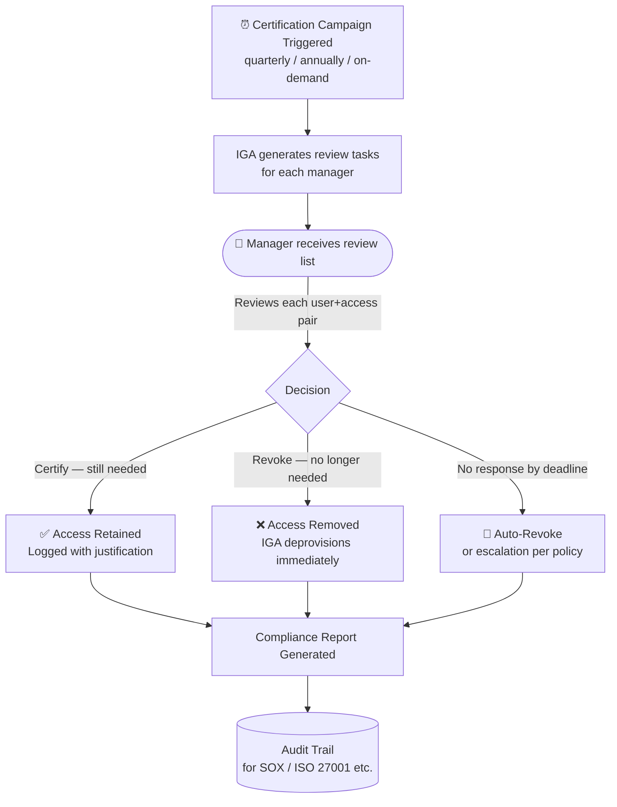
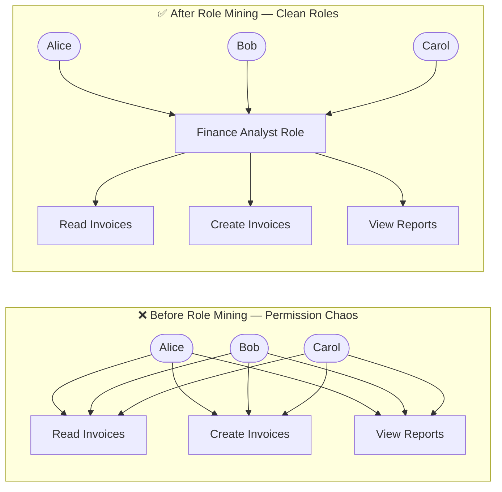
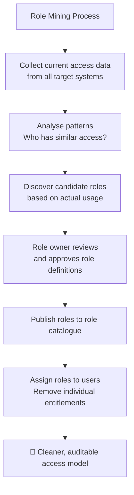
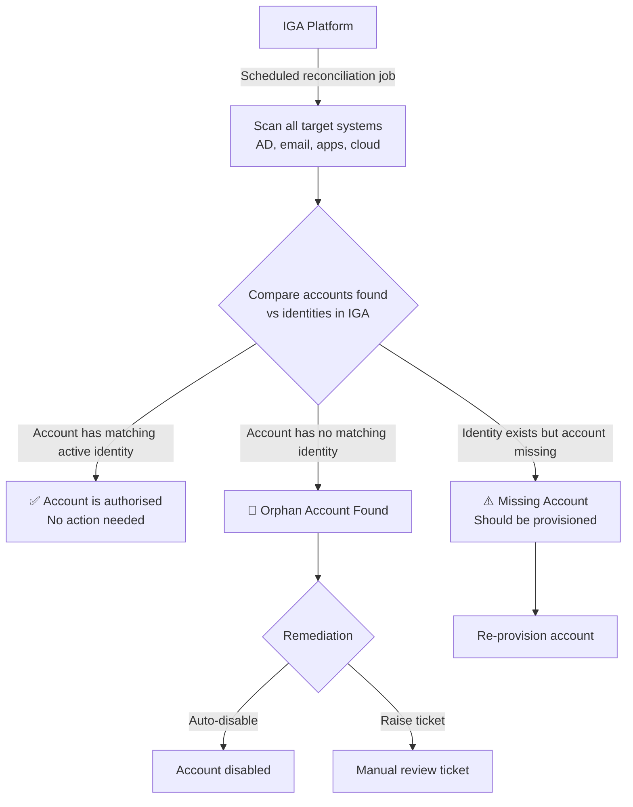
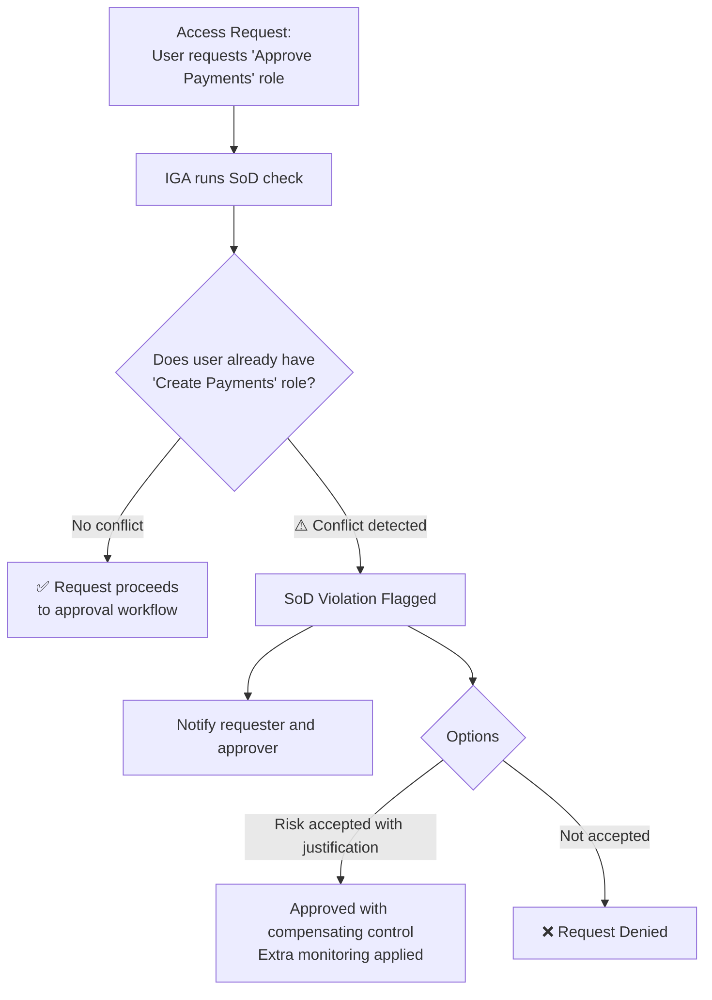
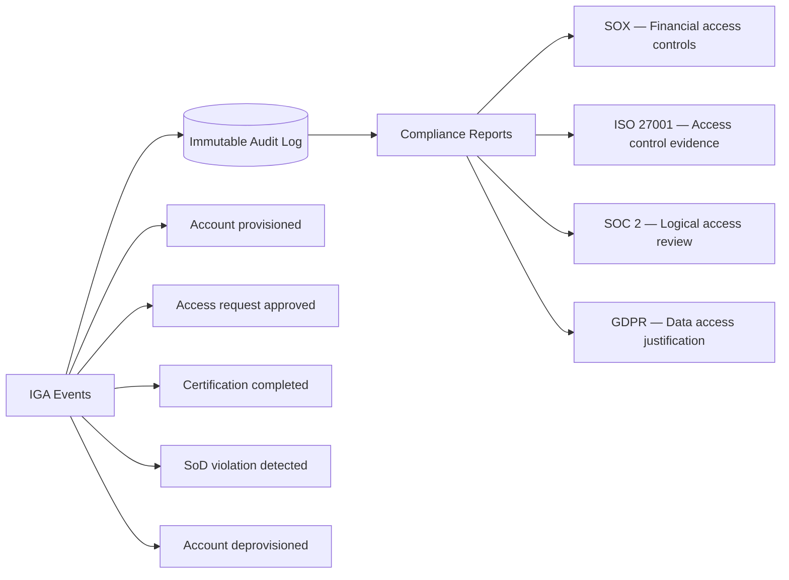

# Identity Governance and Administration (IGA)

[← Back to Index](README.md)

> IGA is the control tower of IAM — it ensures the right people have the right access, for the right reasons, at the right time, and that someone is checking regularly.

---

## 1. What is IGA?

**Simple idea:** IGA is the system that manages *who has access to what*, automates giving and removing access, and makes sure someone regularly checks that access is still appropriate.

Think of a building's key card system:
- Security creates cards when staff join (provisioning)
- Updates them when staff change roles (mover)
- Deactivates them when staff leave (deprovisioning)
- Sends managers a list to review every quarter (access certification)

---

## 2. Automated Provisioning

**Simple idea:** When someone joins the company, IGA automatically creates all their accounts — no IT helpdesk ticket needed.

> Like a hotel check-in: you arrive, give your name, and your key card, room assignment, breakfast voucher and gym access are all ready automatically.

### Deprovisioning — the critical part

> **Why deprovisioning matters:** Orphaned accounts (active accounts for ex-employees) are one of the most common sources of data breaches.

---

## 3. Access Request and Approval Workflow

**Simple idea:** When an employee needs access to something new, they submit a request. The right people approve it. IGA fulfils it and records everything.

> Like requesting annual leave: you submit, your manager approves, HR records it.

---

## 4. Access Certifications (Access Reviews)

**Simple idea:** Periodically, managers are asked "Does your team still need all this access?" They review and approve or revoke. This catches access that was granted long ago but is no longer needed.

> Like an annual property inspection — the landlord checks everything is still appropriate.

---

## 5. Role Management and Role Mining

**Simple idea:** Instead of assigning individual permissions to each person, group common permissions into **roles** (e.g., "Finance Analyst" role). Assign the role, not 50 individual permissions.

**Role mining** is the process of analysing who has what access and discovering natural role groupings.

---

## 6. Reconciliation — Finding Orphan Accounts

**Simple idea:** IGA regularly checks target systems for accounts that shouldn't exist — accounts for people who have left, or accounts created outside IGA's control.

> Like a stocktake — comparing what you think you have vs what's actually on the shelf.

---

## 7. Separation of Duties (SoD) in IGA

**Simple idea:** IGA detects when a single person is being granted conflicting permissions that together would let them commit fraud or errors without detection.

### Common SoD conflict pairs

| Conflicting Permission A | Conflicting Permission B | Risk |
|---|---|---|
| Create purchase order | Approve purchase order | Fraudulent POs |
| Create payroll entry | Approve payroll entry | Payroll fraud |
| Create user account | Approve user account | Unauthorised access |
| Submit expenses | Approve expenses | Expense fraud |
| Write code | Deploy to production | Untested code in prod |

---

## 8. Audit Logging and Compliance Reporting

**Simple idea:** Every action IGA takes — granting access, revoking it, certifications — is logged with who did what, when, and why. This creates an evidence trail for auditors.

---

## 9. IGA Tools at a Glance

| Tool | Strength | Best For |
|---|---|---|
| **SailPoint IdentityNow** | Comprehensive IGA, cloud-native | Large enterprises |
| **Saviynt** | Strong cloud app connectors, CIAM | Cloud-first orgs |
| **One Identity** | Deep AD integration | AD-heavy environments |
| **Microsoft Identity Governance** | Native Azure/M365 integration | Microsoft shops |

---

## Quick Reference Cheat Sheet

| Concept | One-liner | Key Outcome |
|---|---|---|
| **Provisioning** | Automatically create accounts on join | No manual IT tickets; instant access |
| **Deprovisioning** | Remove all access on departure | No orphan accounts |
| **Access Request** | Formal workflow to request new access | Approval trail for auditors |
| **Access Certification** | Periodic review: is this access still needed? | Remove stale access |
| **Role Mining** | Discover natural role groupings from real access | Reduce permission sprawl |
| **Reconciliation** | Find accounts that exist but shouldn't | Catch shadow accounts |
| **SoD Enforcement** | Block conflicting permissions | Prevent fraud |
| **Audit Logging** | Record every IGA action immutably | Compliance evidence |
