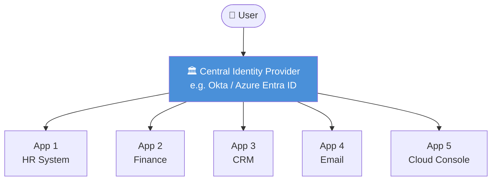
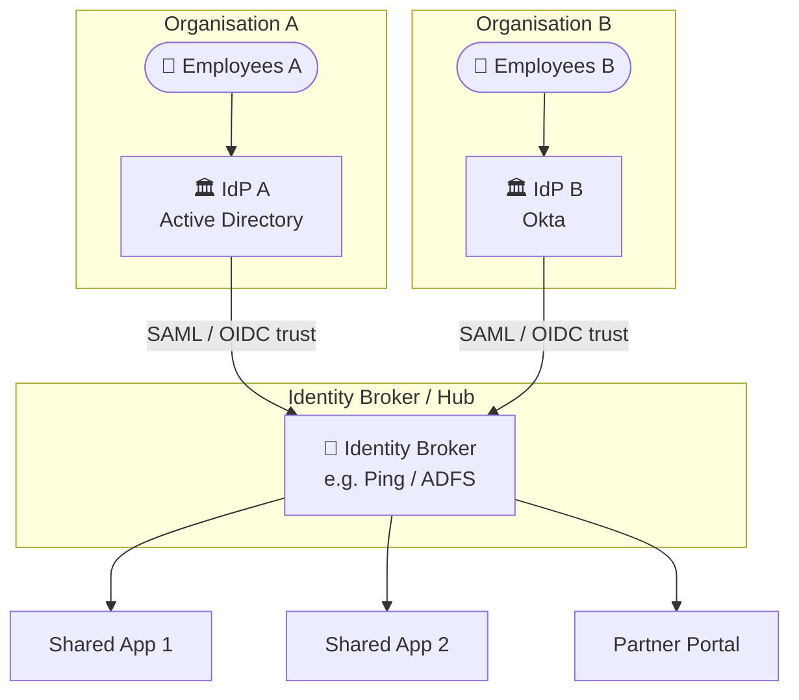
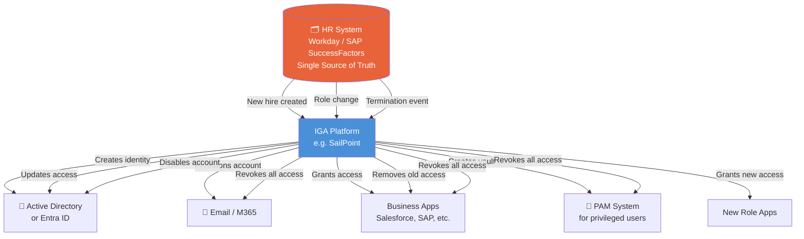
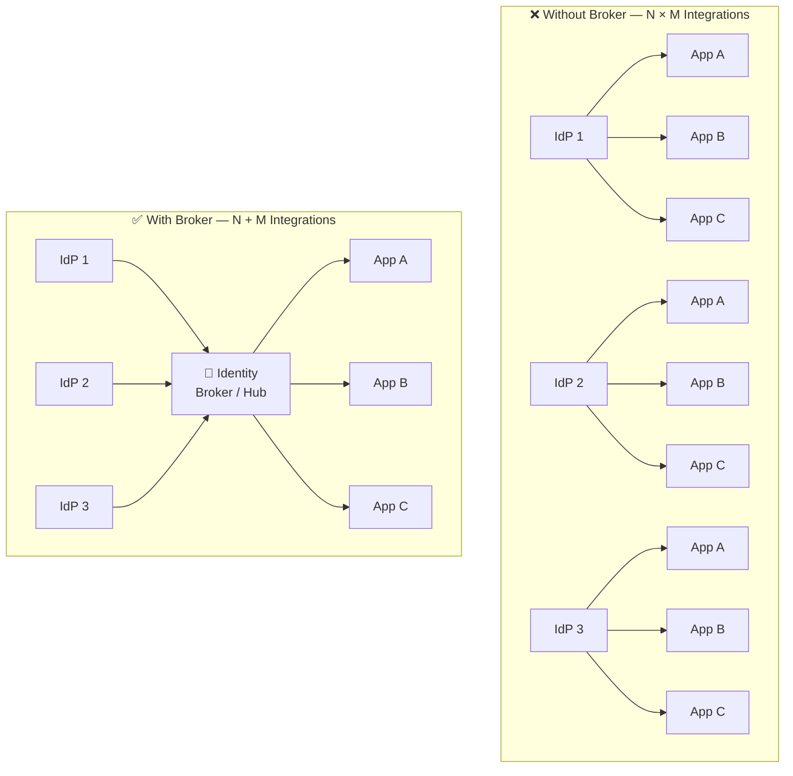
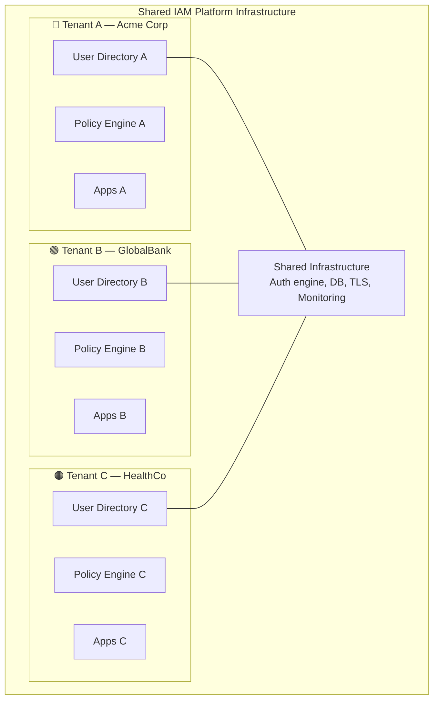
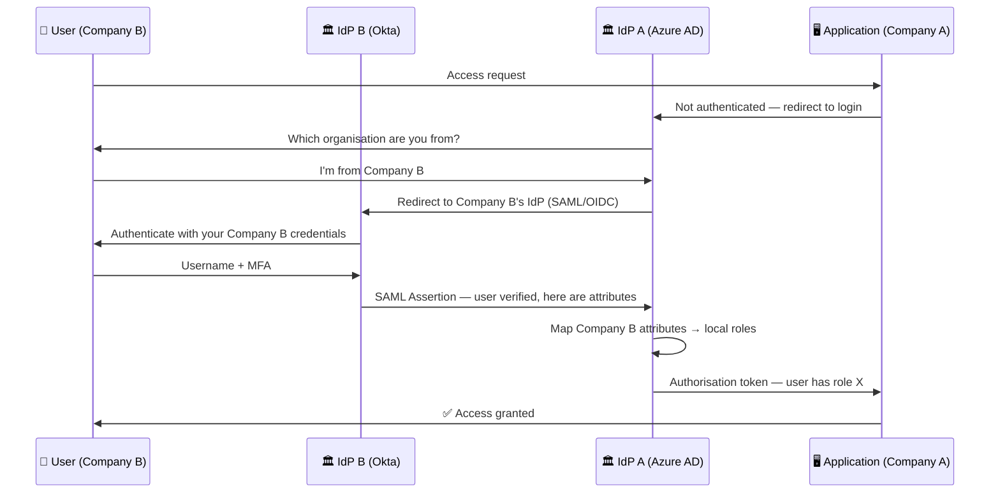
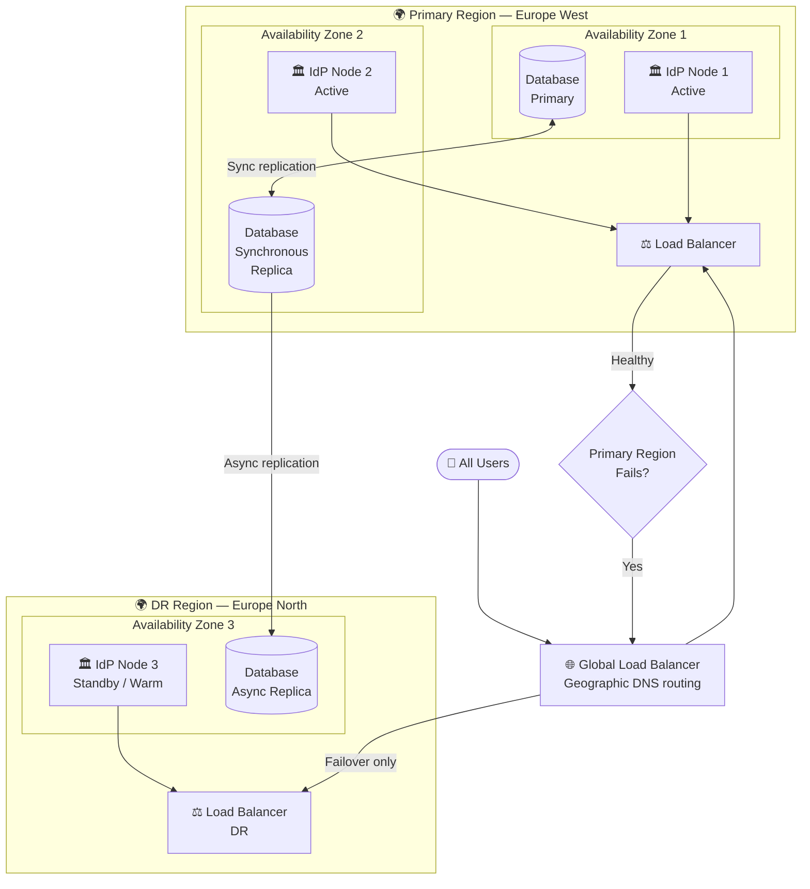
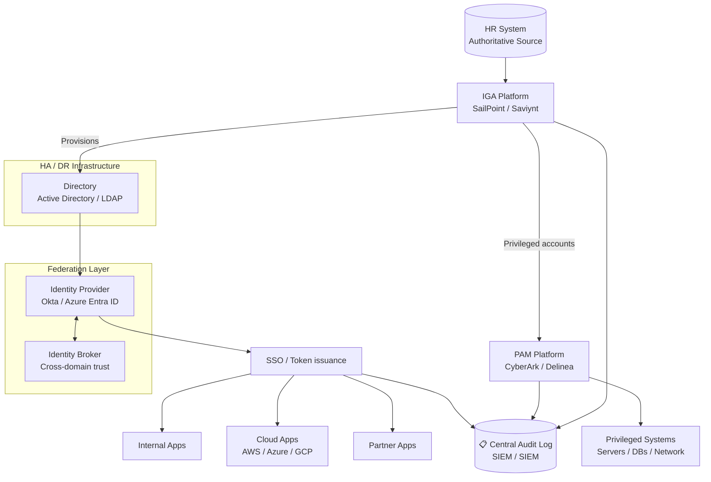

# IAM Architecture and Design Patterns

> Simple explanations of how IAM systems are structured — from the choices you make at the drawing board to how you keep them running when things go wrong.

---

## Why Architecture Matters

IAM is infrastructure. Getting the architecture right means every application, cloud, and user experience works smoothly. Getting it wrong means fragile integrations, security gaps, and painful migrations later.

Think of IAM architecture like **city planning for identity** — the roads (trust relationships), buildings (identity providers), and traffic rules (policies) all need to work together.

---

## 1. Centralised vs Federated Identity

### Centralised Identity
One identity provider. All applications trust it. Simple to manage, single point of failure.

**Analogy:** One master key to the building made by one locksmith — simple, but if the locksmith disappears, all locks need replacing.

**Pros:** Simple, single policy enforcement point, easy audit
**Cons:** Single point of failure, vendor lock-in, may not work across org boundaries

---

### Federated Identity
Multiple identity providers. Trust is established between them. Each organisation keeps its own IdP.

**Analogy:** Multiple countries agreeing to honour each other's passports — your UK passport gets you into France without needing a French ID card.

**Pros:** Works across organisational boundaries, each org controls own identity, flexible
**Cons:** More complex, trust relationships must be maintained, debugging is harder

---

## 2. HR as the Authoritative Source of Identity

**Simple idea:** The HR system is the single source of truth for who exists in the organisation. Everything else follows from it.

**Analogy:** The birth certificate is the authoritative source for a person's legal identity — everything else (passport, driving licence) derives from it.

**Why this matters:**
- No manual "please create an account" emails
- No forgotten access when someone leaves
- Access always matches job role
- One place to update when things change

---

## 3. Identity Hub / Broker Pattern

**Problem:** Without a broker, every identity provider needs a direct integration with every service provider. With 10 IdPs and 20 apps, that's 200 integrations to build and maintain.

**Solution:** An identity broker sits in the middle — IdPs connect to the broker, apps connect to the broker. 10 + 20 = 30 integrations instead of 200.

**Analogy:** An airport hub — airlines don't fly direct between every pair of small cities. Instead they all fly to a central hub, and passengers connect from there.

**What an identity broker does:**
- Translates between protocols (SAML ↔ OIDC ↔ LDAP)
- Applies additional policies (step-up auth, attribute enrichment)
- Provides a single audit point for all authentications
- Enables B2B federation (partner access to internal apps)

---

## 4. Multi-Tenant IAM Design

**Simple idea:** One platform serves multiple separate customers ("tenants"), but their data, users, and policies are completely isolated from each other.

**Analogy:** An apartment building — shared walls, roof, and entrance, but each flat is fully private with its own lock.

**Key isolation requirements:**
- Separate encryption keys per tenant
- Tenant-scoped API tokens (cannot cross tenant boundaries)
- Independent policy configuration per tenant
- Separate audit logs per tenant
- Data residency controls (tenant data stays in specified region)

---

## 5. Cross-Domain Trust and Federation Design

**Simple idea:** When Company A merges with Company B, or a contractor from Agency C needs access to Company A's systems, we need a formal trust relationship.

**Types of cross-domain trust:**

| Type | Description | Use Case |
|---|---|---|
| B2B Federation | Two orgs trust each other's IdPs | Joint venture, partner access |
| Guest Access | Invite external user to your tenant | Azure AD B2B, Okta Inbound Federation |
| Contractor | Third-party staff access internal systems | Agency staff, outsourced teams |
| M&A Integration | Two orgs merging their identity systems | Post-acquisition access harmonisation |

---

## 6. IAM High Availability and Disaster Recovery

**Simple idea:** IAM is as critical as power and water — if authentication goes down, no one can log into anything. HA and DR design keeps it running even when hardware fails or entire data centres go offline.

**Analogy:** Hospitals have backup generators — the moment main power fails, the generator kicks in automatically. IAM HA works the same way.

**HA / DR targets:**

| Metric | Definition | Typical IAM Target |
|---|---|---|
| **RTO** | Recovery Time Objective — how fast can we restore? | < 15 minutes |
| **RPO** | Recovery Point Objective — how much data can we lose? | < 1 minute (sync replication) |
| **Uptime SLA** | Availability percentage | 99.99% (52 min downtime/year) |
| **Failover mode** | Automatic or manual? | Automatic for regional failover |

---

## Putting It All Together — Reference Architecture

---

## Quick Reference Cheat Sheet

| Pattern | When to Use | Key Trade-off |
|---|---|---|
| **Centralised IAM** | Single org, one cloud, simple setup | Easy to manage vs single point of failure |
| **Federated IAM** | Multiple orgs, B2B, M&A | Flexible vs complex trust maintenance |
| **HR as authoritative source** | Always — for employee identity | Automation vs dependency on HR data quality |
| **Identity broker** | Many IdPs + many apps | Reduces integrations vs adds a hop in auth flow |
| **Multi-tenant** | SaaS platforms, MSPs | Cost efficient vs isolation complexity |
| **Cross-domain trust** | Partners, contractors, M&A | Enables collaboration vs extends attack surface |
| **HA/DR** | Always — IAM is critical infra | Resilience vs cost and complexity |
