# User Provisioning

[← Back to Index](README.md)

> How user accounts are created, updated, and removed across systems — and how to do it at scale without manual effort.

---

## 1. What is User Provisioning?

**User provisioning** is the process of creating, managing, and removing user accounts and their access rights across all the systems an organisation uses.

Think of it like a new employee's first day:
- HR creates their record in the HR system
- IT creates their laptop account, email, Slack, Jira, Salesforce...
- When they leave, all of those accounts must be disabled

**Without automation**, this means IT gets a flood of tickets every time someone joins, moves, or leaves. With provisioning automation, it happens instantly and consistently.

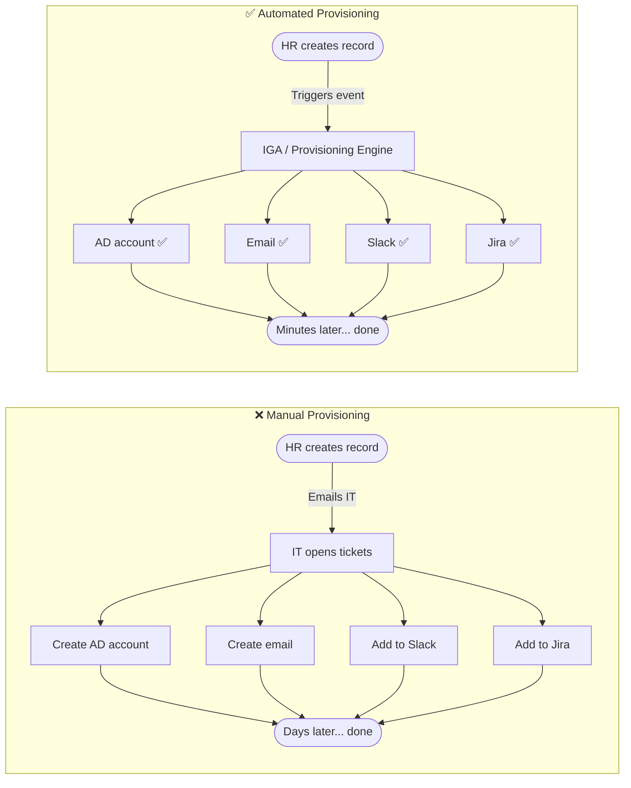

---

## 2. The Provisioning Lifecycle

User provisioning covers three key events — **Joiner, Mover, Leaver** — and one ongoing process: **reconciliation**.

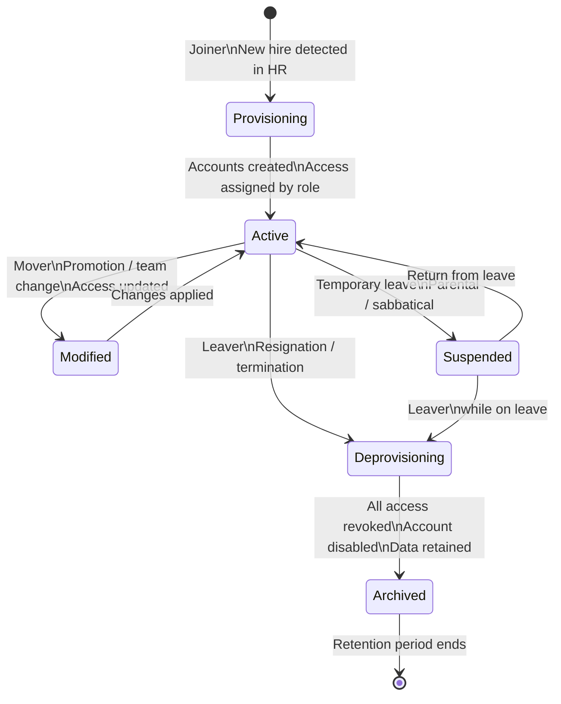

---

## 3. Provisioning Methods

There are four common ways provisioning can be triggered:

### 3.1 Role-Based Provisioning
Access is assigned automatically based on the user's **role or department** in the HR system.

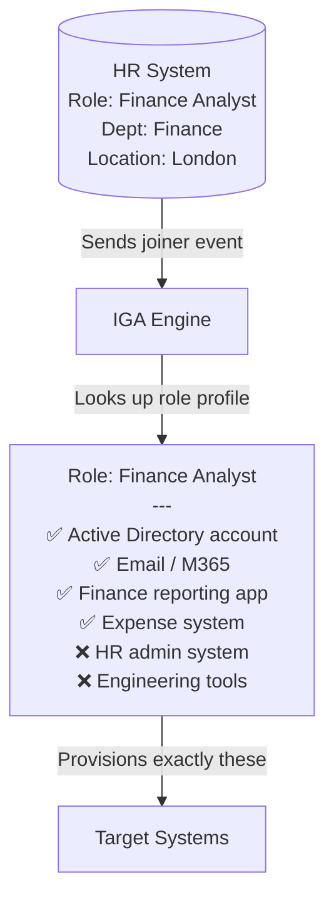

### 3.2 Request-Based Provisioning
User or manager **manually requests** additional access beyond the base role profile.

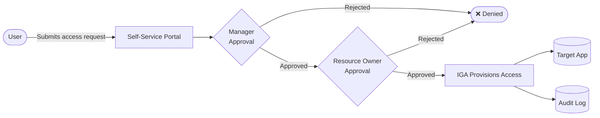

### 3.3 Event-Driven (JIT) Provisioning
Account is created **on-demand at first login** — no pre-provisioning needed.

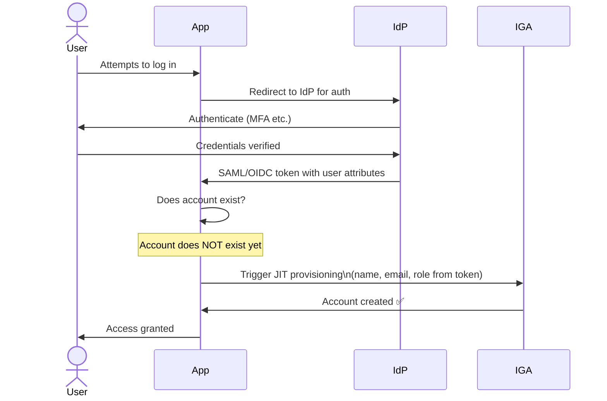

### 3.4 HR-Driven (Automated) Provisioning
HR system is the **authoritative source of truth**. Changes in HR automatically cascade to all downstream systems.

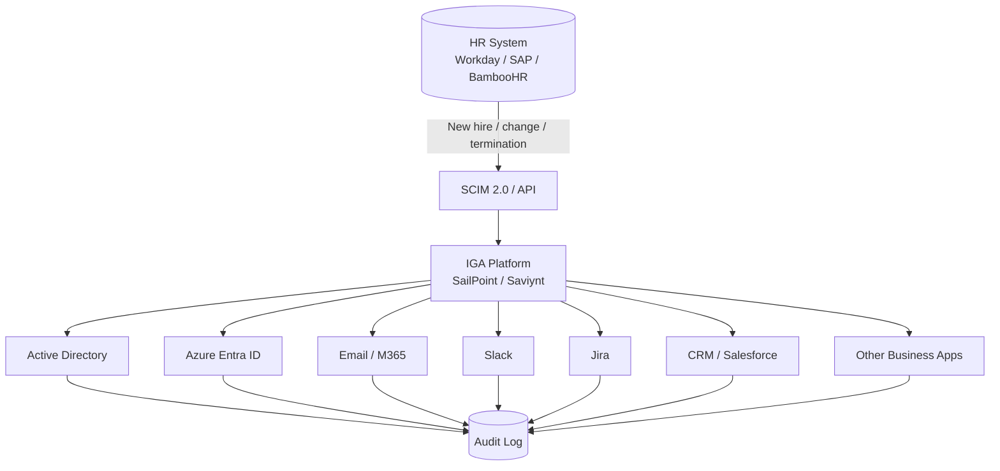

---

## 4. SCIM — The Provisioning Standard

**SCIM (System for Cross-domain Identity Management)** is the industry standard API for automating provisioning. It gives every app a consistent way to receive user create/update/delete events.

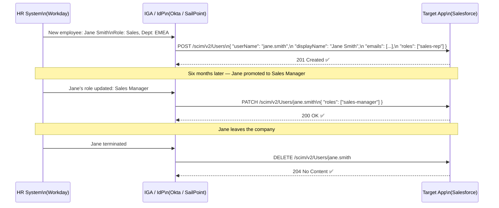

**SCIM operations mapped to lifecycle events:**

| SCIM Operation | HTTP Method | Lifecycle Event |
|---|---|---|
| Create user | `POST /Users` | Joiner |
| Update user | `PATCH /Users/{id}` | Mover (role/dept change) |
| Deactivate user | `PATCH /Users/{id}` `active: false` | Leaver (soft delete) |
| Delete user | `DELETE /Users/{id}` | Leaver (hard delete) |
| List users | `GET /Users` | Reconciliation |

---

## 5. Deprovisioning — The Most Critical Part

Deprovisioning (removing access when someone leaves) is **more important than provisioning** from a security perspective. Orphaned accounts — active accounts belonging to ex-employees — are one of the most common sources of data breaches.

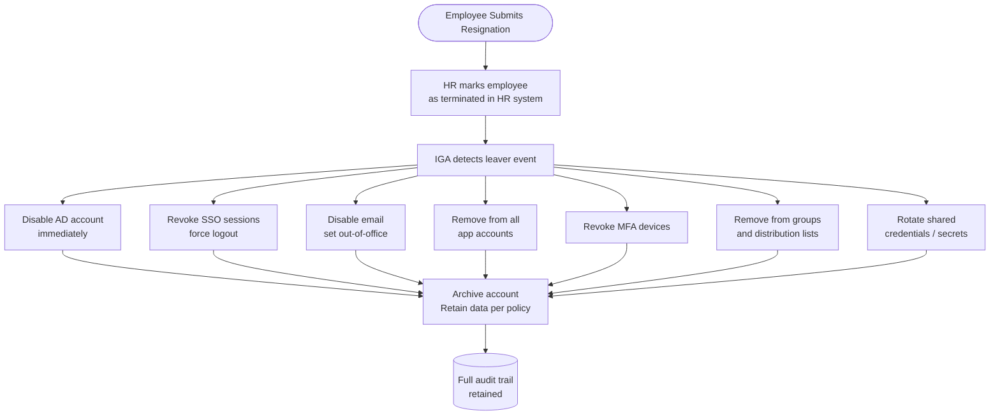

### What happens without proper deprovisioning?

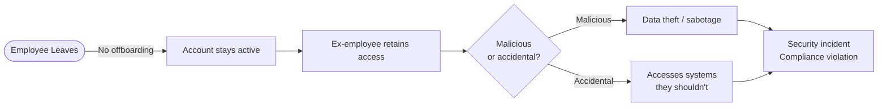

---

## 6. Reconciliation

Reconciliation is the process of **comparing what IGA thinks exists** with **what actually exists** in target systems — and fixing the gaps.

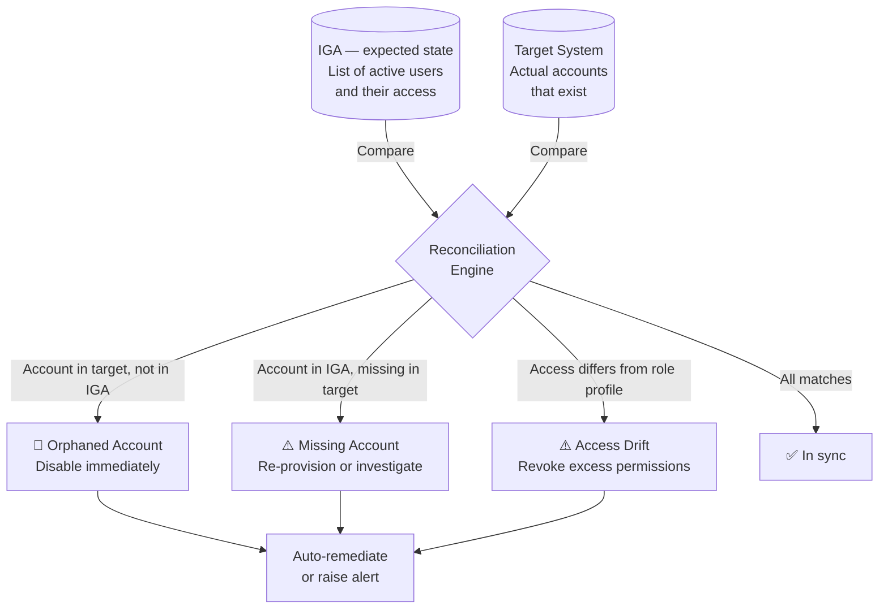

---

## 7. Provisioning Governance

Provisioning without governance creates **access sprawl** — users accumulate permissions over time and never lose them. Governance controls keep it clean.

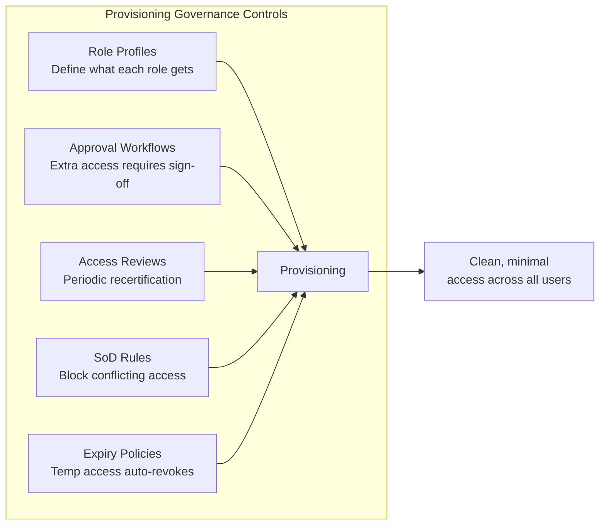

---

## 8. Common Provisioning Patterns by Organisation Size

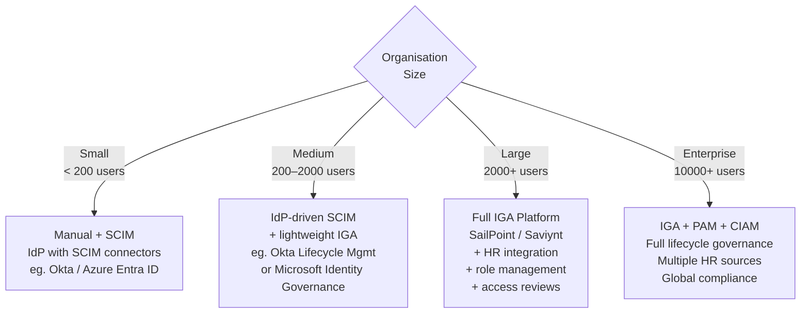

---

## 9. Quick Reference

| Concept | Simple Meaning |
|---|---|
| **Provisioning** | Creating accounts and assigning access |
| **Deprovisioning** | Removing accounts and revoking access |
| **Role-based provisioning** | Access assigned automatically from role in HR |
| **Request-based provisioning** | Extra access requested and approved manually |
| **JIT provisioning** | Account created on first login, not in advance |
| **SCIM** | Standard API for automating provisioning across apps |
| **Orphaned account** | Active account for a user who has left — a security risk |
| **Reconciliation** | Comparing expected vs actual accounts and fixing gaps |
| **Access drift** | Accumulation of excess permissions over time |
| **IGA** | Platform that orchestrates the entire provisioning lifecycle |
