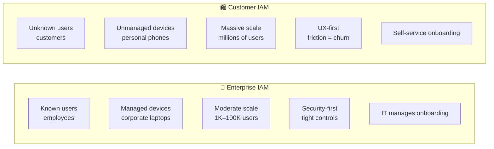
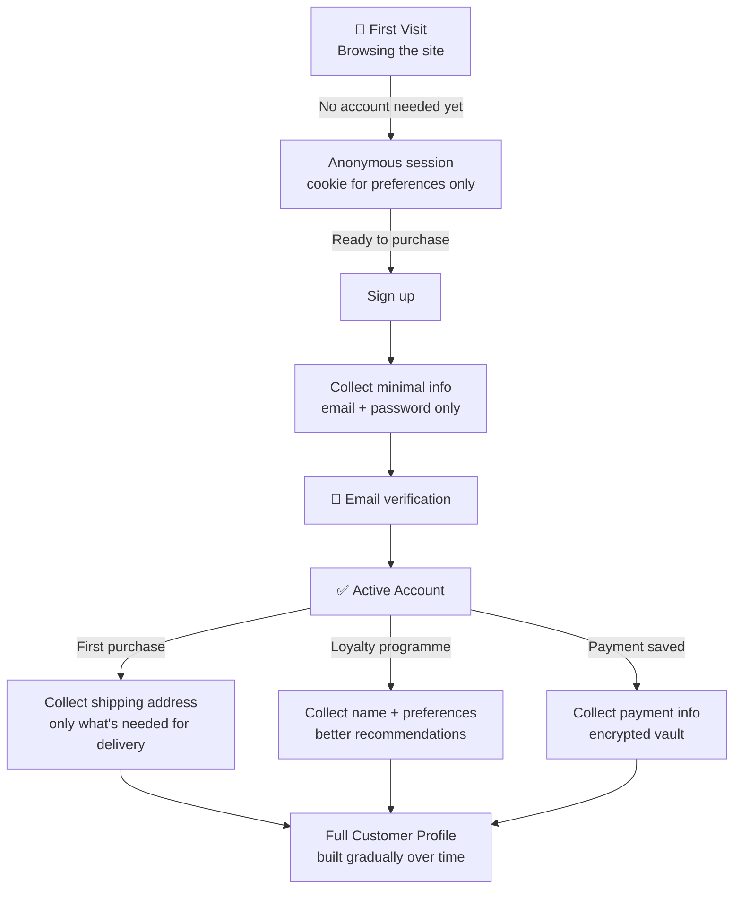
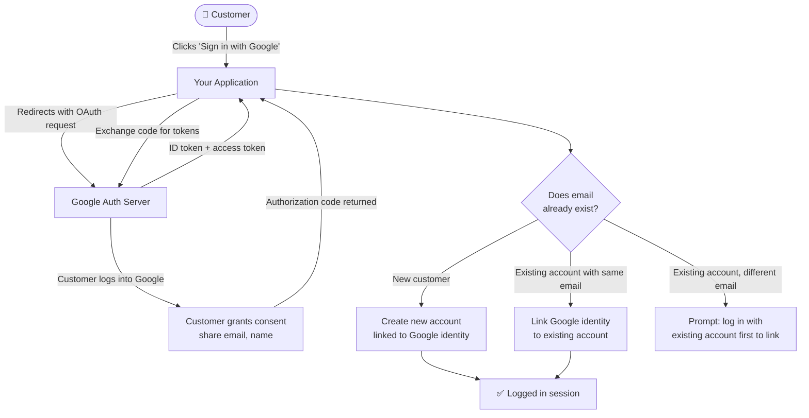
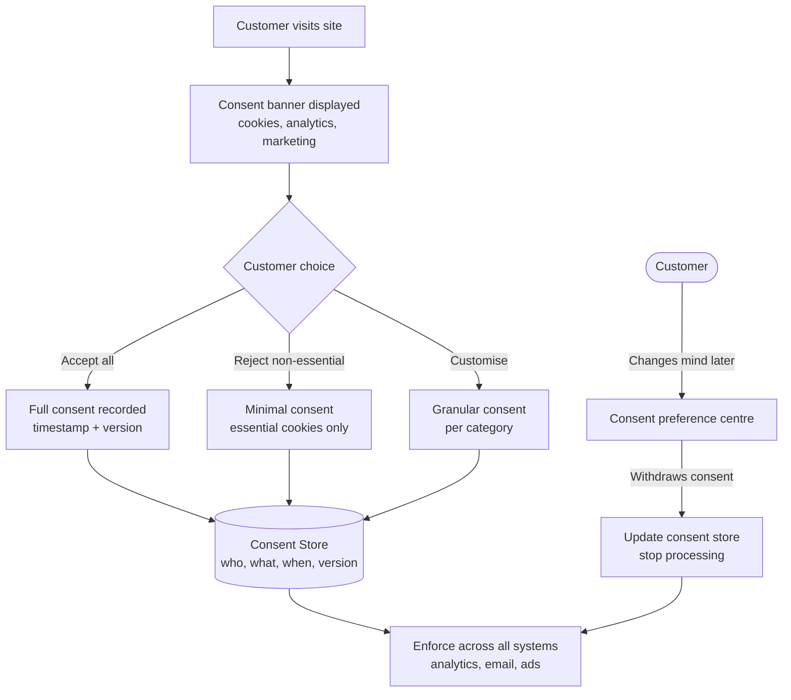
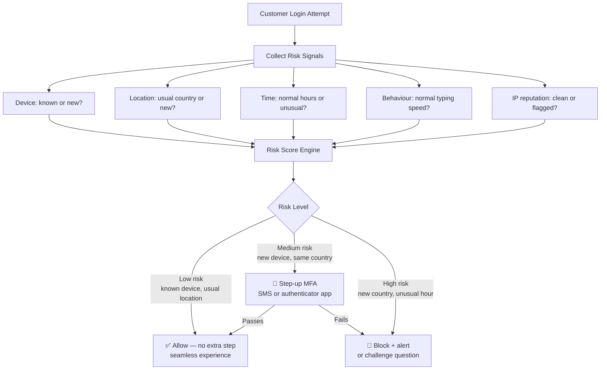
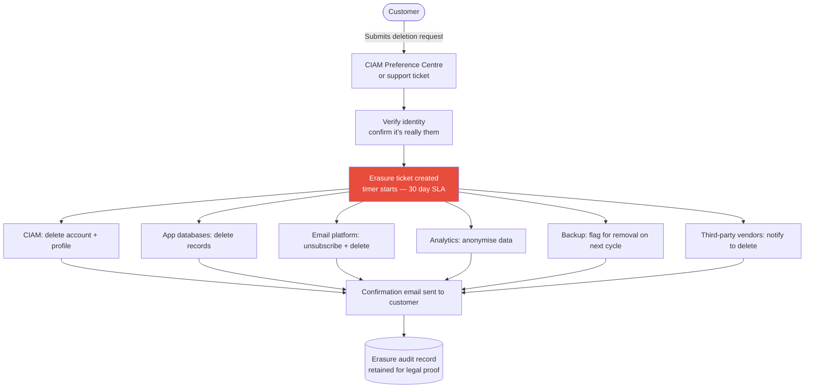

# Customer Identity and Access Management (CIAM)

[← Back to Index](README.md)

> CIAM is IAM designed for your *customers*, not your *employees*. The scale is bigger, the trust level is lower, and the user experience must be frictionless — because a bad login experience means lost revenue.

---

## 1. Enterprise IAM vs CIAM — Key Differences

**Enterprise IAM** manages 1,000–100,000 known employees on corporate devices.
**CIAM** manages millions of unknown customers on personal devices from anywhere.

| Factor | Enterprise IAM | CIAM |
|---|---|---|
| **Scale** | Thousands | Millions |
| **Trust level** | High (employees) | Low (strangers) |
| **UX priority** | Security > UX | UX = Security |
| **Onboarding** | IT-driven | Self-service |
| **Compliance** | HR/SOX/HIPAA | GDPR/CCPA |
| **MFA** | Mandatory | Optional / risk-based |

---

## 2. Customer Registration and Progressive Profiling

**Simple idea:** Don't ask customers for 20 fields on the first visit. Collect data gradually as trust builds and as it becomes needed.

> Like a new friendship: you don't share your life story on day one. You share more as the relationship grows.

---

## 3. Social Login and Account Linking

**Simple idea:** Let customers log in with their existing Google, Apple, or Facebook account — no new password to remember.

> Like showing your passport at a foreign hotel: a trusted authority has already verified you, so the hotel accepts it.

---

## 4. Consent Management (GDPR)

**Simple idea:** Before collecting any personal data, get explicit consent. Record exactly what was consented to, when, and allow customers to change their mind.

> Like a restaurant menu allergen form — you tick what you're OK with, and they keep a copy.

---

## 5. Risk-Based / Adaptive Authentication

**Simple idea:** Make login easy when everything looks normal. Add extra checks (MFA) when something looks suspicious — without blocking legitimate users.

> Like a bouncer: regular regulars walk straight in; someone new wearing a hoodie at 2am gets ID-checked.

---

## 6. Right to Erasure (GDPR — Right to be Forgotten)

**Simple idea:** Customers can ask you to delete all their data. You must do it completely, across all systems, within 30 days.

> **Important:** You can retain data you are legally required to keep (e.g., financial records for tax compliance), even after a deletion request.

---

## 7. CIAM Tools at a Glance

| Tool | Strength | Best For |
|---|---|---|
| **Auth0** | Developer-friendly, easy integration | Startups, B2C apps |
| **Okta CIAM** | Enterprise-grade, scalable | Large consumer platforms |
| **AWS Cognito** | AWS-native, low cost | AWS-hosted apps |
| **Firebase Auth** | Simple, mobile-first | Mobile apps, Google ecosystem |
| **Ping Identity** | Flexible, enterprise | Complex hybrid environments |
| **Akamai Identity Cloud** | Massive scale, CDN-integrated | High-traffic consumer sites |

---

## Quick Reference Cheat Sheet

| Concept | One-liner | Why It Matters |
|---|---|---|
| **CIAM vs Enterprise IAM** | Customers ≠ employees | Different trust, scale, and UX needs |
| **Progressive profiling** | Collect data gradually | Less friction = better conversion |
| **Social login** | Use Google/Apple identity | Fewer passwords to manage |
| **Account linking** | Connect social to existing account | Prevents duplicate accounts |
| **Consent management** | Record what data you're allowed to use | GDPR compliance |
| **Risk-based auth** | Add MFA only when it's risky | Security without friction |
| **Right to erasure** | Delete all data on request | GDPR obligation, 30-day SLA |
