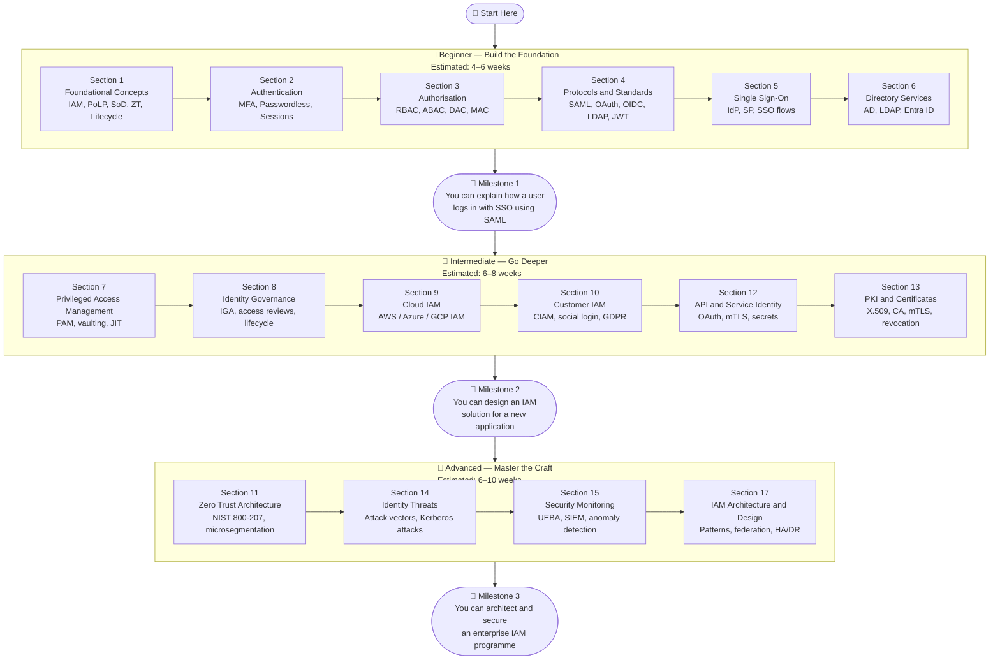
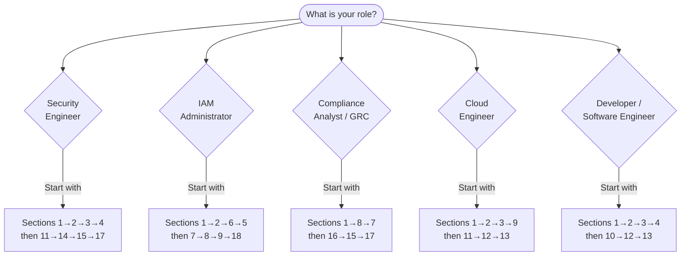
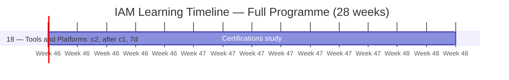
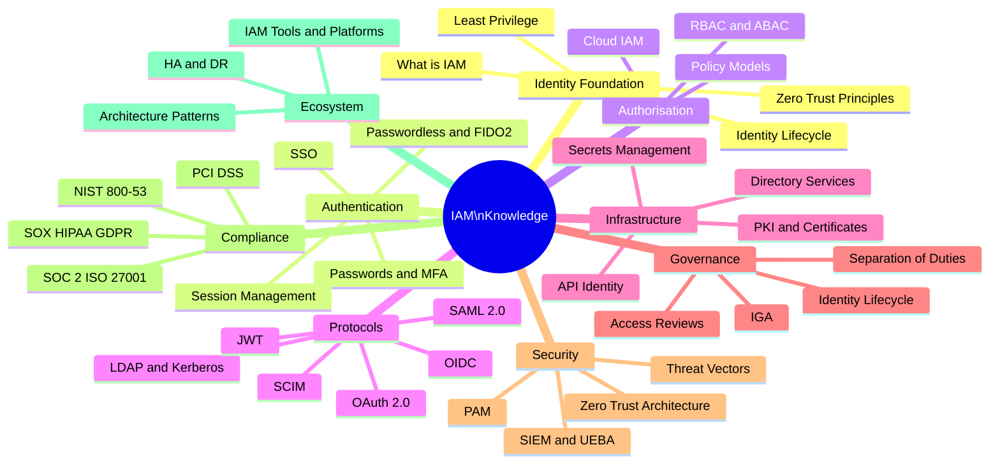
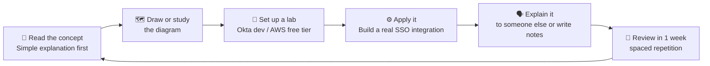

# IAM Learning Path

> A practical, structured guide for building your IAM knowledge — whatever your starting point or career goal.

---

## Learning IAM Is a Journey, Not a Sprint

IAM spans protocols, architecture, compliance, security, and operations. No one learns it all at once — and that's fine. The key is knowing **which path to take for your goal**.

Think of IAM learning like **building a house**:
- First you lay the foundations (core concepts, authentication, authorisation)
- Then you build the walls (protocols, SSO, directory services)
- Then you add the specialist rooms (PAM, IGA, cloud, zero trust)
- Finally you install the security systems (threat detection, compliance, architecture)

---

## 1. The Three-Level Learning Journey

---

## 2. Role-Based Learning Paths

Different roles need different knowledge. Start with where your role takes you.

### Detailed Role Tracks

| Role | Core Sections | Specialist Sections | Skip / Skim |
|---|---|---|---|
| **Security Engineer** | 1, 2, 3, 11, 14, 15 | 4, 7, 17 | 10, 19, 20 |
| **IAM Administrator** | 1, 2, 5, 6, 7, 8 | 9, 18 | 11, 14 |
| **Compliance Analyst** | 1, 8, 16 | 7, 15, 17 | 12, 13 |
| **Cloud Engineer** | 1, 2, 3, 9, 12 | 11, 13 | 7, 10 |
| **Developer** | 1, 2, 3, 4, 10, 12 | 13, 9 | 7, 8 |
| **IAM Architect** | All sections | All sections | None |

---

## 3. Suggested Study Timeline

---

## 4. IAM Knowledge Domains — How They Connect

---

## 5. Learning Resources by Type

| Resource Type | Best For | Examples |
|---|---|---|
| **Official documentation** | Protocols and standards | IETF RFCs (OAuth/OIDC), NIST publications, OASIS (SAML) |
| **Vendor docs** | Hands-on tool learning | Okta developer docs, Microsoft Learn, AWS IAM docs |
| **Online labs** | Practical skills | Okta Developer Edition (free), AWS free tier, Azure free account |
| **Books** | Deep theory | "Identity and Data Security for Web Development" (O'Reilly), CISSP study guides |
| **Certifications** | Validated credentials | SC-300, Okta Certified, AWS Security Specialty (see Section 20) |
| **CTF / practice** | Attack/defence | PentesterLab, HackTheBox, PortSwigger Web Academy (OAuth labs) |

---

## 6. How to Learn Effectively

**The best way to learn IAM is to build it:**
- Create a free Okta developer account and integrate a sample app with SAML SSO
- Set up AWS IAM and practice writing least-privilege policies
- Spin up a local AD or use Azure AD free tier
- Try the PortSwigger OAuth and OIDC labs for attack/defence understanding

---

## Quick Reference — Learning Path Summary

| Level | Sections | Estimated Time | Key Outcome |
|---|---|---|---|
| **Beginner** | 1, 2, 3, 4, 5, 6 | 4–6 weeks | Understand how authentication and SSO work |
| **Intermediate** | 7, 8, 9, 10, 12, 13 | 6–8 weeks | Design IAM for applications and cloud environments |
| **Advanced** | 11, 14, 15, 17 | 6–10 weeks | Architect secure, resilient enterprise IAM |
| **Compliance/GRC** | 16, 8, 7 | 4–5 weeks | Map IAM controls to regulatory requirements |
| **Ecosystem** | 18, 19, 20 | 2–3 weeks | Navigate the tool landscape and certifications |
