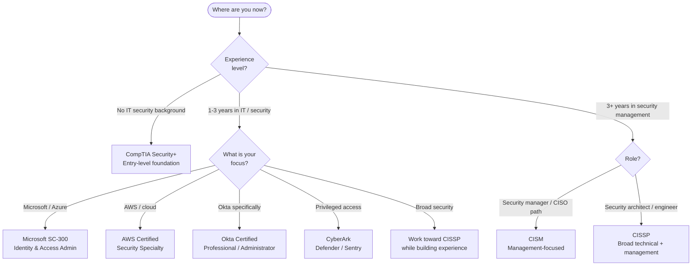
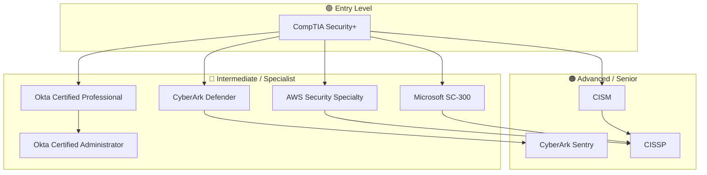
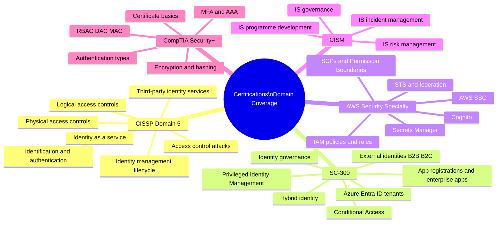
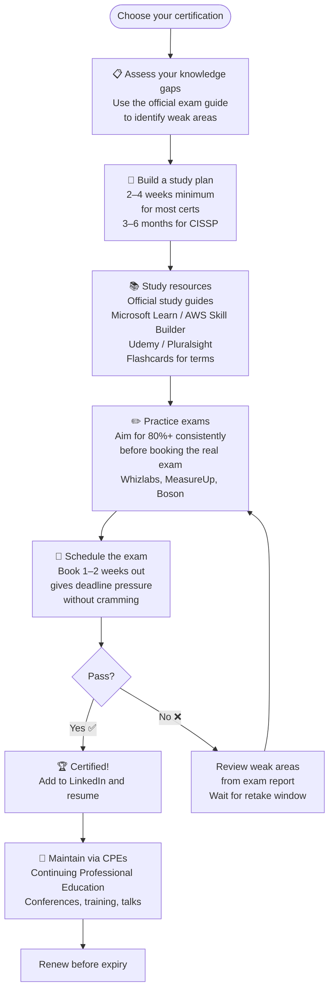

# IAM Certifications

> A practical guide to the most valuable certifications in the identity and access management field — what each validates, who it's for, and how to choose.

---

## Why Get Certified?

Certifications do three things:
1. **Validate** that you know what you say you know
2. **Structure** your learning — the exam syllabus becomes your study plan
3. **Signal** credibility to employers and clients

Think of certifications like **driving licences** — different licences for different vehicles. A motorcycle licence doesn't qualify you to drive a lorry. Similarly, an Okta cert doesn't cover the same ground as CISSP.

---

## 1. Which Certification Should I Pursue?

---

## 2. Certifications at a Glance

### CompTIA Security+

**Simple summary:** The entry door to cybersecurity. Covers authentication, access control, cryptography, network security, and incident response at a broad level.

**Who it's for:** IT professionals making the move into security, students, help desk staff aiming for a security role.

**IAM topics covered:** Authentication types, MFA, AAA, access control models (DAC/MAC/RBAC), identity concepts, certificate basics.

---

### Microsoft SC-300 — Identity and Access Administrator

**Simple summary:** Proves you can configure and manage Microsoft's identity stack — Azure Entra ID, Conditional Access, privileged identity management, app registrations, and hybrid identity.

**Who it's for:** IT admins, cloud engineers, security engineers working in Microsoft environments.

**IAM topics covered:** Entra ID architecture, app registrations, enterprise SSO, Conditional Access policies, PIM, access reviews, B2B/B2C.

---

### AWS Certified Security — Specialty

**Simple summary:** Proves you can secure AWS workloads. Heavily covers IAM policies, roles, SCPs, Cognito, Secrets Manager, and federation.

**Who it's for:** Cloud engineers, architects, DevOps engineers working with AWS.

**IAM topics covered:** AWS IAM policies (identity and resource), IAM roles, STS, SCPs, Permission Boundaries, AWS Cognito, Secrets Manager, AWS SSO.

---

### Okta Certified Professional / Administrator

**Simple summary:** Vendor-specific certifications proving you can configure and operate the Okta platform.

**Who it's for:** IAM administrators, IT engineers, security engineers deploying Okta.

**IAM topics covered:** Okta directory, universal directory, SSO app integrations, MFA policies, lifecycle management, Okta Workflows.

---

### CyberArk Defender / Sentry

**Simple summary:** PAM-specialist certifications. Defender is operational (using CyberArk), Sentry is implementation (deploying and designing CyberArk).

**Who it's for:** PAM engineers, security architects, IT ops teams managing privileged access.

**IAM topics covered:** Credential vaulting, session recording, JIT privileged access, safe management, PSM (Privileged Session Manager), CPM (Central Policy Manager).

---

### CISM — Certified Information Security Manager

**Simple summary:** Management-level certification focused on governing and managing an information security programme. IAM governance is a key domain.

**Who it's for:** Security managers, IT directors, GRC professionals, aspiring CISOs.

**IAM topics covered:** Identity governance, access control strategy, risk management, compliance programme management.

---

### CISSP — Certified Information Systems Security Professional

**Simple summary:** The gold standard for senior security professionals. Domain 5 (Identity and Access Management) is entirely dedicated to IAM.

**Who it's for:** Security architects, senior engineers, CISOs — typically requires 5 years of experience.

**IAM topics covered:** Physical and logical access, identification and authentication, identity services, access control attacks, identity as a service.

---

## 3. Certification Comparison

| Certification | Vendor | Level | Cost (approx.) | Validity | Experience Required |
|---|---|---|---|---|---|
| **CompTIA Security+** | CompTIA | Entry | $392 | 3 years | None (recommended: 2 years IT) |
| **Microsoft SC-300** | Microsoft | Intermediate | $165 | Renewed with new version | 1–2 years Microsoft stack |
| **AWS Security Specialty** | AWS | Advanced | $300 | 3 years | 2+ years AWS + 5 years IT security |
| **Okta Certified Professional** | Okta | Intermediate | $125 | 2 years | 6+ months Okta experience |
| **Okta Certified Administrator** | Okta | Advanced | $125 | 2 years | 1+ year Okta administration |
| **CyberArk Defender** | CyberArk | Intermediate | ~$200 | 2 years | CyberArk product experience |
| **CyberArk Sentry** | CyberArk | Advanced | ~$200 | 2 years | Defender + implementation exp. |
| **CISM** | ISACA | Management | $575 (member) | 3 years | 5 years IS management |
| **CISSP** | (ISC)² | Senior | $749 | 3 years | 5 years in 2+ CISSP domains |

---

## 4. Certification Progression Map

---

## 5. What Each Certification Covers (Domain Map)

---

## 6. Exam Preparation Process

---

## 7. Recommended Preparation Resources

| Certification | Official Resource | Community / Third-Party |
|---|---|---|
| **Security+** | CompTIA CertMaster | Professor Messer (free YouTube), Darril Gibson book |
| **SC-300** | Microsoft Learn (free) | John Savill YouTube, MeasureUp practice tests |
| **AWS Security** | AWS Skill Builder | Adrian Cantrill course, TutorialsDojo practice exams |
| **Okta Certified** | Okta Training (paid) | Okta developer edition (free sandbox) |
| **CyberArk** | CyberArk University | CyberArk community docs |
| **CISM** | ISACA review manual | Hemang Doshi Udemy, ISACA QAE database |
| **CISSP** | (ISC)² Official Study Guide | Mike Chapple/James Stewart book, Larry Greenblatt Udemy |

---

## Quick Reference Cheat Sheet

| Goal | Best Certification(s) |
|---|---|
| Enter cybersecurity from IT | CompTIA Security+ |
| Work in Microsoft/Azure environments | Microsoft SC-300 |
| Work in AWS environments | AWS Certified Security Specialty |
| Administer Okta | Okta Certified Professional → Administrator |
| Manage CyberArk | CyberArk Defender → Sentry |
| Move into security management | CISM |
| Become a senior security professional / architect | CISSP |
| Get the most IAM-specific coverage | CISSP (Domain 5) + SC-300 |
| Build a cloud IAM specialty | SC-300 + AWS Security Specialty |
