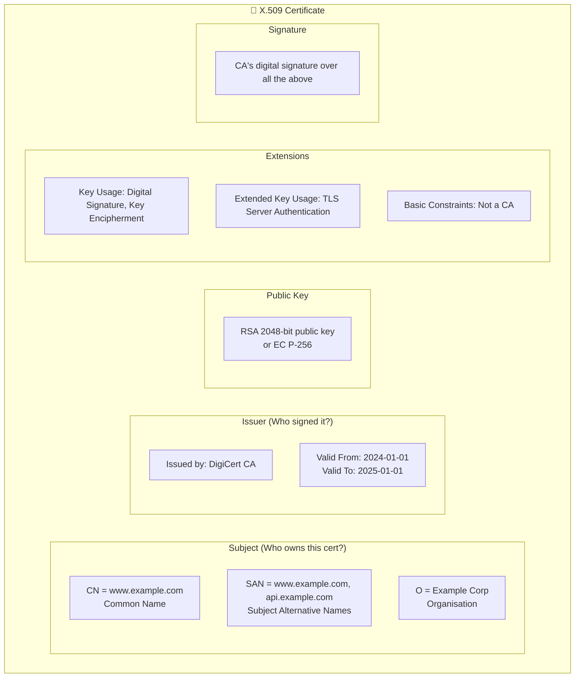
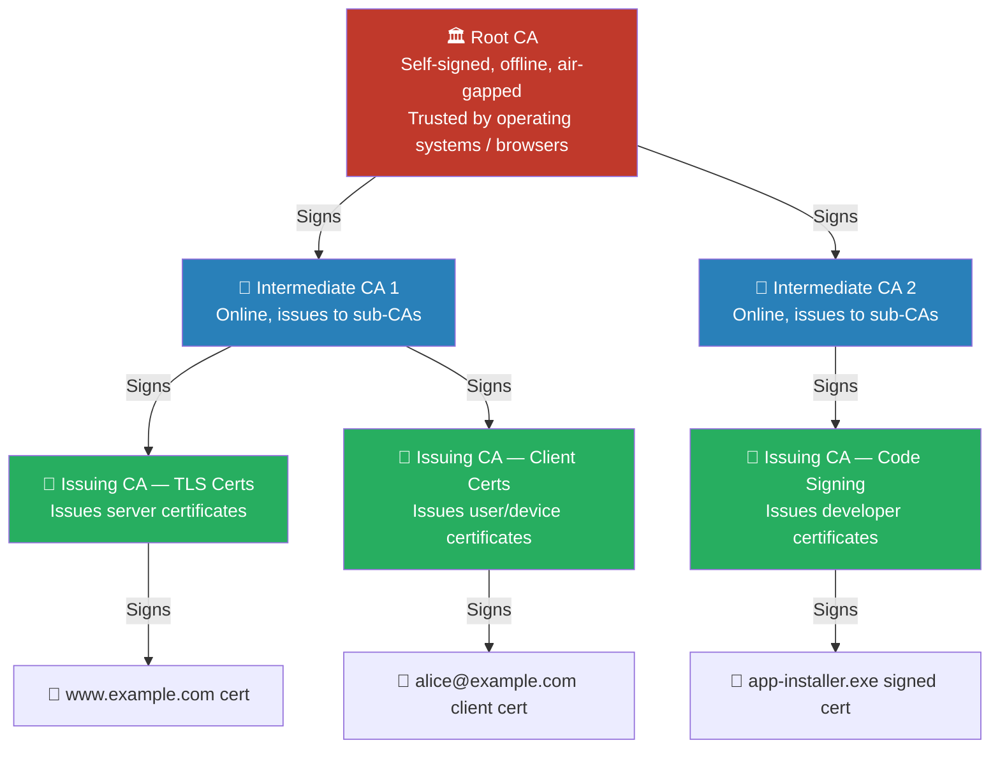
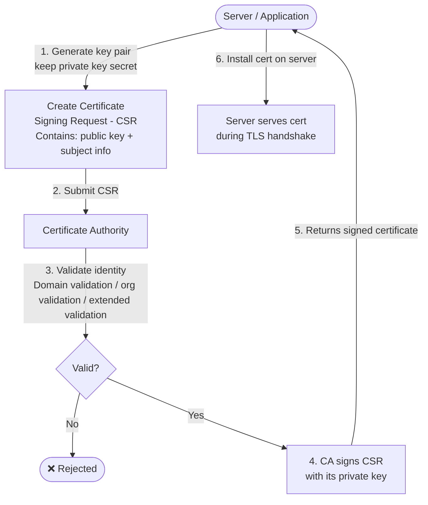
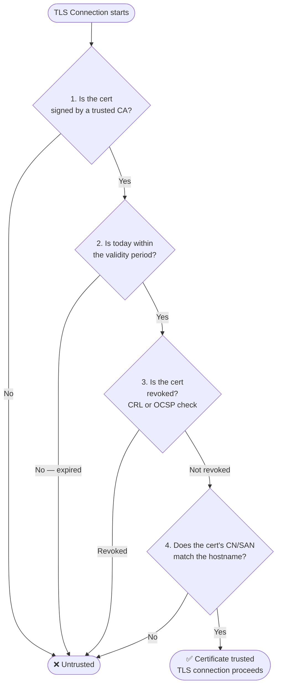
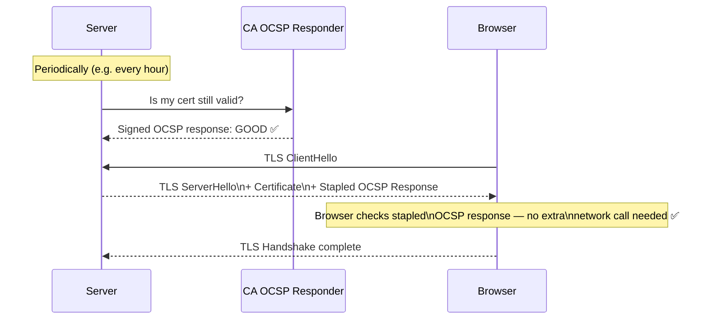
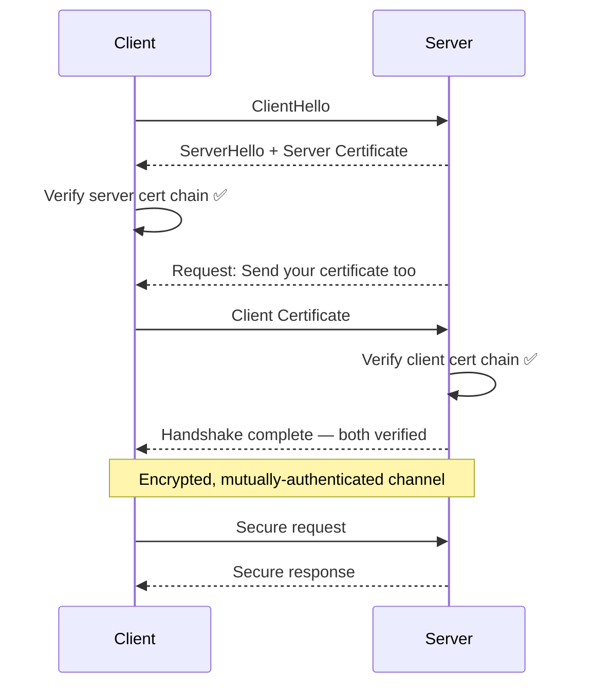
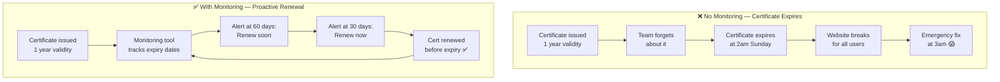
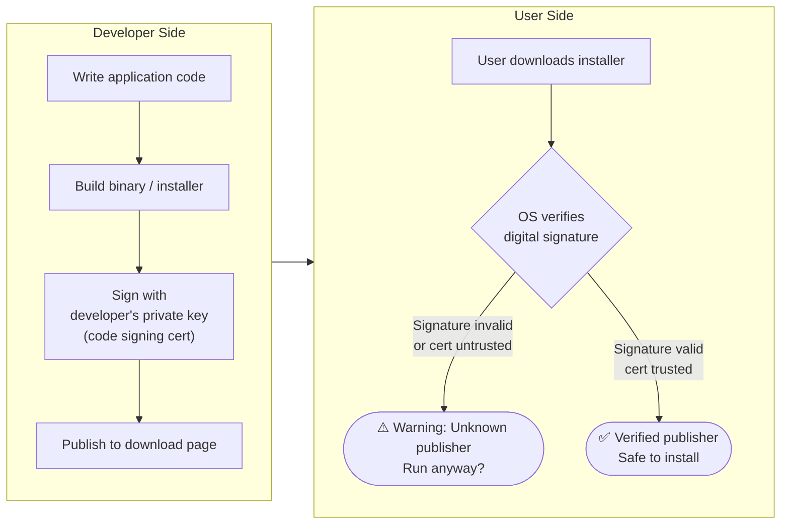

# PKI and Certificates

[← Back to Index](README.md)

> Simple explanations with diagrams for how digital certificates work — the foundation of trusted communication on the internet.

---

## 1. What is PKI?

**Public Key Infrastructure (PKI)** is the system that lets computers trust each other online using **digital certificates** — like digital ID cards issued by a trusted authority.

> When you visit a bank website and see the padlock icon, that's PKI in action. Your browser checked the bank's certificate and confirmed: "Yes, this is really the bank."

---

## 2. X.509 Certificate Anatomy

A certificate is a digitally-signed document that says **"this public key belongs to this entity."**

> Like a passport: it has your name, photo, expiry date, and an official stamp that proves it wasn't forged.

**Key fields explained:**

| Field | What it means |
|---|---|
| **CN** | The main name (usually domain or username) |
| **SAN** | All hostnames this cert is valid for |
| **Valid From/To** | The certificate's active window |
| **Key Usage** | What the cert can be used for (signing, encryption) |
| **Signature** | Proves the CA approved this cert |

---

## 3. Certificate Authority (CA) Hierarchy

No single CA signs everything. Trust is organised in a **chain** — like a government's chain of authority.

> Root CA = the Prime Minister. Never makes direct decisions, stays offline and secure. Intermediate CA = a minister. Issues authority to departments. Issuing CA = a local office. Issues actual ID cards to citizens.

**Why this hierarchy?**
- Root CA stays offline — extremely hard to compromise
- If an Intermediate CA is compromised, only revoke that CA — Root and other branches stay safe
- Separates responsibilities (TLS vs client certs vs code signing)

---

## 4. Certificate Issuance

How does a website or service get a certificate?

> Like applying for a passport: you fill in a form (CSR), submit it to the passport office (CA), they verify you are who you say you are, then issue the passport (certificate).

---

## 5. Certificate Validation

When your browser connects to a site, it checks the certificate is genuine.

> Like checking a passport: is the signature real? Is it still valid? Has it been reported stolen (revoked)?

---

## 6. Revocation — CRL and OCSP

Sometimes a certificate must be cancelled before it expires (private key stolen, employee left, etc.).

| Method | How it works | Drawback |
|---|---|---|
| **CRL** (Certificate Revocation List) | CA publishes a list of revoked certs | List can be large; may be stale |
| **OCSP** (Online Certificate Status Protocol) | Real-time query: "Is cert X revoked?" | Privacy concern; CA must be online |
| **OCSP Stapling** | Server pre-fetches OCSP response and includes it in TLS handshake | Best of both — fast, private |

---

## 7. Mutual TLS (mTLS)

Standard TLS: browser verifies the server.
mTLS: **both** the client and server verify each other.

> Like two spies meeting — they both show their agency badges before exchanging information.

**Where mTLS is used:**
- Service-to-service communication (microservices, service mesh)
- API access from specific authorised clients
- Zero Trust network architecture

---

## 8. Certificate Expiry Risk

An expired certificate immediately breaks services — websites show scary warnings, APIs stop working.

**Tools:** Let's Encrypt + Certbot (auto-renew), Venafi, cert-manager (Kubernetes)

---

## 9. Code Signing

Code signing proves that software came from a known publisher and **hasn't been tampered with** since it was signed.

> Like a wax seal on a medieval letter — if the seal is intact, the message is genuine and unaltered.

---

## Quick Reference Cheat Sheet

| Concept | Simple Meaning | Key Point |
|---|---|---|
| **X.509 Certificate** | Digital ID card for a server/user/service | Contains public key + identity + CA signature |
| **CA Hierarchy** | Chain of trust: Root → Intermediate → Issuing | Root stays offline; compromise contained per branch |
| **CSR** | Application form for a certificate | Contains public key; keep private key secret |
| **CRL / OCSP** | Ways to check if a cert was cancelled | OCSP Stapling is the modern best practice |
| **mTLS** | Both sides show certificates | Use for service-to-service auth |
| **Code Signing** | Proves software came from known publisher | Required for Windows driver/app distribution |
| **Cert Expiry Monitoring** | Track all certs and alert before expiry | Automate renewal where possible |
