# Identity Threats and Attack Vectors

> Simple explanations with diagrams for how attackers target identity systems — and how to defend against them.

---

## 1. Why Identity is the Primary Attack Target

Identity is the new perimeter. 80%+ of breaches involve compromised credentials. If an attacker can steal or forge an identity, they don't need to break through firewalls — they just walk in through the front door.

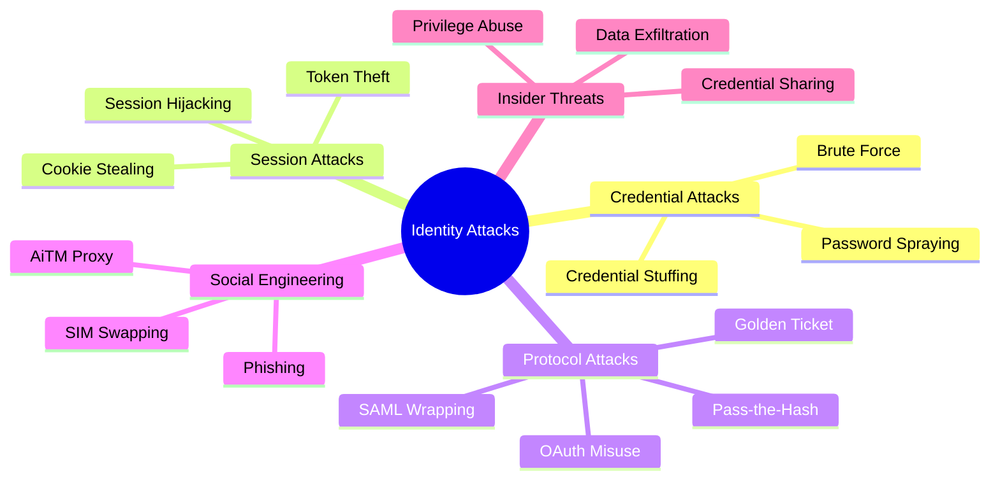

---

## 2. Credential Stuffing

Attackers take **username/password pairs from leaked databases** and try them against other websites. Because people reuse passwords, many attempts succeed.

> Like trying every key from a stolen bunch to see which doors they open elsewhere.

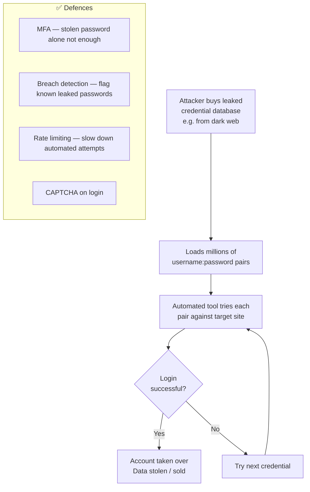

---

## 3. Password Spraying

Instead of trying many passwords against one account (brute force, which triggers lockout), attacker tries **one common password against many accounts**.

> Like a thief trying "1234" on every locker in the building — most will fail, but a few will open.

```mermaid
flowchart LR
    ATK([Attacker]) --> P[One common password\ne.g. Summer2024!]
    
    P -->|Try against| U1[user1@company.com]
    P -->|Try against| U2[user2@company.com]
    P -->|Try against| U3[user3@company.com]
    P -->|Try against| U4[hundreds more users...]

    U1 --> R1[Fail]
    U2 --> R2[✅ SUCCESS — account taken]
    U3 --> R3[Fail]
    U4 --> R4[Fail...]

    subgraph Defence["✅ Defences"]
        D1[MFA — password alone not enough]
        D2[Unusual login pattern detection]
        D3[Ban common passwords at registration]
        D4[UEBA — detect spray pattern across accounts]
    end
```

---

## 4. Phishing and Adversary-in-the-Middle (AiTM)

Modern phishing doesn't just steal passwords — it steals **session cookies** using a proxy between the user and the real site, bypassing MFA entirely.

> Like a fake receptionist who takes your ID, makes a copy of your visitor badge, then hands you through to the real reception — you got in, but they now have your badge.

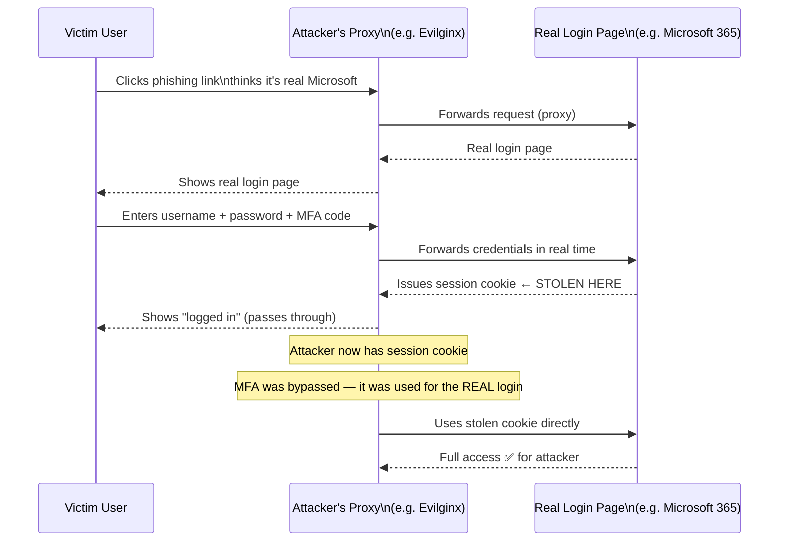

**Defence:** Phishing-resistant MFA (FIDO2/passkeys) — these bind authentication to the legitimate domain, so the proxy can't replay the credential.

---

## 5. Pass-the-Hash

On Windows systems, passwords are stored as **NTLM hashes**. An attacker who gains admin access can dump these hashes from memory and use them to authenticate — **without ever knowing the actual password**.

> Like stealing a photocopy of a key — you don't know what the original looks like, but the photocopy still opens the lock.

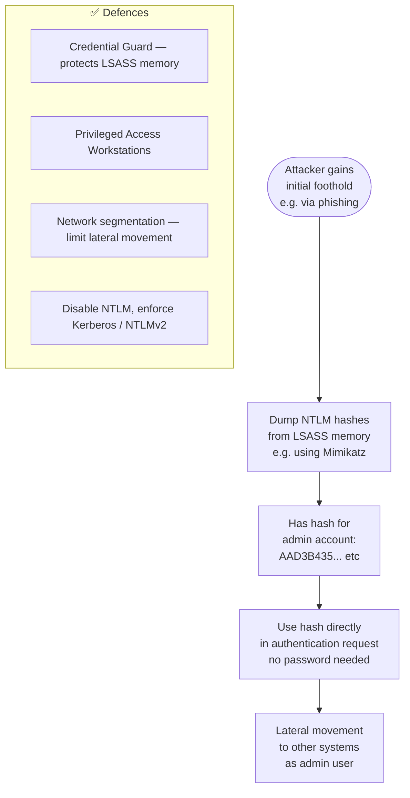

---

## 6. Kerberos Golden Ticket Attack

The most powerful Active Directory attack. Attacker compromises the **KRBTGT account** (the Kerberos ticket-granting secret) and can forge tickets for **any user** in the domain.

> Like stealing the master key-making machine at a hotel — you can now make a key card for any room, for any fake guest, that never expires.

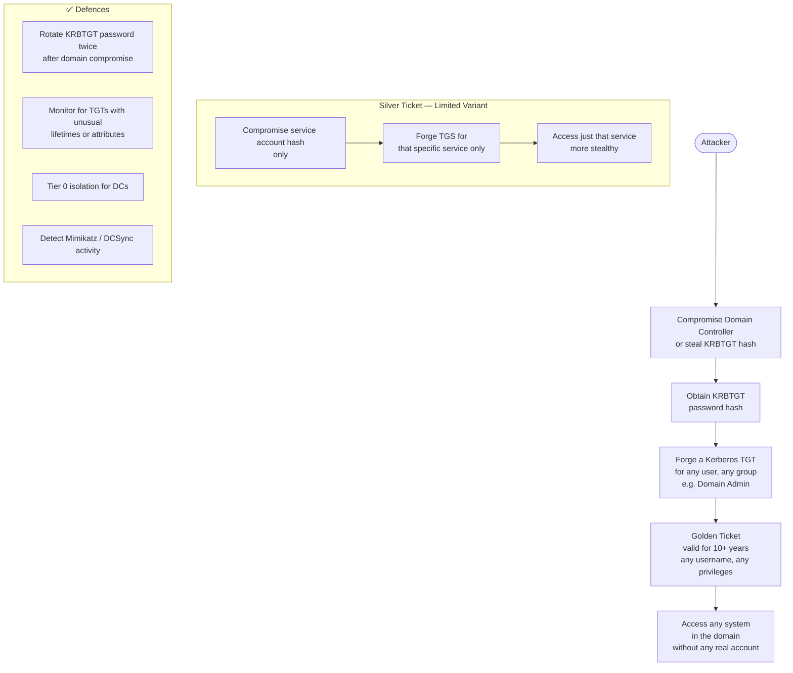

---

## 7. Token Theft and Replay

An attacker steals a valid **JWT or session token** and replays it to gain access — often after compromising a device or intercepting traffic.

> Like someone stealing your hotel keycard while you're at the pool — they can enter your room without knowing your name or booking reference.

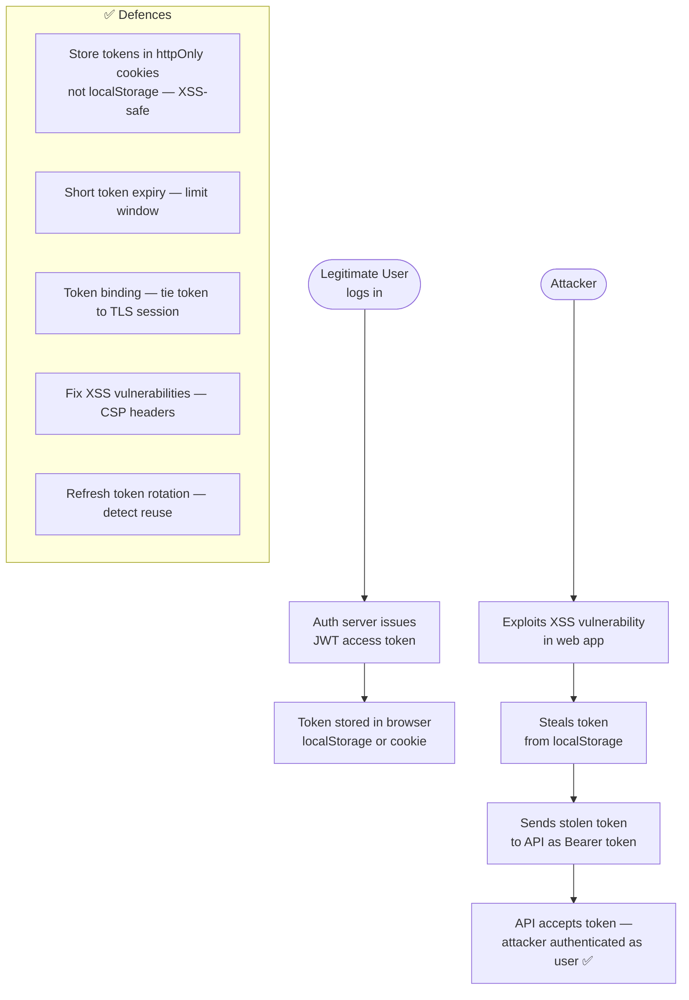

---

## 8. OAuth Open Redirector Attack

In OAuth, after authentication the server redirects to a `redirect_uri`. If the app doesn't validate this strictly, an attacker can steal the **authorization code**.

> Like a fake postal worker intercepting a parcel — they redirect the delivery to their address instead of yours.

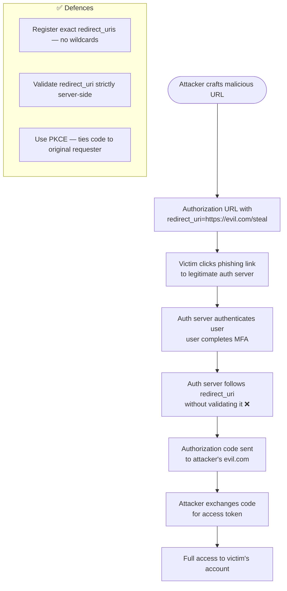

---

## 9. SAML XML Signature Wrapping

SAML assertions are XML documents. Attackers can **modify the assertion content** while keeping the signature valid by exploiting how the XML is parsed.

> Like photocopying a signed contract and inserting extra pages — the signature is real, but the document says something different now.

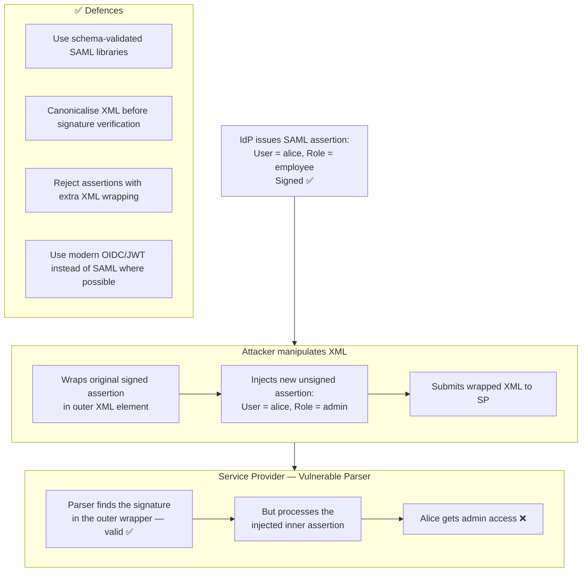

---

## 10. SIM Swapping (MFA Bypass)

Attacker social-engineers a mobile carrier to transfer the victim's phone number to the attacker's SIM card — then receives SMS OTPs.

> Like convincing a bank that you lost your card and getting a new one sent to your address — except it's the attacker's address.

```mermaid
flowchart TD
    ATK([Attacker]) --> INFO[Researches victim\nLinkedIn, social media\ndata broker sites]
    INFO --> CALL[Calls mobile carrier:\n"Hi, I'm Alice. Lost my phone.\nPlease transfer to new SIM."]
    CALL --> SOCIAL[Social engineers\ncustomer service rep]
    SOCIAL --> PORT[Carrier ports Alice's number\nto attacker's SIM ❌]
    PORT --> SMS[Attacker receives\nall of Alice's SMS messages]
    SMS --> OTP[Receives SMS OTP\nfor Alice's bank / email]
    OTP --> RESET[Resets Alice's passwords\nusing OTP + account recovery]
    RESET --> ACCESS[Full account takeover]

    subgraph Defence["✅ Defences"]
        D1[Use TOTP app or hardware key\nnot SMS MFA]
        D2[Set carrier account PIN / port-out freeze]
        D3[Use FIDO2 passkeys — not phone-number-based]
    end
```

---

## 11. Common Techniques of Identity Theft

Identity theft happens when someone uses another person's personal information — without consent — to impersonate them, gain access, or commit fraud. It affects individuals and organisations alike.

> Like someone stealing your wallet, your ID card, and your signature — then pretending to be you everywhere.

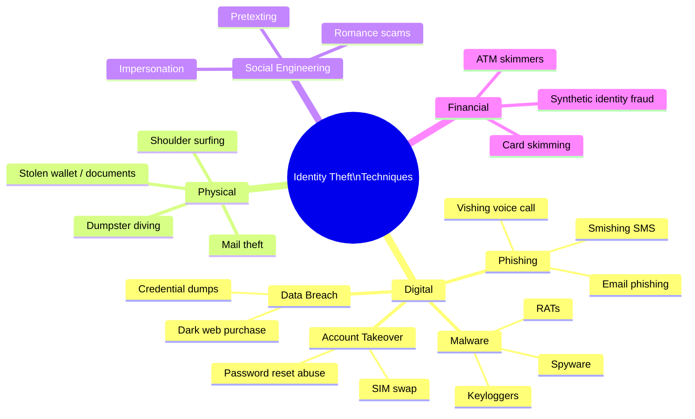

### 11.1 Phishing — Email, SMS, and Voice

The most common identity theft technique. Attacker impersonates a trusted organisation to trick the victim into revealing credentials or personal information.

```mermaid
flowchart TD
    subgraph Email["📧 Email Phishing"]
        E1[Fake email from 'your bank'] --> E2[Victim clicks link]
        E2 --> E3[Fake login page — credentials stolen]
    end

    subgraph SMS["📱 Smishing (SMS Phishing)"]
        S1["'Your package is held — verify identity'"] --> S2[Victim clicks SMS link]
        S2 --> S3[Personal details harvested]
    end

    subgraph Voice["📞 Vishing (Voice Phishing)"]
        V1["Caller: 'This is HMRC / IRS / bank security'"] --> V2[Victim provides SSN, DOB, password]
        V2 --> V3[Caller uses info for fraud]
    end
```

### 11.2 Data Breaches and Dark Web Purchase

Attackers buy **leaked personal data** from past breaches — name, email, password, SSN, date of birth, address — and use it to impersonate victims.

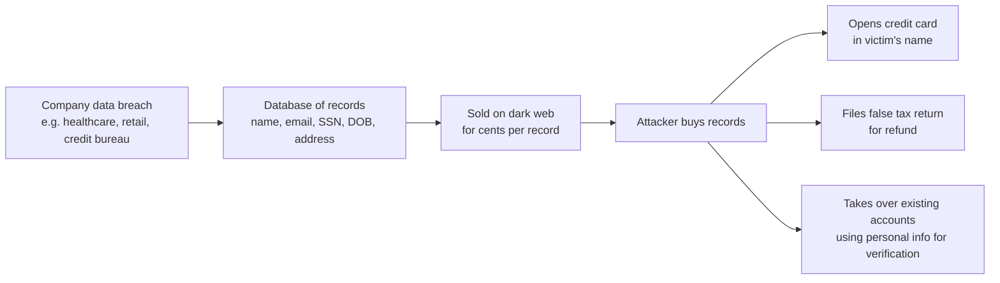

### 11.3 Malware — Keyloggers and Spyware

Malicious software silently records everything the victim types or views.

| Malware Type | What it steals | How it gets installed |
|---|---|---|
| **Keylogger** | Passwords, credit card numbers, messages | Email attachment, fake software download |
| **Spyware** | Browser history, saved passwords, files | Bundled with free software |
| **RAT (Remote Access Trojan)** | Full system access, screenshots, webcam | Phishing, cracked software |
| **Info-stealer** (Redline, Vidar) | Browser cookies, saved credentials | Malvertising, game cheats |

### 11.4 Physical Identity Theft

Not all identity theft is digital. Physical methods remain common.

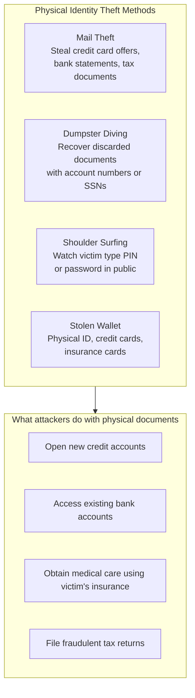

**Defence:** Shred documents before disposal. Use a P.O. box or mail lock. Use a PIN cover keypad when entering PINs.

### 11.5 Social Engineering and Pretexting

Attacker invents a believable scenario (pretext) to trick the victim or an organisation's staff into revealing information.

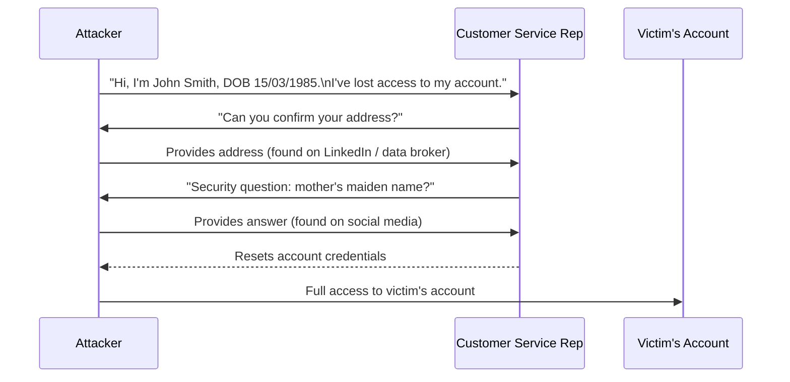

**Common pretexts:** "I'm from IT support", "I'm from your bank's fraud team", "I'm a government official".

### 11.6 Card Skimming

Physical devices attached to ATMs or payment terminals capture card data and PINs.

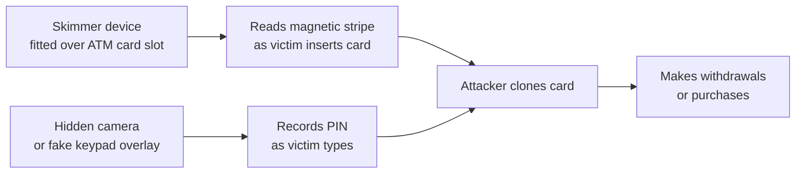

**Defence:** Check for loose card readers, cover keypad when typing PIN, use contactless payments (chip+PIN, Apple Pay).

### 11.7 Synthetic Identity Fraud

Attacker **combines real and fake information** to create a new fictitious identity — often using a real SSN with a fake name and DOB.

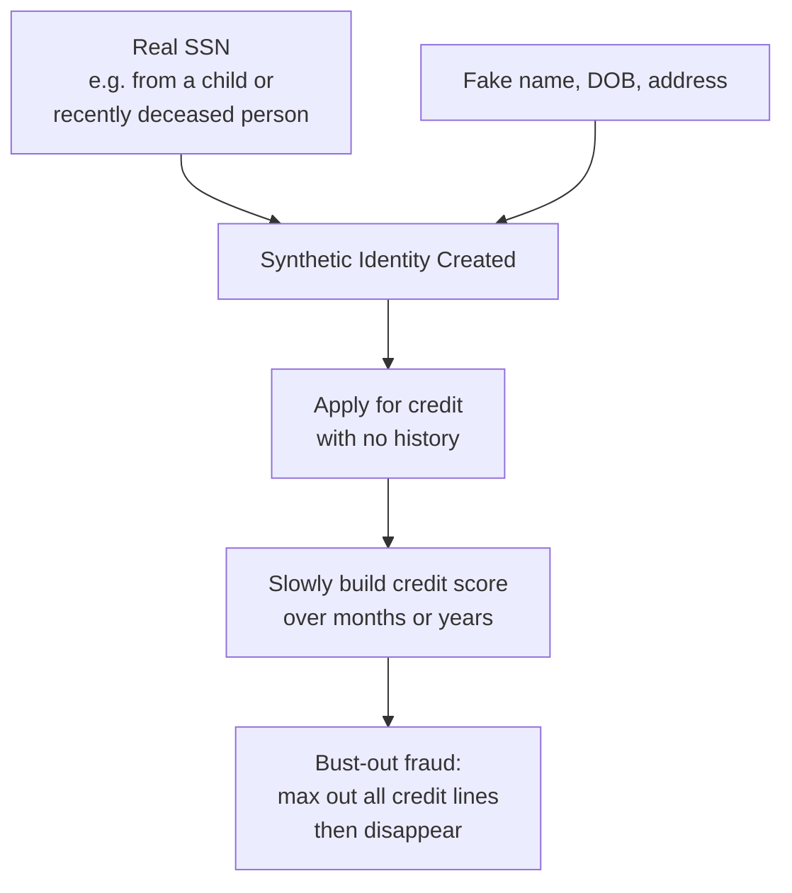

> Hardest fraud to detect because the SSN belongs to a real (but different) person. Banks often can't tell until the bust-out.

### 11.8 Account Takeover (ATO)

Attacker gains control of an existing legitimate account using stolen credentials or identity information.

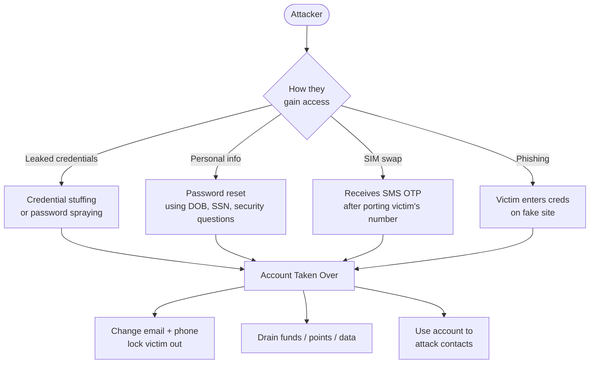

### 11.9 Identity Theft Defence Summary

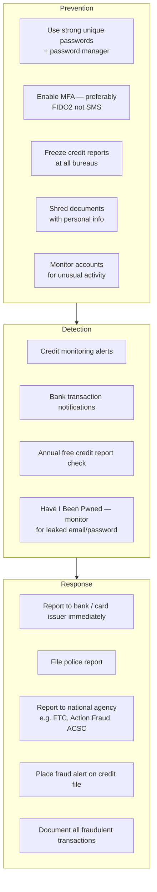

---

## 12. Insider Threat and Privilege Abuse

Not all threats come from outside. Employees, contractors, or admins with legitimate access can misuse it.

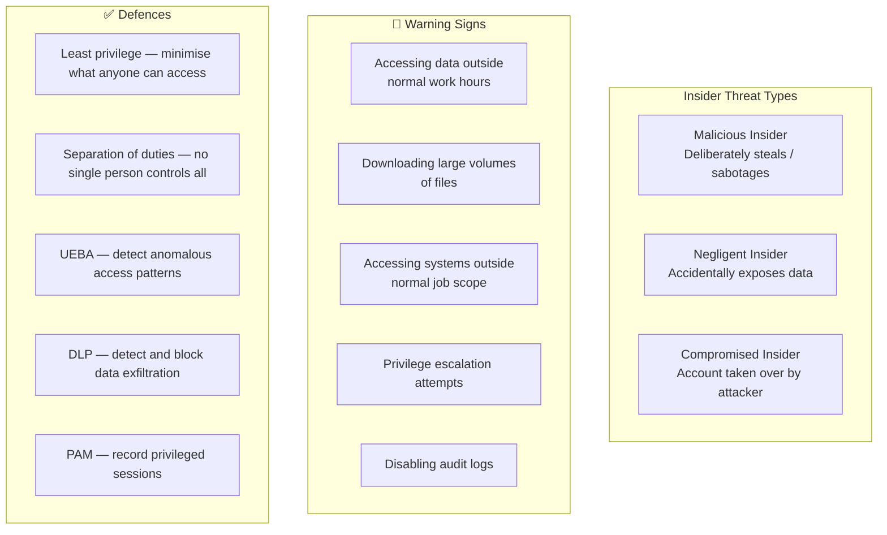

---

## Quick Reference Cheat Sheet

### Technical Attack Vectors

| Attack | How it works | Key Defence |
|---|---|---|
| **Credential Stuffing** | Leaked creds tried against target | MFA + breach detection |
| **Password Spraying** | One common password vs many users | MFA + anomaly detection |
| **AiTM Phishing** | Proxy steals session cookie, bypasses MFA | FIDO2 / passkeys |
| **Pass-the-Hash** | NTLM hash used instead of password | Credential Guard, disable NTLM |
| **Golden Ticket** | Forged Kerberos TGT with KRBTGT hash | Protect DC, rotate KRBTGT |
| **Token Theft** | Stolen JWT replayed | httpOnly cookies, short expiry |
| **OAuth Open Redirect** | Auth code stolen via bad redirect_uri | Exact URI registration + PKCE |
| **SAML Wrapping** | Modified XML with valid signature | Schema-validated SAML libraries |
| **SIM Swapping** | Phone number ported to attacker | Use TOTP/FIDO2, not SMS MFA |
| **Insider Threat** | Legitimate user abuses access | Least privilege + UEBA + PAM |

### Common Identity Theft Techniques

| Technique | Method | Key Defence |
|---|---|---|
| **Email Phishing** | Fake email → fake login page → credentials stolen | Security awareness + MFA |
| **Smishing** | Fake SMS → link → personal info harvested | Never click SMS links from unknown senders |
| **Vishing** | Fake phone call → victim reveals SSN, DOB, password | Verify caller identity independently |
| **Data Breach / Dark Web** | Leaked personal data bought and used for fraud | Credit freeze + HIBP monitoring |
| **Keylogger / Malware** | Records keystrokes, steals saved passwords | Antivirus + avoid pirated software |
| **Mail Theft** | Physical statements / card offers stolen | Shred documents + mail lock |
| **Dumpster Diving** | Documents with account numbers recovered | Shred everything with personal info |
| **Shoulder Surfing** | PIN / password watched in public | Cover keypad, use privacy screen |
| **Social Engineering** | Pretext to trick staff into resetting account | Knowledge-based auth is weak; use strong MFA |
| **Card Skimming** | Physical device reads card + captures PIN | Use contactless; cover keypad |
| **Synthetic Identity** | Real SSN + fake name used to open accounts | SSN + biometric verification at account opening |
| **Account Takeover** | Multiple methods used to hijack existing account | MFA + anomaly detection + credit freeze |
