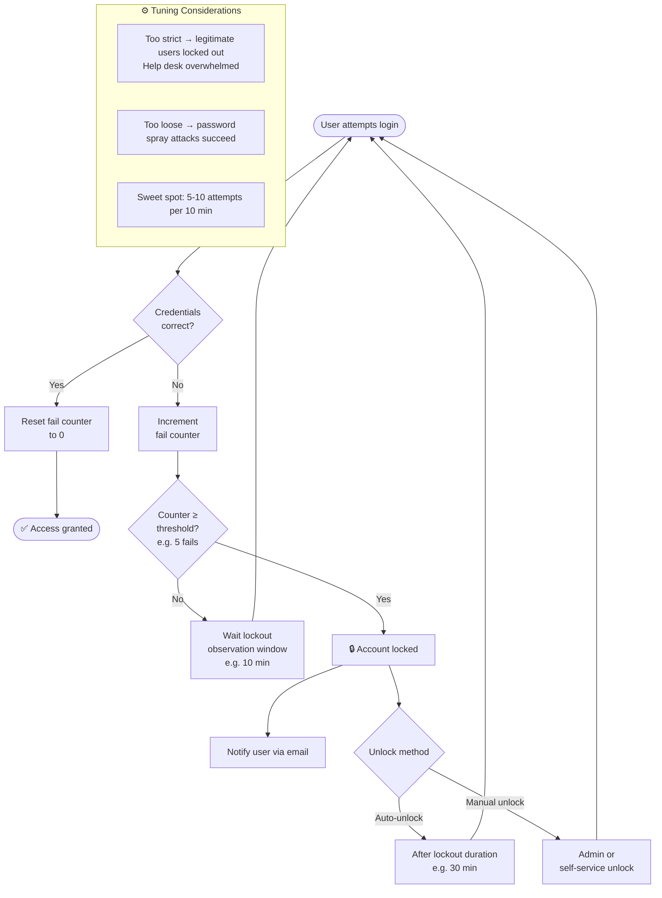
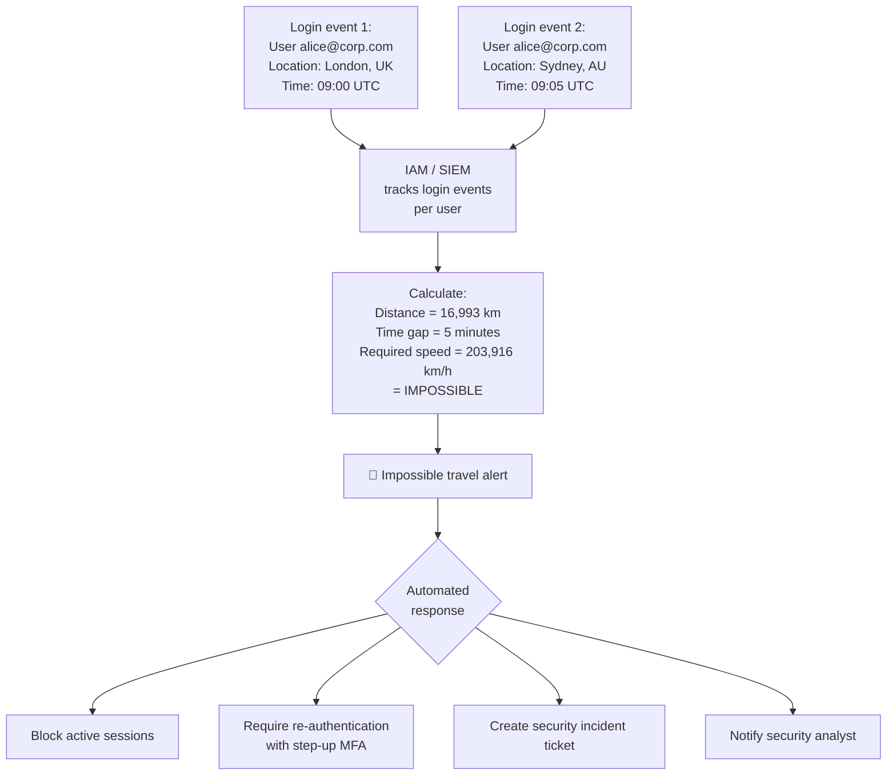
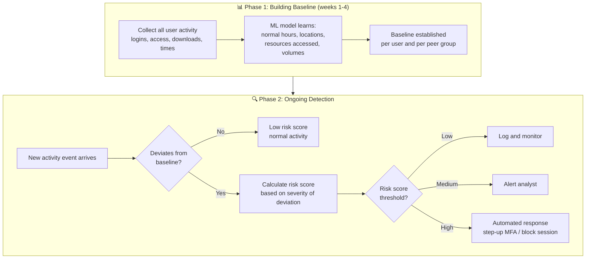
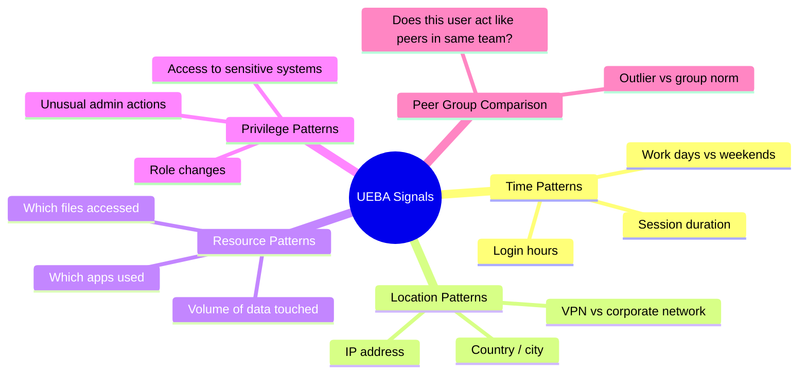
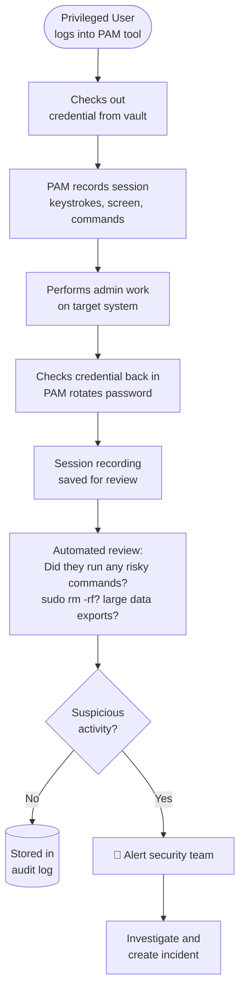
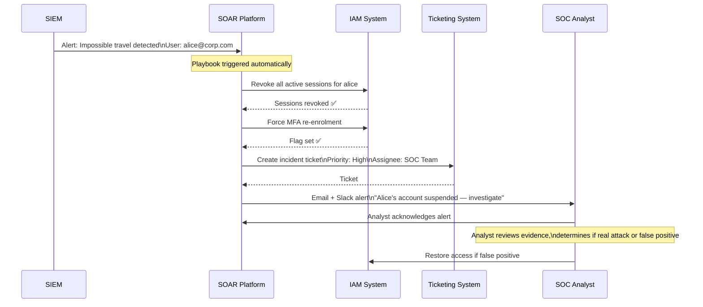
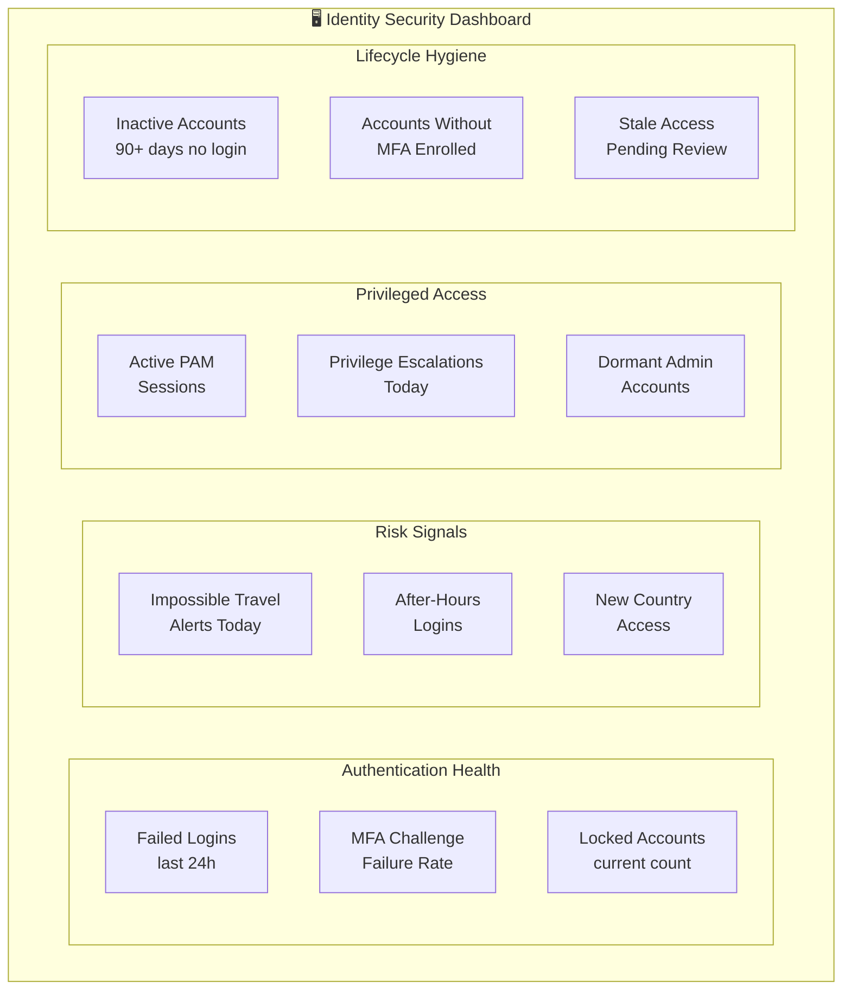

# Identity Security Monitoring

[← Back to Index](README.md)

> Simple explanations with diagrams for how to detect and respond to identity-based threats in real time.

---

## 1. Why Monitor Identity?

Firewalls and antivirus protect the perimeter and devices. But if an attacker **steals valid credentials**, they bypass all of that — they look just like a legitimate user. The only way to catch them is to watch **how** identities behave.

> Think of it like a casino's eye-in-the-sky cameras. The cards and chips look the same whether you're a customer or a cheat. Only by watching patterns — are they counting cards? visiting the cashier too often? — can you spot trouble.

---

## 2. The Security Monitoring Pipeline

Identity events flow from many sources into a central system that detects threats and triggers automated responses.

```mermaid
flowchart LR
    subgraph Sources["📡 Identity Event Sources"]
        E1[Login attempts\nsuccess & failure]
        E2[MFA challenges\n& failures]
        E3[Password changes\n& resets]
        E4[Privileged access\nsessions]
        E5[Access to\nsensitive resources]
        E6[Account creation\n& modification]
    end

    subgraph Collection["📥 Log Collection"]
        SIEM[(SIEM\nSentinel / Splunk /\nChronicle)]
    end

    subgraph Detection["🔍 Detection"]
        RULES[Correlation Rules\nif X happens Y times → alert]
        UEBA[UEBA Engine\nAnomaly vs baseline]
    end

    subgraph Response["⚡ Response"]
        ALERT[Alert to analyst]
        SOAR[SOAR Playbook\nautomated actions]
    end

    Sources --> Collection
    Collection --> Detection
    Detection --> Response
```

---

## 3. Account Lockout Policy

A basic defence: if too many failed logins happen in a short time, lock the account temporarily.

> Like a PIN pad that blocks your card after 3 wrong attempts — it protects you, but if set too aggressively, it can lock out real users too.

---

## 4. Impossible Travel Detection

A login from London at 9:00 AM and then Sydney at 9:05 AM is physically impossible. This is a strong signal of account compromise.

> Like a hotel noticing a guest checked out at noon in New York, then tried to check in at noon in Tokyo — that's not humanly possible.

**Common anomaly patterns to detect:**

| Signal | What it might mean |
|---|---|
| Impossible travel | Account takeover from another country |
| Login at 3 AM when user normally works 9-5 | Compromised credential or insider threat |
| Login from new country / anonymous VPN | Attacker hiding location |
| Sudden access to new, sensitive resources | Lateral movement or privilege escalation |
| Mass file download | Data exfiltration |

---

## 5. UEBA — User and Entity Behaviour Analytics

UEBA goes beyond simple rules. It **learns what "normal" looks like** for each user and device, then flags deviations.

> Like a bank fraud system that knows you usually buy coffee near home and flags when your card is suddenly used for electronics in another city.

**What UEBA analyses:**

---

## 6. Privileged Account Audit Flow

Privileged accounts (admins, service accounts, root) need **extra scrutiny** because they can cause the most damage.

---

## 7. SOAR Automated Response

**Security Orchestration, Automation and Response (SOAR)** automatically responds to alerts — faster than a human ever could.

> Like an automated sprinkler system: it doesn't wait for a firefighter to arrive — it starts responding the moment it detects fire.

---

## 8. Identity Monitoring Dashboard

What to track at a glance — the key metrics every security team should monitor.

**Key thresholds to alert on:**

| Metric | Alert threshold |
|---|---|
| Failed logins per user | > 5 in 10 minutes |
| Failed logins across org | > 1,000 in 1 hour (spray attack) |
| Impossible travel | Any occurrence |
| Dormant accounts | 90+ days inactive |
| Admin accounts without MFA | Any |
| Privileged session duration | > 8 hours continuous |

---

## Quick Reference Cheat Sheet

| Concept | Simple Meaning | Key Metric / Tool |
|---|---|---|
| **Account Lockout** | Temporarily block after failed attempts | 5-10 attempts / 10 min window |
| **Impossible Travel** | Physics-defying logins = compromise | Alert on any occurrence |
| **UEBA** | AI learns normal, flags abnormal | Risk score threshold-based alerting |
| **Privileged Audit** | Record everything admins do | PAM session recording + review |
| **SOAR** | Automated incident response | Playbooks: suspend → ticket → alert |
| **SIEM** | Central log aggregation + correlation | Sentinel, Splunk, Chronicle |
| **Dashboard KPIs** | Real-time identity health metrics | Failed logins, MFA failures, dormant accounts |
