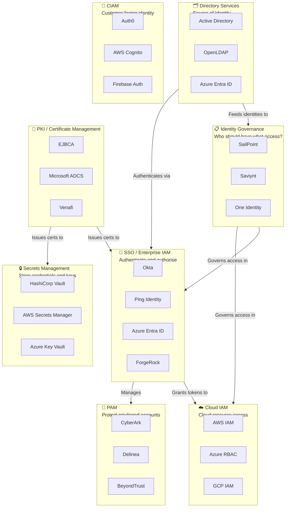
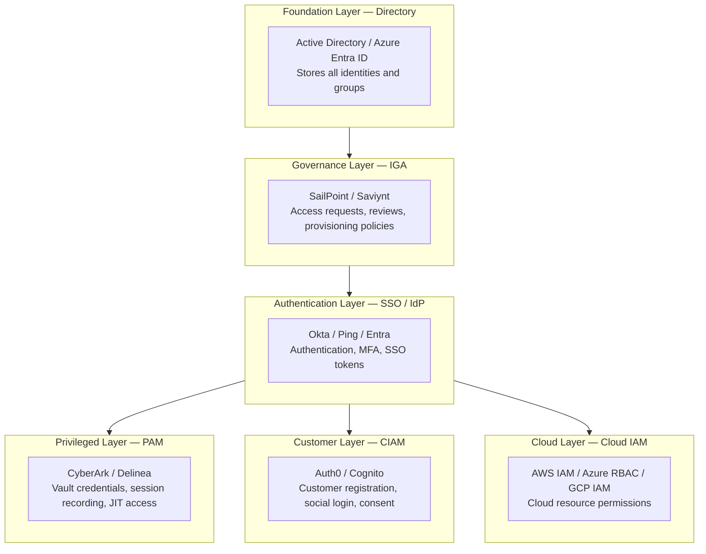
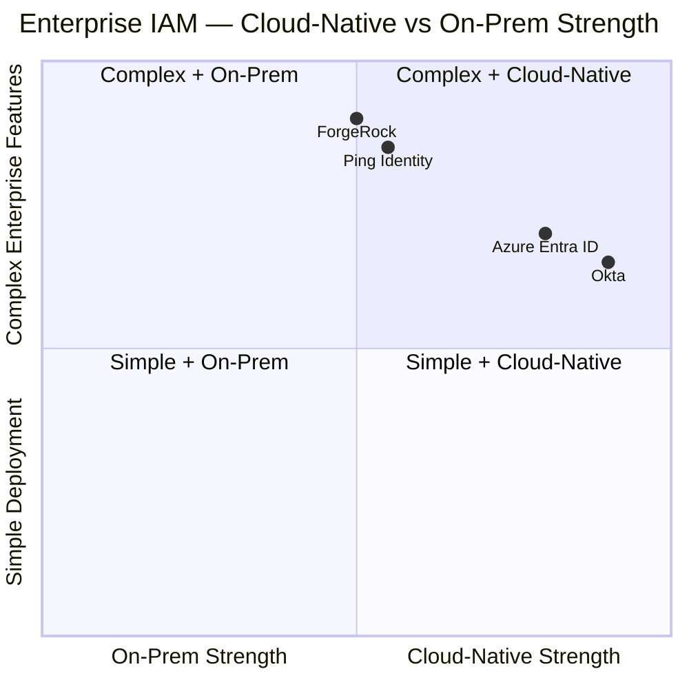
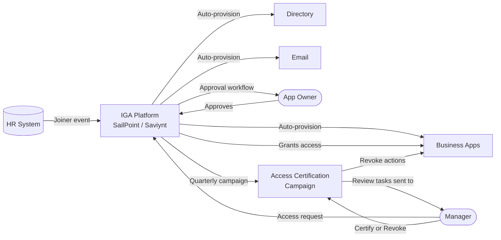
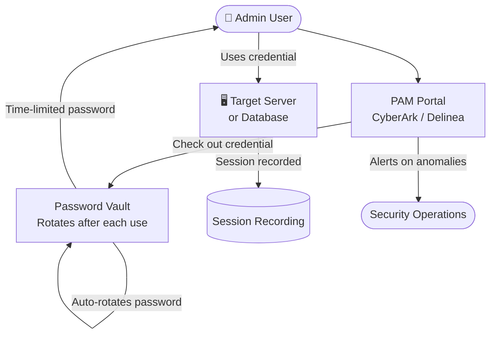
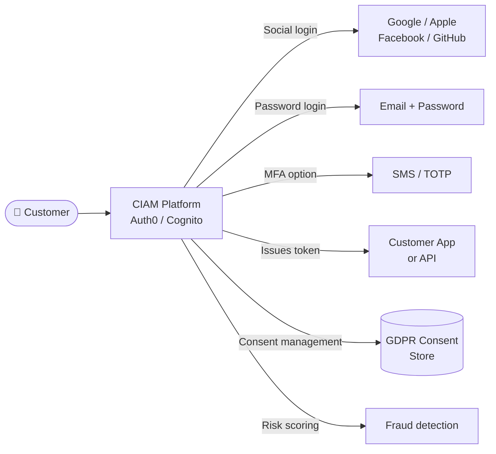
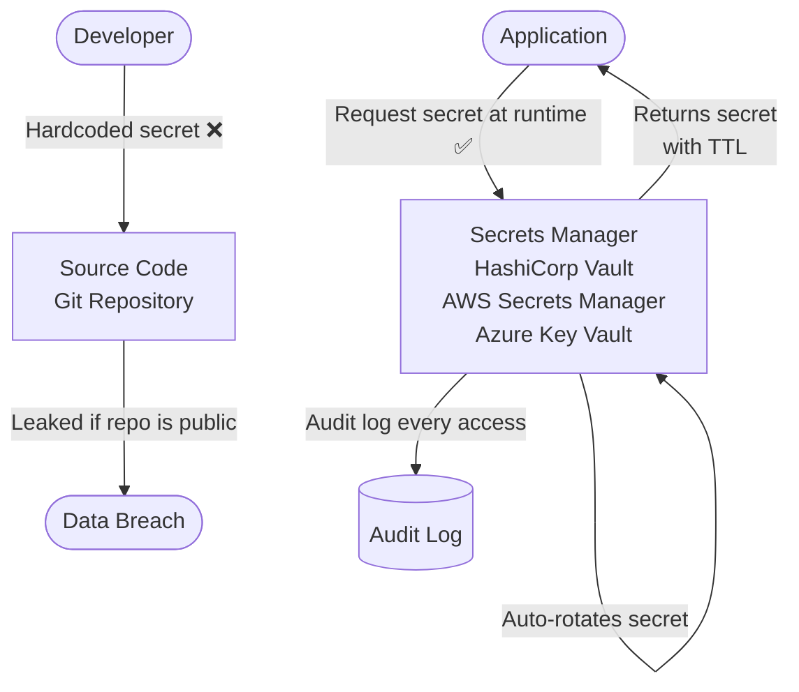
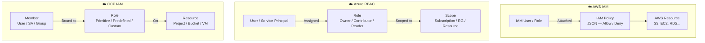
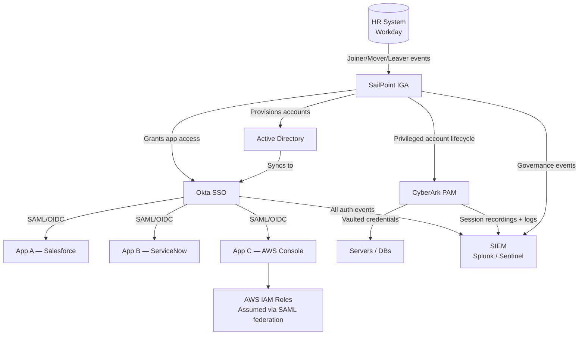
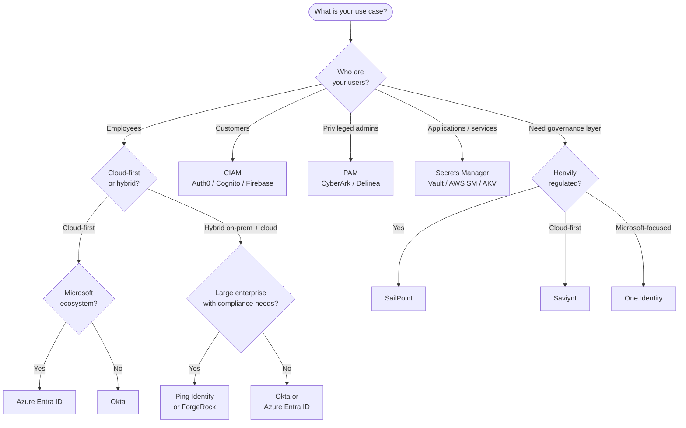

# IAM Tools and Platforms

[← Back to Index](README.md)

> A practical guide to the IAM ecosystem — what each category of tool does, what the major players are, and how they fit together.

---

## The IAM Tool Landscape

No single tool does everything. IAM is an ecosystem of specialised products that work together. Understanding which tool belongs to which category — and why — is key to making good architecture decisions.

**Analogy:** Think of IAM tools like a hospital — you have doctors (identity providers), administrators (IGA), security guards (PAM), receptionists for walk-ins (CIAM), a pharmacy (secrets management), and medical records (directory). Each plays a distinct role.

---

## 1. The IAM Ecosystem Map

---

## 2. Typical Enterprise IAM Stack (Layers)

---

## 3. Category Deep-Dives

### Enterprise IAM / SSO

These are the central identity platforms — the "front door" for authentication across all enterprise apps.

| Tool | Best For | Deployment | Strength |
|---|---|---|---|
| **Okta** | Cloud-first, modern workforce | SaaS only | Largest app integration catalogue |
| **Azure Entra ID** | Microsoft-heavy orgs | Cloud (+ hybrid) | Native M365 integration, Conditional Access |
| **Ping Identity** | Large enterprise, complex federation | On-prem or cloud | Protocol flexibility, fine-grained policy |
| **ForgeRock** | Custom identity platforms, complex workflows | On-prem or cloud | Highly customisable, good for CIAM + workforce |

---

### Identity Governance and Administration (IGA)

IGA tools answer: "Who has access to what, should they have it, and how did they get it?"

| Tool | Strength | Best For |
|---|---|---|
| **SailPoint** | Deep lifecycle automation, compliance reporting | Large enterprises, heavily regulated industries |
| **Saviynt** | Cloud-native IGA, good cloud app connectors | Cloud-first orgs, SaaS-heavy environments |
| **One Identity** | Strong AD governance | Microsoft-centric environments |

---

### Privileged Access Management (PAM)

PAM tools protect the most dangerous accounts — admin accounts, root access, service accounts — which attackers target most.

| Tool | Strength | Differentiator |
|---|---|---|
| **CyberArk** | Market leader, most features | Largest enterprise deployments, advanced threat analytics |
| **Delinea** (ex-Thycotic + Centrify) | Easier deployment | Good for mid-market, cloud-ready |
| **BeyondTrust** | Endpoint privilege management | Strong least-privilege for endpoints/workstations |

---

### CIAM — Customer Identity

Customer-facing identity is different from workforce identity. Scale is higher, UX matters more, and social login is expected.

| Tool | Strength | Best For |
|---|---|---|
| **Auth0** (Okta) | Developer-friendly, flexible | SaaS products, developer teams |
| **AWS Cognito** | Native AWS integration, low cost at scale | AWS-native apps |
| **Firebase Auth** | Easy to set up, Google ecosystem | Mobile apps, startups |

---

### Secrets Management

Secrets are passwords, API keys, certificates, and tokens that applications need to function. Without a secrets manager, they end up hardcoded in source code — a major security risk.

| Tool | Strength | Best For |
|---|---|---|
| **HashiCorp Vault** | Most flexible, supports any secret type | Multi-cloud, hybrid, complex orgs |
| **AWS Secrets Manager** | Native AWS integration, auto-rotation | AWS-native workloads |
| **Azure Key Vault** | Native Azure integration, HSM-backed | Azure workloads, certificate management |

---

### Cloud IAM

Each cloud has its own native IAM system for controlling who can do what with cloud resources.

---

## 4. How Tools Connect in a Typical Enterprise

---

## 5. Choosing the Right Tool

---

## Quick Reference Cheat Sheet

| Category | What it does | Leading Tools |
|---|---|---|
| **Enterprise SSO / IAM** | Authenticate employees, enforce MFA, enable SSO | Okta, Azure Entra ID, Ping, ForgeRock |
| **IGA** | Govern who has access, run access reviews, automate provisioning | SailPoint, Saviynt, One Identity |
| **PAM** | Protect privileged accounts, vault credentials, record sessions | CyberArk, Delinea, BeyondTrust |
| **CIAM** | Customer registration, social login, consent management | Auth0, AWS Cognito, Firebase Auth |
| **Secrets Management** | Store/rotate app secrets, prevent hardcoded credentials | HashiCorp Vault, AWS Secrets Manager, Azure Key Vault |
| **Cloud IAM** | Control access to cloud resources natively | AWS IAM, Azure RBAC, GCP IAM |
| **Directory** | Store and manage identity objects | Active Directory, OpenLDAP, Azure Entra ID |
| **PKI** | Issue and manage X.509 certificates | EJBCA, Microsoft ADCS, Venafi |
